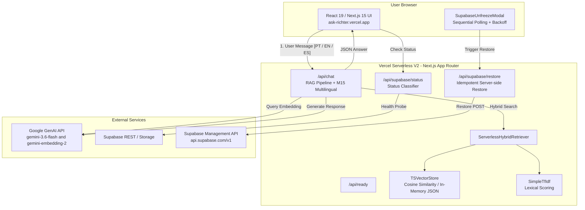

# Project Context — ask-richter

## Current State

Production-ready, highly-optimized Serverless RAG application built as a Turborepo monorepo.
The system has completed **Cutover to Serverless V2 (Vercel Native)** under ADR-0007, ADR-0008, ADR-0009, and Milestone M15 (Multilingual Response Alignment).

- **Frontend & RAG Engine (Vercel):** `apps/frontend` running Next.js 15 (App Router, React 19) with a pure TypeScript vector search (`TSVectorStore`), pure TypeScript lexical search (`SimpleTfIdf`), and Google Gemini LLM/embeddings (`gemini-3.6-flash`, `gemini-embedding-2`).
- **Data Ingestion & Offline Toolkit (Local):** `apps/backend` contains the consolidated Markdown knowledge base (`apps/backend/src/knowledge-base/`), ingestion & chunking scripts (`generate-index.ts`, `export-vectors.ts`), and the multi-provider LLM factory (`ProviderFactory`).
- **Resilience Engine:** Supabase operational state machine with 7 strict states and automated server-side project unfreezing via Supabase Management API.

## Current Milestone

**Stage: Discovery & Governance Baseline (AI Engineering Framework v2.1)**
- All 65 frontend tests passing across 8 suites.
- All 19 backend tests passing across 3 suites.
- Unified Jidoka Andon Cord pipeline (`npm run jidoka`) passing with 11/11 tasks verified.

## Current Focus

Reconciling legacy documentation artifacts (`.askrichter-spec.md`, `docs/architect.md`) with active V2 Serverless architecture, formalizing canonical specification in `META_SPEC.md` / `docs/pt-br/META_SPEC.md`, and establishing verified operation baselines.

## Repository Structure

```text
ask-richter/
├── .ai/                            # AI Engineering Framework configuration, memory & setup
├── .askrichter-spec.md             # [Legacy] Initial Meta Spec (pre-ADR-0007)
├── AGENTS.md                       # Operational constitution and conduct rules for AI agents
├── META_SPEC.md                    # Canonical architectural specification & project identity (English)
├── package.json                    # Monorepo root scripts (npm workspaces & Turborepo)
├── turbo.json                      # Turborepo task pipeline (build, lint, check-types, jidoka)
├── vercel.json                     # Vercel deployment configuration
├── render.yaml                     # [Legacy] Render deployment configuration
├── apps/
│   ├── frontend/                   # Next.js 15 Serverless V2 RAG Engine + User Interface
│   │   ├── src/app/api/chat/       # Main RAG API route (hybrid retrieval + Gemini LLM)
│   │   ├── src/app/api/supabase/   # Status probe (/status) & Server-side Restore (/restore)
│   │   ├── src/app/api/ready/      # Readiness probe (vector index verification)
│   │   ├── src/app/api/health/     # Healthcheck probe (serverless-v2 mode)
│   │   ├── src/lib/rag/            # TSVectorStore (cosine) & ServerlessHybridRetriever
│   │   ├── src/lib/supabase/       # Status classifier & restore service
│   │   └── src/components/         # Chat UI, Tailwind styling, SupabaseUnfreezeModal
│   ├── backend/                    # Offline Ingestion, Knowledge Base & Provider Factory
│   │   ├── src/knowledge-base/     # Consolidated CV, Experience, Projects, Challenges Markdown
│   │   ├── src/scripts/            # generate-index.ts, export-vectors.ts, benchmark scripts
│   │   ├── src/core/providers/     # Gemini, Ollama, OpenRouter, HuggingFace, Resilient providers
│   │   └── src/core/factory/       # ProviderFactory
│   ├── web/                        # Turborepo default starter workspace (scaffold)
│   └── docs/                       # Turborepo default starter workspace (scaffold)
├── packages/
│   ├── ui/                         # Shared UI components
│   ├── eslint-config/              # Shared ESLint configs
│   └── typescript-config/          # Shared TSConfig definitions
└── docs/
    ├── adr/                        # Architecture Decision Records (ADR-0001 through ADR-0009)
    ├── pt-br/                      # Localized human-readable documentation (pt-BR)
    ├── snapshots/                  # Architecture & progress snapshots (2026-08-26, 2026-08-27)
    └── Rules.md                    # Operational guidelines and reindexing rules
```

## Technology Stack

- **Monorepo & Build:** Turborepo 2.10.8, npm 11.4.2 workspaces, Node.js >= 22
- **Frontend / Serverless Runtime:** Next.js 15.5.22 (App Router), React 19.1.0, Tailwind CSS 3.4.17, Framer Motion 12.23.12, `next-intl` 4.3.4
- **Language:** TypeScript 5.8.3
- **Vector Search:** Pure TypeScript Cosine Similarity (`TSVectorStore`) operating over pre-computed 768-dimensional embeddings (`gemini-embedding-2`)
- **Lexical Search:** Pure TypeScript TF-IDF (`SimpleTfIdf`), eliminating C++ native dependencies
- **AI / LLM Layer:** Google GenAI SDK (`@google/genai` 2.17.1), model `gemini-3.6-flash`; fallback support for Ollama (`deepseek-r1:8b`), OpenRouter, and Hugging Face
- **Database & Storage:** Supabase PostgreSQL, Supabase Storage (`faiss-index` bucket), Supabase Management API v1
- **Testing:** Node.js native test runner (`node:test` via `npx tsx --test`)

## Architecture



## Important Components

1. **[`apps/frontend/src/app/api/chat/route.ts`](file:///Users/master/projects/chatbot/ask-richter/apps/frontend/src/app/api/chat/route.ts):** Primary serverless RAG endpoint. Coordinates query planning, vector + lexical retrieval, token budgeting (2800 tokens max), and M15 multilingual generation.
2. **[`apps/frontend/src/lib/rag/ts-vector-store.ts`](file:///Users/master/projects/chatbot/ask-richter/apps/frontend/src/lib/rag/ts-vector-store.ts):** Pure TypeScript vector store implementing cosine similarity over loaded `docstore.json` and `vectors.json`.
3. **[`apps/frontend/src/lib/rag/hybrid-retriever.ts`](file:///Users/master/projects/chatbot/ask-richter/apps/frontend/src/lib/rag/hybrid-retriever.ts):** Serverless hybrid retriever combining cosine similarity with TF-IDF, query intent decomposition, and diversity filtering.
4. **[`apps/frontend/src/lib/supabase/status-classifier.ts`](file:///Users/master/projects/chatbot/ask-richter/apps/frontend/src/lib/supabase/status-classifier.ts):** Pure status classifier strictly implementing the 7-state machine (`READY`, `PAUSED`, `WAKING`, `UNAVAILABLE`, `TIMEOUT`, `AUTH_ERROR`, `UNKNOWN`) and the Golden Rule of Non-Inference.
5. **[`apps/frontend/src/lib/supabase/restore-service.ts`](file:///Users/master/projects/chatbot/ask-richter/apps/frontend/src/lib/supabase/restore-service.ts):** Server-side unfreeze service with 10s memory idempotency lock calling the Supabase Management API.
6. **[`apps/frontend/src/components/ui/supabase-unfreeze-modal.tsx`](file:///Users/master/projects/chatbot/ask-richter/apps/frontend/src/components/ui/supabase-unfreeze-modal.tsx):** Client-side recovery modal with progressive backoff (2s, 3s, 5s, 8s, 13s, max 15s) and a 300s SLA.
7. **[`apps/backend/src/core/factory/provider-factory.ts`](file:///Users/master/projects/chatbot/ask-richter/apps/backend/src/core/factory/provider-factory.ts):** Factory pattern providing lazy initialization of LLM & embedding providers with bounded retry and fallback chains.

## Important Commands

```bash
# Unified Andon Cord validation (check-types + lint + build across all workspaces)
npm run jidoka

# Run test suites
npm test --workspace=frontend   # 65 automated tests (Parity, Routing, Chaos, Multilingual)
npm test --workspace=backend    # 19 automated tests (Provider Factory, Resilient LLM, Embeddings)

# Typecheck & Lint
npm run check-types
npm run lint

# Build production bundles
npm run build

# Start local development
npm run dev                     # Starts Next.js frontend on port 3000
npm run dev --workspace=backend # Starts Express backend locally on port 3001 (optional)

# Knowledge base re-indexing (offline)
npm run build-index --workspace=backend
```

## Environment Variables

List names only (NO SECRETS):

### Frontend (`apps/frontend/.env.local`)
- `GEMINI_API_KEY`
- `GEMINI_MODEL`
- `NEXT_PUBLIC_SUPABASE_URL`
- `NEXT_PUBLIC_SUPABASE_ANON_KEY`
- `SUPABASE_MANAGEMENT_TOKEN`
- `SUPABASE_PROJECT_REF`
- `NEXT_PUBLIC_API_BASE_URL` (optional; if set to onrender.com, sanitized to relative `/api/*`)

### Backend (`apps/backend/.env`)
- `AI_PROVIDER`
- `AI_FALLBACK_PROVIDERS`
- `EMBEDDING_PROVIDER`
- `GEMINI_API_KEY`
- `GEMINI_MODEL`
- `GEMINI_EMBEDDING_MODEL`
- `OLLAMA_BASE_URL`
- `OLLAMA_MODEL`
- `OPENROUTER_API_KEY`
- `OPENROUTER_BASE_URL`
- `OPENROUTER_MODEL`
- `HUGGINGFACE_API_KEY`
- `HUGGINGFACE_MODEL`
- `SUPABASE_URL`
- `SUPABASE_ANON_KEY`
- `SUPABASE_SERVICE_ROLE_KEY`
- `SUPABASE_BUCKET_NAME`
- `DB_ACCESS_TOKEN`

## External Dependencies

- **Google GenAI API:** Primary LLM and embeddings generation.
- **Supabase Management API:** Project lifecycle state monitoring and programmatic unfreeze/restore.
- **Supabase Storage:** Storage of vector assets (`faiss-index` bucket).
- **Vercel:** Primary deployment target for Next.js App Router and Serverless APIs.

## Current Constraints

1. **Zero Render in Production:** Vercel production deployment MUST NOT route requests to `ask-richter-backend.onrender.com`. All frontend calls must resolve to native relative endpoints (`/api/*`).
2. **Serverless Vector Bounds:** `TSVectorStore` operates in-memory from static JSON vectors bundled into the deployment. Full re-indexing is an offline process executed via `apps/backend/src/scripts/generate-index.ts`.
3. **No Inference of Pause:** A network timeout or DNS failure must NEVER trigger `isPaused: true`. Only explicit Supabase pause signatures trigger unfreezing flows.
4. **Language Policy:** Canonical documentation is written in English (`META_SPEC.md`). Portuguese documents in `docs/pt-br/` are localized representations.

## Known Risks

| Risk | Probability | Impact | Mitigation |
| :--- | :--- | :--- | :--- |
| Supabase Inactive Sleep (Free Tier) | High | Med | Automated status probe + `SupabaseUnfreezeModal` with progressive backoff and 300s SLA. |
| Google GenAI 503 / 429 Quota Exceeded | Med | High | Bounded exponential retry (3 attempts) + fallback provider chain in `ResilientLLMProvider`. |
| Legacy Render URL in Production Bundle | Low | High | Runtime URL sanitizer in `page.tsx` + automated invariant test in `routing.test.ts`. |
| Out-of-sync Vector Indexes | Low | Med | Audit logging requirement in `docs/INDEXING_LOG.md` + `manifest.json` generation. |

## Important Decisions

- **ADR-0001:** Meta Spec, WSCI Scope Isolation & Jidoka Protocol
- **ADR-0002:** Deterministic Synthetic Chunk Retrieval via Docstore
- **ADR-0003:** Technology Intent Routing & Multi-Technology Extraction
- **ADR-0004:** Metadata Scope Isolation during Ingestion
- **ADR-0005:** Provider-Agnostic AI Architecture & Gemini Embeddings Migration
- **ADR-0006:** LLM Provider Resilience and Fallback Chain
- **ADR-0007:** FAISS Elimination & Pure TypeScript Vector Search (`TSVectorStore`)
- **ADR-0008:** Lexical Search Modernization (`SimpleTfIdf`)
- **ADR-0009:** Supabase Operational State Machine & Resilience

## Context Loading Order

Agents should load context in this order:

1. `AGENTS.md`
2. `META_SPEC.md`
3. `.ai/setup/project-context.md`
4. Relevant ADRs (`docs/adr/`)
5. Current TASK / PLAN
6. Affected source files
7. Relevant test suites

Do NOT load the entire repository unless necessary.
