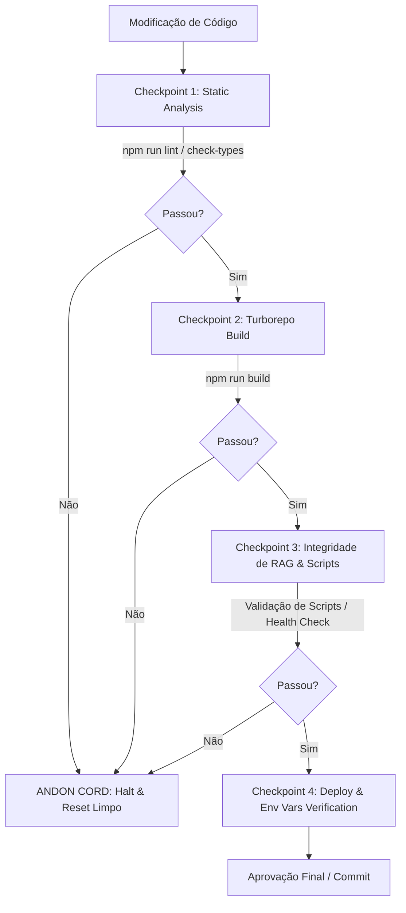

# Constitution & Meta Spec: AskRichter

> **Versão da Especificação:** 1.0.0  
> **Status:** Ativa (Fonte Primária da Verdade)  
> **Escopo:** Monorepo AskRichter (Backend RAG + Frontend Next.js + Infraestrutura)  
> **Governança:** WSCI + SDLC SPARC+DD + Protocolo Jidoka

---

## 1. Visão Geral e Objetivos do Projeto

**AskRichter** é uma aplicação web full-stack que transforma o currículo e trajetória profissional de Luiz F. Richter em um assistente conversacional inteligente com IA. O sistema permite que recrutadores, gestores e engenheiros interajam via linguagem natural para obter respostas precisas, contextualizadas e fundamentadas sobre competências técnicas, experiências, projetos e conquistas.

### Objetivos Primários:
1. **RAG de Alta Precisão (Zero Alucinação):** Respostas fundamentadas exclusivamente no conhecimento estruturado do candidato através de busca vetorial híbrida (FAISS + BM25/Filtros).
2. **Disponibilidade Híbrida de LLMs:** Suporte transparente para LLMs em nuvem (OpenRouter, Hugging Face, OpenAI) e execução offline/local via Ollama para desenvolvimento.
3. **Experiência de Usuário Premium:** UI reativa, moderna e fluida em Next.js 15, com suporte a internacionalização, formatação Markdown rica e animações suaves.
4. **Governança e Confiabilidade (Zero-Trust):** Código validado continuamente por verificações estáticas, builds limpos no Turborepo e auditoria contínua via protocolo Jidoka.

---

## 2. Arquitetura da Solução e Stack Tecnológica

O projeto é estruturado como um monorepo gerenciado por **Turborepo** (`npm` workspaces).

```
ask-richter/
├── .askrichter-spec.md         # [META SPEC] Fonte primária da verdade arquitetural
├── package.json                # Workspaces root & scripts globais do Turborepo
├── turbo.json                  # Pipeline de build e cache do Turborepo
├── render.yaml                 # Configuração de Infraestrutura/Deploy do Backend (Render)
├── vercel.json                 # Configuração de Deploy do Frontend (Vercel)
├── apps/
│   ├── backend/                # API Node.js / Express / LangChain / FAISS
│   └── frontend/               # Next.js 15 (App Router) / Tailwind / Framer Motion
├── packages/                   # Pacotes compartilhados (TSConfig, UI, etc.)
└── docs/
    ├── architect.md            # Índice de arquitetura e mapa mental
    └── adr/                    # Architecture Decision Records (ADRs numerados)
```

### 2.1 Stack do Backend (`apps/backend`)
- **Runtime:** Node.js (>=18) + TypeScript (ESModules).
- **Servidor Web:** Express.js + CORS + dotenv.
- **Framework de RAG:** LangChain (`@langchain/core`, `@langchain/community`).
- **Banco Vetorial & Indexação:** FAISS (`faiss-node`) armazenado em `/tmp/faiss_index` no container runtime com validação estrita de `manifest.json`.
- **Embeddings:** Gemini Embeddings (`gemini-embedding-2`, 768 dimensões).
- **Motor de Busca Híbrido:** `HybridRetriever` (combinação de busca vetorial FAISS + busca textual por palavras-chave/BM25).
- **Provedores de IA (Provider-Agnostic & Resiliente):**
  - **Orquestração de Resiliência:** `ResilientLLMProvider` com retentativa exponencial (max 3) e cadeia de fallback (`AI_FALLBACK_PROVIDERS="openrouter,huggingface,ollama"`).
  - **Produção / Padrão:** Google Gemini API (`GeminiLLMProvider` com `gemini-3.6-flash`).
  - **Desenvolvimento Local:** Ollama (`OllamaLLMProvider` com `mistral:7b`).
  - **Provedores Alternativos:** OpenRouter (`OpenRouterLLMProvider`) e Hugging Face (`HuggingFaceLLMProvider`).
- **Storage Persistente do Índice:** Supabase Storage (`faiss-index` bucket) para download na inicialização da instância Render.

### 2.2 Stack do Frontend (`apps/frontend`)
- **Framework:** Next.js 15 (App Router, React 19).
- **Estilização:** Tailwind CSS + `tailwindcss-animate` + Radix UI Primitives + Framer Motion.
- **Internacionalização:** `next-intl` (suporte a Português e Inglês).
- **Renderização de Mensagens:** `markdown-to-jsx` + `react-syntax-highlighter` (suporte a blocos de código com destaque de sintaxe).
- **Comunicação:** Fetch API assíncrono para endpoints REST do Backend (Render).

### 2.3 Infraestrutura & Nuvem
- **Backend:** Hosted on Render.com (`ask-richter-backend`, Web Service Node.js).
- **Frontend:** Hosted on Vercel (`ask-richter.vercel.app`).
- **Storage & DB:** Supabase PostgreSQL & Storage Bucket (`faiss-index`).

---

## 3. Engenharia de RAG & Pipeline de Contexto

### 3.1 Ciclo de Vida do Índice Vetorial
1. **Geração do Índice:** O script `generate-index.ts` lê os documentos estruturados em Markdown/JSON do candidato, gera os embeddings via OpenAI `text-embedding-3-small` e compila os arquivos de índice FAISS (`index.faiss` e `index.pkl`).
2. **Persistência Remota:** Os arquivos binários do índice e o arquivo `manifest.json` são enviados para o bucket `faiss-index` no Supabase Storage (*Nota: caso o projeto no Supabase esteja pausado/congelado, é necessário ativá-lo/descongelá-lo manualmente no painel antes de realizar o upload*).
3. **Registro Obrigatório de Log (Audit Log):** Ao final de toda reindexação (seja local ou com upload para o Supabase), é OBRIGATÓRIO gerar o `manifest.json` e registrar o log de auditoria no arquivo [`docs/INDEXING_LOG.md`](docs/INDEXING_LOG.md), documentando timestamp, volume de chunks, status do upload e modelo utilizado.
4. **Inicialização do Runtime (Render):** No startup do backend (`download-index.ts`), o servidor verifica se o índice já existe em `/tmp/faiss_index`. Caso não exista, baixa os arquivos atualizados do Supabase Storage.
5. **Recuperação Híbrida (`HybridRetriever`):** As consultas recebidas no endpoint `/api/chat` passam pelo retriever híbrido para pontuar relevância tanto vetorial quanto lexical.

---

## 4. Engenharia de Contexto WSCI (World-Scope Context Isolation)

Para garantir máxima performance do LLM/Agente e evitar sobrecarga de contexto, toda tarefa deve ser isolada no seu escopo específico:

| Escopo | Diretórios Permitidos | Arquivos Relevantes |
| :--- | :--- | :--- |
| **Frontend** | `apps/frontend/` | `src/app/**`, `src/components/**`, `package.json`, `tailwind.config.ts`, `next.config.mjs` |
| **Backend** | `apps/backend/` | `src/index.ts`, `src/core/**`, `src/scripts/**`, `package.json`, `tsconfig.json` |
| **Infraestrutura** | Raiz do Monorepo | `render.yaml`, `vercel.json`, `turbo.json`, `package.json`, `docs/` |

### 4.1 Regras de Operação no Dia a Dia (WSCI & Isolation)
- **Comandos Filtrados por Workspace:** Em tarefas restritas a um domínio específico (ex: Frontend), utilize sempre os filtros do Turborepo/npm (ex: `npm run dev --workspace=frontend` ou `turbo run build --filter=frontend`). Não ler ou modificar arquivos de outro escopo.
- **Git Worktrees para Refatoração Arquitetural:** Sempre que uma tarefa envolver refatoração estrutural (ex: alteração na carga do índice FAISS no backend), crie um Git Worktree isolado antes de iniciar:
  ```bash
  git worktree add ../askrichter-backend-refactor -b backend-refactor
  ```
  Isso isola fisicamente os arquivos, protegendo a branch `main` e a estabilidade do monorepo contra regressões.

---

## 5. Protocolo Jidoka (Andon Cord & Zero-Trust)

Nenhuma modificação de código é considerada finalizada sem validação rigorosa pelos checkpoints automatizados do protocolo Jidoka.

### Checkpoints de Qualidade OBRIGATÓRIOS:



1. **Comando Unificado do Andon Cord:** Ao concluir qualquer alteração de código, a integridade total do monorepo é validada com um único comando:
   ```bash
   npm run jidoka
   ```
   *Este comando executa em paralelo e em grafo de dependências os pipelines `check-types`, `lint` e `build` em todos os workspaces.*

2. **Procedimento em Caso de Anomalia (Andon Cord):**
   Se `npm run jidoka` retornar um exit code diferente de 0:
   - **Interrupção Imediata:** Abortar a consolidação de código.
   - **Reset Limpo de Contexto:** Limpar contexto, reanalisar os logs de erro e realizar rollback se necessário.
   - **Correção na Origem:** Corrigir a causa raiz no arquivo afetado.
   - **Re-Validação:** Executar `npm run jidoka` até obter exit code 0.

---

## 6. Governança de Arquitetura (ADRs & `architect.md`)

- **ADRs como Registro Histórico Imutável:** Todas as decisões de arquitetura, mudanças de stack ou novos padrões devem ser documentados em `docs/adr/NNNN-titulo-curto.md`.
- **Mapa Mental Único:** `docs/architect.md` atua como o ponto focal e índice atualizado da arquitetura do AskRichter.
- **Consistência de Migrações:** Quaisquer alterações de schema do Supabase devem ser exclusivamente *forward-only* em novos arquivos de migração.

---

## 7. Diretrizes de Desenvolvimento Clean Code & SOLID

- **Não Ocultar Sintomas:** Tratar a causa raiz de qualquer erro. Proibido colocar `try/catch` vazios ou retornos falsos para mascarar falhas.
- **Links Clicáveis:** Toda documentação deve conter hiperlinks no formato `file:///` direcionando para as linhas exatas do código fonte.
- **Centralized Client Error Logging:** Logar exceções críticas através do utilitário padronizado do projeto.
