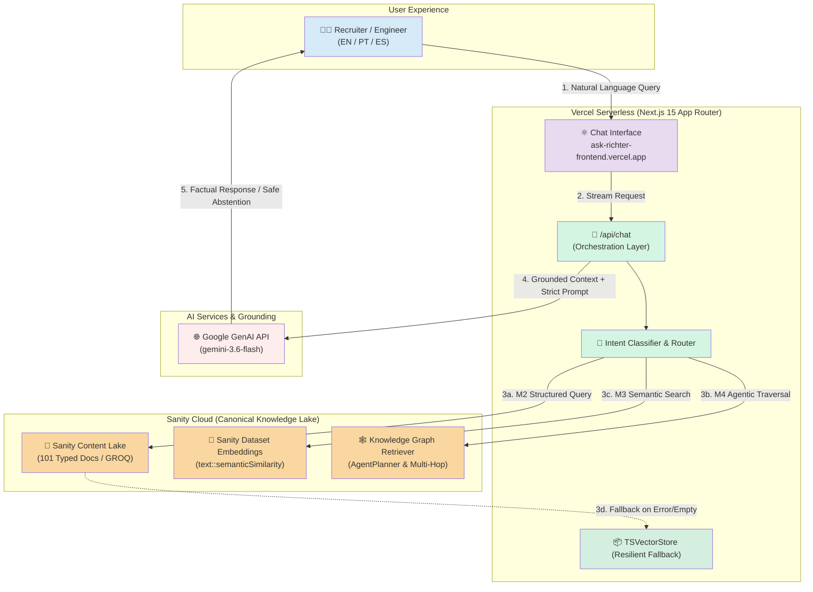

# Ask Richter — AI Career Agent & Structured Knowledge Platform

[](https://nodejs.org/)
[](https://www.typescriptlang.org/)
[](https://nextjs.org/)
[](https://reactjs.org/)
[](https://www.sanity.io/)
[](https://vercel.com/)
[](https://supabase.com/)
[](https://turbo.build/)

> **Ask Richter** is an intelligent, conversational **AI Career Agent** that transforms a static resume into an interactive, multi-strategy reasoning system built on top of **Sanity Content Lake** and powered by the **AI Engineering Framework v2.1**.

[](https://ask-richter-frontend.vercel.app/)

**Live Application:** [https://ask-richter-frontend.vercel.app/](https://ask-richter-frontend.vercel.app/)

---

## 🌟 Overview & Purpose

Rather than treating a developer's career as raw unindexed text, **Ask Richter** models career data as a strongly-typed, interconnected ontological graph within **Sanity Content Lake**:

- **Entities**: Skills, Professional Experiences, Production Projects, Education, STAR Impact Achievements, and Architectural Decision Records (ADRs).
- **Core Value**: Enables hiring managers, recruiters, and engineering leads to interact with a career history through natural language in **English, Portuguese, and Spanish**, receiving grounded, evidence-based answers with safe factual abstention when evidence is unavailable.

*(Para a versão da documentação em Português, consulte [`README_ptBR.md`](README_ptBR.md)).*

---

## 🧠 Why Sanity? Evolving from Traditional RAG to a Structured Agent

Traditional RAG architectures slice raw text into arbitrary chunks, often losing relational context (e.g., *which exact company used this technology*, or *how many total production projects used Laravel*).

By adopting **Sanity as the canonical Content Lake**, Ask Richter implements a **Tri-Retrieval Engine** combining:

1. **M2 — Structured Retrieval (GROQ Declarative Queries)**: Precise factual queries (catalog listings, technology filters, chronological timelines) resolved in single-digit milliseconds without vector drift.
2. **M4 — Agentic Knowledge Graph Traversal**: Bounded multi-hop reasoning over entity references, with strict execution budgets and grounded abstention when the required relationship cannot be reached within the traversal budget.
3. **M3 — Semantic Retrieval (Sanity Dataset Embeddings)**: Free-form semantic search using native Sanity dataset embeddings (`text::semanticSimilarity`) for distributed architectural insights.
4. **Deterministic In-Memory Fallback**: Pure TypeScript vector store (`TSVectorStore`) providing seamless offline resilience and zero-trust safe abstention.

---

## ☁️ Tri-Retrieval Engine Architecture



---

## 🛡️ Zero-Trust Grounding & Factual Abstention

Ask Richter operates under strict **Zero-Trust Factual Integrity**:
- **Anti-Hallucination Guardrail**: The system answers strictly from retrieved graph nodes and chunks.
- **Safe Abstention**: If evidence is missing or unverified (e.g., querying for non-existent technologies like *XYZ-UNEXISTENT* or undocumented roles), the agent safely abstains (*"I do not have the details to answer this question"*) rather than fabricating facts.
- **Cognitive Load & Cardinality Management**: Structured catalog queries present the 7 most relevant items alongside a clear count of total matches, offering a polite invitation to explore further.

---

## 🚀 Key Features & Highlights

- **Sanity Studio v3 (`apps/studio`)**: Centralized management studio with 6 schemas:
  - `skill` (categorized proficiency, keywords, and levels)
  - `experience` (roles, companies, STAR storytelling, timeline)
  - `project` (architecture, challenges, live URLs, technologies)
  - `education` (degrees, academic institutions, certifications)
  - `achievement` (quantifiable engineering metrics, impact)
  - `architectureDecision` (immutable ADR records, rationale, trade-offs)
- **Multilingual Language Parity (EN / PT / ES)**: Automatic language detection and symmetrical response generation aligned with user intent.
- **100% Serverless V2 on Vercel**: Low-overhead serverless execution achieved by eliminating native C++ dependencies (FAISS) in favor of TypeScript in-memory vector math.
- **Supabase Resilience & 7-State Machine (ADR-0009)**: Automated detection of paused database instances with server-side unfreezing via Supabase Management API.
- **Audited Jidoka Quality Gate**: 170 automated unit/integration tests and 17 end-to-end HTTP regression scenarios passing with 0 errors.

---

## 📦 Monorepo Structure

```text
ask-richter/
├── apps/
│   ├── frontend/         # Next.js 15 App Router: Chat UI, Tri-Retrieval Engine, Serverless RAG
│   ├── studio/           # Sanity Studio v3: Content Lake Schemas, Migrations & Ingestion
│   ├── backend/          # Node.js/TS: Legacy indexing toolkits, resilient LLM providers
│   ├── web/              # Next.js 15: Public landing page
│   └── docs/             # Next.js 15: Living ecosystem documentation
├── packages/
│   ├── ui/               # Shared UI components (@repo/ui)
│   ├── eslint-config/    # Canonical linting configurations (@repo/eslint-config)
│   └── typescript-config/# Shared TypeScript configurations (@repo/typescript-config)
└── docs/
    ├── submission/       # Sanity Challenge Submission Evidence & Documentation
    ├── adr/              # Architectural Decision Records (ADR-0001 to ADR-0010)
    └── Plans/            # Milestone verification plans & regression artifacts
```

---

## 🛠️ Quick Start & Local Setup

### 1. Prerequisites
- **Node.js**: >= 22.x
- **npm**: >= 10.x

### 2. Installation
```bash
git clone https://github.com/lfrichter/ask-richter.git
cd ask-richter
npm install
```

### 3. Environment Variables
Copy and configure the environment template in `apps/frontend/.env.local`:
```bash
cp apps/frontend/.env.example apps/frontend/.env.local
```
Required keys:
```env
GEMINI_API_KEY="your-gemini-api-key"
GEMINI_MODEL="gemini-3.6-flash"
NEXT_PUBLIC_SANITY_PROJECT_ID="q19ey6yx"
NEXT_PUBLIC_SANITY_DATASET="production"
SANITY_API_READ_TOKEN="your-sanity-read-token"
```

### 4. Running the Monorepo
```bash
npm run dev
```
- **Web Chat Application**: `http://localhost:3000`
- **Sanity Studio**: `http://localhost:3333`

---

## 🧪 Testing & Verification

### Automated Test Suite (170 Tests)
```bash
# Run 151 frontend tests (Sanity GROQ, Embeddings, Knowledge Graph, Multilingual)
npm --prefix apps/frontend test

# Run 19 backend provider & resilience tests
npm --prefix apps/backend test
```

### Turborepo Jidoka Pipeline (Full Validation)
```bash
npm run jidoka
```
Executes typecheck, linting, and production builds across all 8 monorepo packages.

---

## 📑 Submission & Architecture Evidence

For complete Sanity Challenge submission artifacts, demo scripts, and detailed test runs:
- [Submission Overview](docs/submission/README.md)
- [Official 6-Query Demo Script](docs/submission/demo-script.md)
- [Deep Architecture Document](docs/submission/architecture.md)
- [Test & Regression Evidence Report](docs/submission/test-evidence.md)

---

## 📄 License

This project is licensed under the [MIT License](LICENSE).
