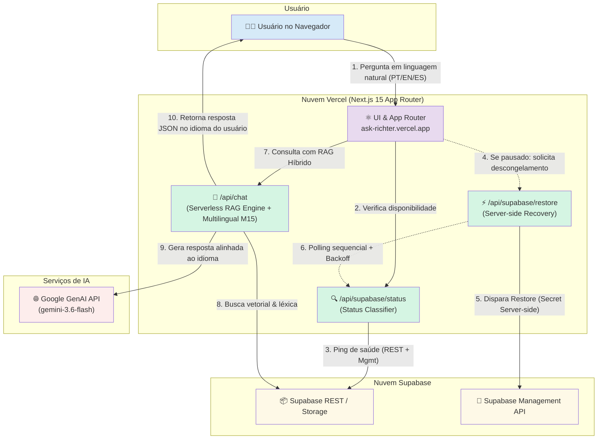

# Ask Richter - Meu CV Interativo com IA

[](https://nodejs.org/)
[](https://www.typescriptlang.org/)
[](https://nextjs.org/)
[](https://reactjs.org/)
[](https://vercel.com/)
[](https://supabase.com/)
[](https://turbo.build/)

Este projeto transforma um currículo tradicional em uma experiência de diálogo interativo. O **Ask Richter** é um chatbot especialista na trajetória profissional de Luiz F. Richter, permitindo que recrutadores e lideranças técnicas façam perguntas em linguagem natural e recebam respostas precisas, fundamentadas e contextuais.

Mais do que um portfólio, o projeto opera sob o **AI Engineering Framework v2.1**, servindo como demonstração prática de arquitetura RAG Serverless moderna, desenvolvimento full-stack em monorepo, resiliência de infraestrutura e governança automatizada.

---

## 🛡️ Governança de Software & Arquitetura (AI Engineering Framework v2.1)

O desenvolvimento do AskRichter segue regras estritas de governança estruturada e Zero-Trust:

1. **Meta Spec Canônica ([`META_SPEC.md`](META_SPEC.md) e [`docs/pt-br/META_SPEC.md`](docs/pt-br/META_SPEC.md)):**  
   Fonte absoluta da verdade para identidade, decisões de arquitetura, contratos de API, fluxo RAG e regras de infraestrutura.
2. **Constituição dos Agentes ([`AGENTS.md`](AGENTS.md) e [`docs/pt-br/AGENTS.md`](docs/pt-br/AGENTS.md)):**  
   Constituição operacional e limites de conduta ética e técnica para os Agentes de IA (Zero-Trust, Jidoka, Surgical Changes).
3. **Contexto & Setup do Projeto ([`.ai/setup/project-context.md`](.ai/setup/project-context.md)):**  
   Visão consolidada da topologia atual, componentes críticos, variáveis de ambiente e comandos auditados.
4. **Fonte da Verdade Operacional ([`docs/Rules.md`](docs/Rules.md)):**  
   Regras operacionais, diretrizes de conduta e procedimentos de reindexação auditável.
5. **Engenharia de Contexto WSCI (World-Scope Context Isolation):**  
   Separação estrita por escopos (Frontend, Backend, Infraestrutura). Operações no dia a dia utilizam filtros de workspace (ex: `npm run dev --workspace=frontend`) e refatorações estruturais utilizam `git worktree`.
6. **Governança por ADRs ([`docs/architect.md`](docs/architect.md) & [`docs/adr/`](docs/adr/)):**  
   Todas as decisões arquiteturais geram registros imutáveis numerados no diretório [`docs/adr/`](docs/adr/) (ex: [`ADR-0001`](docs/adr/0001-meta-spec-e-governanca-de-arquitetura.md) a [`ADR-0009`](docs/adr/0009-supabase-resilience-and-state-machine.md)).
7. **Protocolo Jidoka / Andon Cord Unificado (`npm run jidoka`):**  
   Comando único no Turborepo que executa `check-types`, `lint` e `build` em paralelo com grafo de dependências. Se houver falha (exit code != 0), o ciclo é interrompido imediatamente para Reset Limpo e correção na origem.

---

## 🚀 Principais Features & Inovações Recentes

- **Alinhamento Multilíngue de Respostas (M15 / Multilingual RAG):** Suporte inteligente a múltiplos idiomas (Inglês, Português, Espanhol). A IA identifica a língua da pergunta do usuário e gera a resposta no mesmo idioma, priorizando a mensagem do usuário sobre a língua do contexto factual recuperado do banco de dados.
- **RAG 100% Serverless V2 (Next.js App Router):** Motor de RAG executando em funções Serverless no Vercel (ADR-0007/ADR-0008), eliminando a necessidade de contêineres ou servidores dedicados 24/7.
- **Invariantes de Roteamento de Produção (Zero Render Fallback):** Sanitização automática de URLs em tempo de execução que elimina qualquer desvio para o Render legado em produção, forçando o uso de rotas relativas nativas Vercel (`/api/chat`, `/api/supabase/status`, `/api/supabase/restore`, `/api/ready`).
- **Resiliência do Supabase & Máquina de Estados Operacional (ADR-0009):** Sistema robusto de detecção de disponibilidade e descongelamento automático do Supabase com 7 estados operacionais estritos (`READY`, `PAUSED`, `WAKING`, `UNAVAILABLE`, `TIMEOUT`, `AUTH_ERROR`, `UNKNOWN`).
- **Regra de Ouro da Não-Inferência de Pausa:** Garantia por software de que falhas de rede (`fetch failed`), estouros de tempo (`AbortError`) ou falhas de chave API nunca são falsamente marcados como "Supabase Pausado".
- **Descongelamento Server-Side Seguro (`POST /api/supabase/restore`):** Comunicação com a Supabase Management API realizada exclusivamente via rotas de servidor Next.js, mantendo tokens de administração (`SUPABASE_MANAGEMENT_TOKEN`) 100% isolados do navegador.
- **UX Resiliente com Polling Sequencial & SLA Calibrado:** Polling no modal frontend (`supabase-unfreeze-modal.tsx`) com *progressive backoff* (2s, 3s, 5s, 8s, 13s, teto 15s), `AbortController` por tentativa, trava de idempotência contra chamadas duplicadas e SLA total de 300s (5 minutos), calibrado com a medição real em produção do ciclo de inicialização do Supabase.
- **Arquitetura Provider-Agnostic de IA:** Suporte dinâmico a múltiplos provedores via `GoogleGenAI` (`gemini-3.6-flash` e `gemini-embedding-2`), com fallbacks e suporte local com Ollama (`deepseek-r1:8b`).
- **Monorepo com Turborepo 2.x:** Pipeline otimizada de compilação, linting, checagem de tipos e validação Jidoka com cache distribuído.

---

## 🤖 Arquitetura de Provedores de IA (AI Provider Layer)

```text
                    AI Provider Layer
                           │
             ┌─────────────┴─────────────┐
             │                           │
        LLM Provider              Embedding Provider
             │                           │
   ┌─────────┼─────────┬─────────┐       │
   │         │         │         │       │
Gemini    Ollama   OpenRouter HuggingFace Gemini
```

### Provedores Suportados e Impacto Financeiro (Custos)

> [!IMPORTANT]
> A escolha dos provedores via variáveis de ambiente altera diretamente os custos da aplicação:

| Componente | Provedor | Modelo Padrão | Status | Custos / Impacto Financeiro |
| :--- | :--- | :--- | :--- | :--- |
| **LLM** | **Gemini** | `gemini-3.6-flash` | **Ativo (Padrão)** | Gratuito dentro das quotas do Google AI Free Tier (`@google/genai`). |
| **LLM** | **Ollama** | `deepseek-r1:8b` | **Opção (Dev / Fallback)** | Zero custo (executado localmente no hardware da máquina). |
| **LLM** | **OpenRouter** | `google/gemma-4-26b-a4b-it:free` | **Opção (Fallback 1)** | Variável conforme modelo selecionado no OpenRouter. |
| **LLM** | **Hugging Face** | `meta-llama/Llama-3.1-8B-Instruct:novita` | **Opção (Fallback 2)** | Sujeito a cobrança conforme plano/créditos na Hugging Face. |
| **Embedding** | **Gemini** | `gemini-embedding-2` (768 dim) | **Ativo (Padrão)** | Gratuito dentro do Free Tier. |

---

## ☁️ Arquitetura de Nuvem Resiliente (Serverless V2)



---

## 🛠️ Stack Tecnológica Completa

| Camada | Tecnologia | Descrição |
| :--- | :--- | :--- |
| **🏗️ Governança & Estrutura** | Meta Spec ([`META_SPEC.md`](META_SPEC.md)) | Constituição primária e regras de RAG/infraestrutura. |
| | Constituição de Agentes ([`AGENTS.md`](AGENTS.md)) | Regras operacionais Zero-Trust e protocolo Jidoka. |
| | Regras Operacionais ([`docs/Rules.md`](docs/Rules.md)) | Fonte da verdade para processos e reindexação auditável. |
| | Decisões de Arquitetura ([`docs/adr/`](docs/adr/)) | Registros formais ADR-0001 a ADR-0009. |
| | Turborepo 2.x ([`turbo.json`](turbo.json)) | Orquestração de tarefas (`build`, `lint`, `check-types`, `jidoka`). |
| | npm Workspaces ([`package.json`](package.json)) | Gerenciamento de dependências e workspaces (`apps/*`, `packages/*`). |
| **⚡ Serverless RAG Engine** | Next.js 15 App Router ([`apps/frontend`](apps/frontend)) | RAG Serverless V2 rodando nativamente na Vercel (ADR-0007/0008). |
| | `TSVectorStore` | Busca vetorial por similaridade de cosseno em TypeScript puro (dim: 768). |
| | `SimpleTfIdf` | Busca léxica TF-IDF em TypeScript puro sem dependências C++. |
| | `@google/genai` | SDK oficial do Google GenAI para `gemini-3.6-flash` e `gemini-embedding-2`. |
| | Multilingual RAG (M15) | Geração de resposta no idioma exato da pergunta (PT/EN/ES). |
| | Status Classifier ([`status-classifier.ts`](file:///Users/master/projects/chatbot/ask-richter/apps/frontend/src/lib/supabase/status-classifier.ts)) | Classificação estrita de disponibilidade com 7 estados operacionais (ADR-0009). |
| | Server-side Restore ([`restore-service.ts`](file:///Users/master/projects/chatbot/ask-richter/apps/frontend/src/lib/supabase/restore-service.ts)) | Restauração server-side via Supabase Management API com idempotência. |
| **⚛️ Frontend UX** | React 19 + Next.js 15 | Interface reativa moderna e componetizada. |
| | Tailwind CSS + Framer Motion | Estilização responsiva, glassmorphism e micro-animações. |
| | `SupabaseUnfreezeModal` | Modal de descongelamento com polling sequencial e progressive backoff. |
| | markdown-to-jsx + SyntaxHighlighter | Renderização de respostas da IA com destaque de sintaxe. |
| **☁️ Nuvem & DevOps** | Vercel ([`vercel.json`](vercel.json)) | Deploy Serverless do frontend e APIs RAG com rotas relativas. |
| | Supabase Storage & Management API | Armazenamento de vetores e gerenciamento de ciclo de vida do projeto. |

---

## ⚙️ Rodando o Projeto Localmente

### 1. Pré-requisitos
- **Node.js:** Versão >= 20.
- **npm:** Versão 10.x ou superior.
- **Ollama (Opcional para dev local):** Instale o [Ollama](https://ollama.com/) e baixe o modelo padrão:
  ```bash
  ollama pull deepseek-r1:8b
  ```

### 2. Instalação
Clone o repositório e instale as dependências da raiz do monorepo:
```bash
git clone https://github.com/lfrichter/ask-richter.git
cd ask-richter
npm install
```

### 3. Variáveis de Ambiente

**Frontend / Serverless App ([`apps/frontend/.env.local`](apps/frontend/.env.example)):**
```bash
cd apps/frontend
cp .env.example .env.local
```
Preencha as chaves no arquivo `.env.local`:
```env
GEMINI_API_KEY="sua-chave-gemini"
GEMINI_MODEL="gemini-3.6-flash"
NEXT_PUBLIC_SUPABASE_URL="https://[SEU-PROJETO].supabase.co"
NEXT_PUBLIC_SUPABASE_ANON_KEY="sua-chave-anon"
SUPABASE_MANAGEMENT_TOKEN="sbp_sua-chave-de-gerenciamento"
SUPABASE_PROJECT_REF="seu-project-ref"
```

### 4. Execução do Servidor de Desenvolvimento
A partir da raiz do monorepo, inicie o ambiente de desenvolvimento:
```bash
npm run dev
```
- Aplicação: `http://localhost:3000`

---

## 🧪 Suíte de Testes Automatizados & Protocolo Jidoka

### 1. Testes Unitários de Resiliência, Roteamento & Multilíngue
Para executar a suíte completa com **65 testes automatizados** divididos em 8 módulos (paridade vetorial, classificação de status, resiliência, invariantes de roteamento em produção e alinhamento multilíngue M15):

```bash
cd apps/frontend
npm test
```

### 2. Validação Jidoka (Andon Cord)
Antes de realizar commits ou abrir Pull Requests, valide a integridade total do monorepo com o comando do Andon Cord:

```bash
npm run jidoka
```

Este comando executa a pipeline unificada do Turborepo (`check-types`, `lint` e `build` em paralelo com grafo de dependências).

---

## 📚 Arquivos de Registro de Arquitetura (ADRs)

| ADR | Título | Status |
| :--- | :--- | :---: |
| [ADR-0001](docs/adr/0001-meta-spec-e-governanca-de-arquitetura.md) | Meta Spec e Governança de Arquitetura | Aceito |
| [ADR-0002](docs/adr/0002-recuperacao-deterministica-de-chunks-sinteticos.md) | Recuperação Determinística de Chunks Sintéticos | Aceito |
| [ADR-0003](docs/adr/0003-roteamento-de-intencoes-e-extracao-multi-tecnologia.md) | Roteamento de Intenções e Extração Multi-Tecnologia | Aceito |
| [ADR-0004](docs/adr/0004-isolamento-de-escopo-de-metadados-em-ingestao.md) | Isolamento de Escopo de Metadados em Ingestão | Aceito |
| [ADR-0005](docs/adr/0005-provider-agnostic-ai-architecture.md) | Provider-Agnostic AI Architecture | Aceito |
| [ADR-0006](docs/adr/0006-llm-provider-resilience-and-fallback.md) | LLM Provider Resilience and Fallback | Aceito |
| [ADR-0007](docs/adr/adr-0007-faiss-elimination-and-ts-vector-search.md) | FAISS Elimination & TS Vector Search | Aceito |
| [ADR-0008](docs/adr/adr-0008-lexical-retriever-modernization.md) | Modernização da Busca Léxica (TF-IDF) | Aceito |
| [ADR-0009](docs/adr/adr-0009-supabase-resilience-and-state-machine.md) | Máquina de Estados e Resiliência do Supabase | Aceito |

---

## 📄 Licença

Este projeto está sob a licença MIT. Veja o arquivo [`LICENSE`](LICENSE) para mais detalhes.
