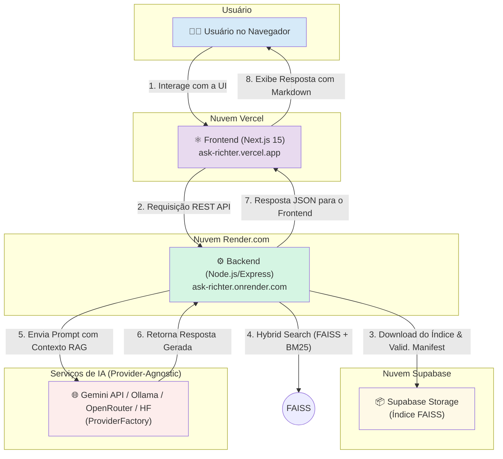

# Ask Richter - Meu CV Interativo com IA

[](https://nodejs.org/)
[](https://www.typescriptlang.org/)
[](https://expressjs.com/)
[](https://nextjs.org/)
[](https://reactjs.org/)
[](https://ollama.com/)
[](https://turbo.build/)
[](https://www.docker.com/)
[](https://vercel.com/)


Este projeto transforma um currículo tradicional em uma experiência de diálogo interativo. O **Ask Richter** é um chatbot especialista na trajetória profissional de Luiz F. Richter, permitindo que recrutadores e lideranças técnicas façam perguntas em linguagem natural e recebam respostas precisas, fundamentadas e contextuais.

Mais do que um portfólio, o projeto opera sob o **Framework de Engenharia de Software Guiado por IA v2.0 Master**, servindo como demonstração prática de arquitetura RAG moderna, desenvolvimento full-stack em monorepo e governança automatizada.

---

## 🛡️ Governança de Software & Arquitetura (IA v2.0 Master)

O desenvolvimento do AskRichter segue regras estritas de governança estruturada e Zero-Trust:

1. **Meta Spec como Lei Constitucional ([`.askrichter-spec.md`](file:///.askrichter-spec.md)):**  
   Fonte absoluta da verdade para decisões de arquitetura, contratos de API, fluxo RAG e regras de infraestrutura.
2. **Engenharia de Contexto WSCI (World-Scope Context Isolation):**  
   Separação estrita por escopos (Frontend, Backend, Infraestrutura). Operações no dia a dia utilizam filtros de workspace (ex: `npm run dev --workspace=frontend`) e refatorações estruturais utilizam `git worktree`.
3. **Governança por ADRs ([`docs/architect.md`](file:///docs/architect.md) & [`docs/adr/`](file:///docs/adr/)):**  
   Todas as decisões arquiteturais geram registros imutáveis numerados no diretório `docs/adr/` (ex: [`ADR-0001`](file:///docs/adr/0001-meta-spec-e-governanca-de-arquitetura.md)).
4. **Protocolo Jidoka / Andon Cord Unificado (`npm run jidoka`):**  
   Comando único no Turborepo que executa `check-types`, `lint` e `build` em paralelo com grafo de dependências. Se houver falha (exit code != 0), o ciclo é interrompido imediatamente para Reset Limpo e correção na origem.

---

## 🚀 Principais Features

- **Interface de Chat Conversacional:** UI moderna e reativa em Next.js 15 com Tailwind CSS, Radix UI e Framer Motion.
- **Respostas Contextuais com RAG Híbrido:** Utiliza a técnica de Retrieval-Augmented Generation combinando **FAISS** em memória (`faiss-node`) e **HybridRetriever** para máxima precisão semântica.
- **Arquitetura Provider-Agnostic de IA:** Abstração completa de provedores (`ProviderFactory`) suportando **Gemini** (padrão), **Ollama** (dev local), **OpenRouter** e **Hugging Face**.
- **Persistência Vetorial na Nuvem:** Sincronização do índice FAISS no startup da aplicação via **Supabase Storage** com validação estrita de manifest (`provider`, `model`, `dimension`).
- **Monorepo com Turborepo 2.x:** Pipeline otimizada de compilação, linting, checagem de tipos e validação Jidoka.

---

## 🤖 Arquitetura de Provedores de IA (AI Provider Layer)

```text
                    AI Provider Layer
                           │
             ┌─────────────┴─────────────┐
             │                           │
        LLM Provider              Embedding Provider
             │                           │
   ┌─────────┼─────────┬─────────┐       │
   │         │         │         │       │
Gemini    Ollama   OpenRouter HuggingFace Gemini
```

### Provedores Suportados e Impacto Financeiro (Custos)

> [!IMPORTANT]
> A escolha dos provedores via variáveis de ambiente altera diretamente os custos da aplicação:

| Componente | Provedor | Modelo Padrão | Status | Custos / Impacto Financeiro |
| :--- | :--- | :--- | :--- | :--- |
| **LLM** | **Gemini** | `gemini-3.6-flash` | **Ativo (Padrão)** | Gratuito dentro das quotas do Google AI Free Tier (Retentativa atômica + Fallback). |
| **LLM** | **Ollama** | `deepseek-r1:8b` | **Opção (Dev / Fallback)** | Zero custo (executado localmente no hardware da máquina). |
| **LLM** | **OpenRouter** | `google/gemma-4-26b-a4b-it:free` | **Opção (Fallback 1)** | Variável conforme modelo selecionado no OpenRouter. |
| **LLM** | **Hugging Face** | `meta-llama/Llama-3.1-8B-Instruct:novita` | **Opção (Fallback 2)** | Sujeito a cobrança conforme plano/créditos na Hugging Face. |
| **LLM** | **Groq** | - | *Fase 2 (Planejado)* | Futuro provedor de alta velocidade. |
| **Embedding** | **Gemini** | `gemini-embedding-2` (768 dim) | **Ativo (Padrão)** | Gratuito dentro do Free Tier. |
| **Embedding** | **OpenAI** | `text-embedding-3-small` | **Inativo (Legacy)** | Desativado no runtime para evitar custos de API. |

> [!TIP]
> **Resiliência e Cadeia de Fallback (`AI_FALLBACK_PROVIDERS`)**:
> O backend conta com retentativa exponencial no Gemini para falhas transitórias (`429`, `503`) e transição automática em cadeia (`gemini` -> `openrouter` -> `huggingface` -> `ollama`). Se a API principal falhar, o serviço transiciona transparentemente sem erro HTTP 500.

---

## ☁️ Arquitetura na Nuvem



---

## 🛠️ Stack Tecnológica Completa

| Camada | Tecnologia | Descrição |
| :--- | :--- | :--- |
| **🏗️ Governança & Estrutura** | Meta Spec (`.askrichter-spec.md`) | Constituição primária e regras de RAG/infraestrutura. |
| | Turborepo 2.x | Orquestração de tarefas (`build`, `lint`, `check-types`, `jidoka`). |
| | npm Workspaces | Gerenciamento de dependências e workspaces (`apps/*`, `packages/*`). |
| **⚙️ Backend** | Node.js (ESM) + Express.js | API RESTful com rotas `/api/chat` e `/api/health`. |
| | TypeScript 5.8 | Tipagem estática rigorosa em todo o backend. |
| | LangChain 0.3 | Framework de orquestração de RAG e retrievers. |
| | FAISS (`faiss-node`) | Banco vetorial em memória para busca de similaridade semântica (dim: 768). |
| | ProviderFactory | Camada de abstração desacoplada de IA (`Gemini`, `Ollama`, `OpenRouter`, `HuggingFace`). |
| | Gemini Embeddings | Modelo `gemini-embedding-2` (768 dimensões). |
| **⚛️ Frontend** | Next.js 15 (App Router) | Interface reativa otimizada para SEO e performance. |
| | React 19 | Componentização reativa moderna. |
| | Tailwind CSS + Framer Motion | Estilização responsiva e micro-animações. |
| | markdown-to-jsx + SyntaxHighlighter | Renderização de respostas da IA com destaque de sintaxe. |
| **☁️ Nuvem & DevOps** | Vercel | Deploy contínuo do frontend Next.js. |
| | Render.com | Deploy contínuo do backend Node.js (`render.yaml`). |
| | Supabase Storage | Bucket para persistência remota do índice FAISS. |

---

## ⚙️ Rodando o Projeto Localmente

### 1. Pré-requisitos
- **Node.js:** Versão >= 18.
- **npm:** Versão 11.x ou superior.
- **Ollama (Opcional para dev local):** Instale o [Ollama](https://ollama.com/) e baixe o modelo padrão:
  ```bash
  ollama pull deepseek-r1:8b
  ```

### 2. Instalação
Clone o repositório e instale as dependências da raiz do monorepo:
```bash
git clone https://github.com/lfrichter/ask-richter.git
cd ask-richter
npm install
```

### 3. Variáveis de Ambiente

**Backend (`apps/backend/.env`):**
```bash
cd apps/backend
cp .env.example .env
```
Preencha as chaves no arquivo `.env`:
```env
OPENAI_API_KEY="sk-..."
AI_PROVIDER="ollama"
OLLAMA_MODEL="deepseek-r1:8b"
OLLAMA_BASE_URL="http://localhost:11434"
SUPABASE_URL="https://[SEU-PROJETO].supabase.co"
SUPABASE_SERVICE_ROLE_KEY="sua-chave-secreta"
SUPABASE_BUCKET_NAME="faiss-index"
```

**Frontend (`apps/frontend/.env.local`):**
```bash
cd apps/frontend
cp .env.example .env.local
```
Garantir a URL da API do backend:
```env
NEXT_PUBLIC_API_BASE_URL=http://localhost:3001
```

### 4. Execução do Servidor de Desenvolvimento
A partir da raiz do monorepo, inicie o ambiente completo:
```bash
npm run dev
```
- Frontend: `http://localhost:3000`
- Backend: `http://localhost:3001`

Para rodar apenas o frontend com filtro WSCI:
```bash
npm run dev --workspace=frontend
```

### 5. Reindexação de Dados & Sincronização com o Supabase

Caso necessite gerar novamente os vetores FAISS da base de conhecimento Markdown e sincronizar com o Supabase Storage:

```bash
cd apps/backend
npm run build-index -- --yes --upload
```

> [!IMPORTANT]
> **Aviso sobre o Projeto no Supabase**:
> Projetos no plano gratuito do Supabase entram em estado *paused* (congelados) após um período de inatividade. **Antes de executar a atualização dos índices e o upload para o Supabase (`--upload`), é necessário acessar o painel do Supabase e descongelar/ativar o projeto manualmente**, caso contrário o upload falhará com erro de conexão (`fetch failed` / `NXDOMAIN`).

---

## 🧪 Validação Jidoka (Andon Cord)

Antes de realizar commits ou abrir Pull Requests, valide a integridade total do monorepo com o comando do Andon Cord:

```bash
npm run jidoka
```

Este comando executa a pipeline unificada do Turborepo (`check-types`, `lint` e `build` em paralelo com grafo de dependências).

---

## 🤝 Contribuição e Governança

Para contribuir, siga as diretrizes estabelecidas no [Guia de Contribuição](file:///docs/CONTRIBUTING.md) e certifique-se de que todas as decisões de arquitetura sejam registradas via ADR em [`docs/adr/`](file:///docs/adr/).

---

## 📄 Licença

Este projeto está sob a licença MIT. Veja o arquivo `LICENSE` para mais detalhes.
