### 🚀 PoC:  Cache Semântico de Alta Performance para Otimização de LLMs - PoC

#### 🎯 Visão Geral e Arquitetura da Solução

Em um cenário onde a eficiência e a velocidade das interações com Grandes Modelos de Linguagem (LLMs) são cruciais, este projeto nasceu como uma Prova de Conceito (PoC) para um desafio claro: como reduzir a latência e os custos operacionais sem sacrificar a qualidade das respostas? A solução foi arquitetar um sistema de cache semântico de alta performance, projetado para operar de forma 100% local, garantindo privacidade total dos dados e eliminando dependências de APIs externas.

A arquitetura funciona de maneira elegante: ao receber uma pergunta, o sistema utiliza o **Ollama** para gerar localmente um vetor de embedding, que é uma representação numérica do significado daquela pergunta. Em seguida, esse vetor é usado para consultar um índice **FAISS** em memória, que realiza uma busca por similaridade em velocidade quasi-instantânea. Se uma pergunta semanticamente equivalente é encontrada acima de um limiar de confiança (um "Cache Hit"), a resposta armazenada é devolvida imediatamente. Caso contrário (um "Cache Miss"), a requisição prossegue para o LLM, e a nova resposta é então adicionada ao cache, enriquecendo o sistema para futuras interações.

#### 👨‍💻 Meu Papel no Projeto

Como idealizador e desenvolvedor principal desta Prova de Conceito, minhas responsabilidades foram:

  * **Arquitetura da Solução:** Desenhar o fluxo completo do sistema, desde a entrada do prompt até a decisão de hit/miss do cache.
  * **Implementação do Core:** Desenvolver a lógica central em Python, integrando as bibliotecas para busca vetorial e geração de embeddings.
  * **Integração de Tecnologias:** Orquestrar a comunicação entre o **Ollama** para a vetorização local e o **FAISS** para a busca por similaridade, garantindo uma operação coesa e performática.
  * **Validação e Performance:** Executar testes para validar a eficácia da PoC, comprovando a redução drástica na latência para perguntas recorrentes e o impacto positivo na otimização de recursos.

#### ✨ Pontos Fortes e Desafios Superados

O maior ponto forte desta solução é sua **autonomia e eficiência**. O principal desafio era construir um sistema de cache inteligente que não dependesse de serviços de terceiros para a geração de embeddings, que geralmente representam um gargalo de custo e privacidade.

A superação veio através da combinação estratégica de tecnologias de ponta:

  * **FAISS (Facebook AI Similarity Search):** Garantiu que a busca por similaridade, o coração do cache, fosse realizada em milissegundos, diretamente na memória.
  * **Ollama:** Permitiu a geração de embeddings de alta qualidade de forma totalmente local e gratuita, eliminando chamadas de API externas e assegurando que os dados nunca saíssem do ambiente de execução.

O resultado foi uma PoC que não apenas validou uma tese, mas demonstrou um caminho viável para otimizar sistemas de IA de forma significativa, melhorando a experiência do usuário e a sustentabilidade financeira da operação.

#### 🌱 Pontos para Evolução Futura

Para evoluir esta PoC para um sistema em produção, os próximos passos poderiam incluir a implementação de uma camada de persistência para o índice vetorial (ex: usando um banco de dados vetorial como Milvus ou Weaviate) e a criação de uma API robusta para servir o cache a múltiplas aplicações.

-----

#### 🛠️ Pilha de Tecnologias (Tech Stack)

| Componente | Tecnologia Utilizada | Papel na Arquitetura |
| :--- | :--- | :--- |
| **Linguagem Principal** | **Python** | Orquestra todo o fluxo de dados e a lógica de cache (Hit/Miss). |
| **Busca por Similaridade** | **FAISS** | Cria e gerencia um índice vetorial em memória para buscas semânticas de altíssima velocidade. |
| **Geração de Embeddings** | **Ollama** | Gera os vetores (embeddings) das perguntas de forma 100% local, garantindo privacidade e custo zero. |
| **Computação Numérica** | **NumPy** | Fornece a base para manipulação eficiente de vetores e matrizes, essencial para o FAISS. |

-----

#### 🗺️ Diagrama da Arquitetura

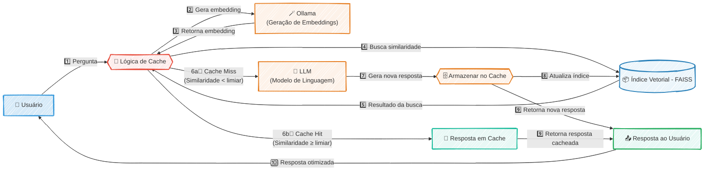

---
#### RESUMO TÉCNICO PARA EMBEDDING

Este projeto é uma Prova de Conceito (PoC) de um cache semântico de alta performance para otimização de Grandes Modelos de Linguagem (LLMs), focado em redução de latência e custos. A arquitetura, implementada em Python, opera de forma 100% local para garantir privacidade. O fluxo consiste em receber uma query, gerar um vetor de embedding localmente com Ollama e realizar uma busca por similaridade em um índice vetorial em memória gerenciado por FAISS. A lógica de "Cache Hit" retorna uma resposta pré-existente se a similaridade ultrapassa um limiar, enquanto um "Cache Miss" encaminha a requisição ao LLM, e a nova resposta é vetorizada e adicionada ao índice FAISS. A solução utiliza NumPy para computação numérica e valida a eficácia na otimização de recursos e na melhoria da experiência do usuário, superando o desafio de criar um sistema autônomo sem dependência de APIs externas de embedding.

#### CLASSIFICAÇÃO DE TECNOLOGIAS E CONCEITOS

| Categoria | Tecnologias e Conceitos |
| :--- | :--- |
| **AI & Machine Learning** | Cache Semântico, LLMs (Grandes Modelos de Linguagem), Vetor de Embedding, Busca por Similaridade, FAISS (Facebook AI Similarity Search), Ollama, Limiar de Confiança |
| **Software Development** | Python, NumPy |
| **Architecture**| Prova de Conceito (PoC), Sistema de Cache, Cache Hit/Miss, Arquitetura Local, Otimização de Performance, Redução de Latência, Índice em Memória |
| **Cloud Computing** | N/A |
| **API RESTFul development** | N/A |
| **Frontend Development** | N/A |
| **Mobile Development** | N/A |
| **Database** | N/A |
| **Data Management** | Índice Vetorial |
| **Content Management - CMS** | N/A |
| **System Administration** | N/A |
| **DevOps** | N/A |
| **Leadership** | Idealizador, Desenvolvedor Principal |
| **Coaching** | N/A |
| **Agile Project Management** | Prova de Conceito (PoC) |

***

### 🚀 PoC:  Análise de Jobs de Renderização com PySpark - PoC

#### 🎯 Visão Geral e Arquitetura da Solução

Este projeto nasceu da necessidade de extrair insights operacionais a partir de dados de renderização de vídeos, que estavam dispersos em um banco de dados SQLite. Como uma Prova de Conceito (PoC), o objetivo foi validar o uso de PySpark para orquestrar um micro-pipeline de ETL, consolidando informações de múltiplas tabelas para viabilizar uma análise de dados coesa.

A solução funciona em um ambiente interativo com Jupyter Notebook, onde um script se conecta à base de dados, executa uma query SQL complexa para unificar dados de jobs, roteiros e seus respectivos segmentos, e por fim, materializa o resultado em um DataFrame enriquecido e pronto para análise.

#### 👨‍💻 Meu Papel no Projeto

Como único desenvolvedor nesta Prova de Conceito, minhas responsabilidades abrangeram todo o ciclo de vida dos dados em pequena escala:

  * **Engenharia de Dados:** Desenvolvi o script ETL para extração, transformação e carga dos dados, utilizando PySpark para o processamento.
  * **Análise de Dados:** Utilizei o Jupyter Notebook para a análise exploratória e validação dos dados transformados.
  * **Otimização de Consulta:** Elaborei a query SQL com múltiplos `LEFT JOINs` para garantir a integridade e a correta união das informações.

#### ✨ Pontos Fortes e Desafios Superados

O principal desafio foi consolidar informações de três tabelas distintas (`render_jobs`, `scripts` e `segments`) em uma visão única, especialmente ao lidar com a relação 1:N entre roteiros e seus segmentos.

A superação veio através da construção de uma query SQL otimizada, que não apenas enriqueceu os dados dos jobs, mas também garantiu que todos os segmentos fossem corretamente associados aos seus respectivos roteiros. Embora seja um PoC, a escolha do PySpark valida a arquitetura para futura escalabilidade, permitindo que o mesmo código processe volumes de dados ordens de magnitude maiores com mínima alteração.

#### 🌱 Pontos para Evolução Futura

  * **Automação:** Agendar a execução do notebook como um job recorrente (utilizando ferramentas como Airflow ou cron).
  * **Escalabilidade:** Migrar a fonte de dados de SQLite para um Data Lake (ex: AWS S3) para testar o pipeline com um volume de dados maior.

-----

#### 🛠️ Pilha de Tecnologias (Tech Stack)

| Componente | Tecnologia Utilizada | Papel na Arquitetura |
| :--- | :--- | :--- |
| **Processamento de Dados** | **PySpark** | Orquestrador principal do ETL, responsável por ler, transformar e processar os dados de forma distribuída. |
| **Ambiente de Análise** | **Jupyter Notebook** | Interface interativa para desenvolvimento, execução do pipeline e análise exploratória dos resultados. |
| **Fonte de Dados** | **SQLite** | Banco de dados relacional que armazena os dados brutos dos jobs, roteiros e segmentos. |
| **Manipulação Auxiliar** | **Pandas** | Utilizado para a conversão final e visualização mais direta do DataFrame resultante no ambiente do notebook. |

-----

#### 🗺️ Diagrama da Arquitetura

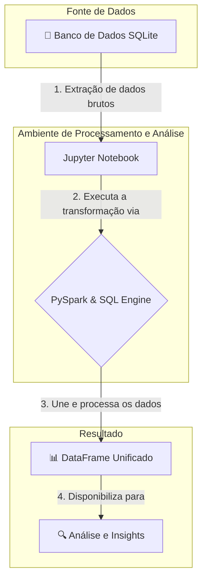

***

### 🚀 PoC:  Robo de Atendimento por Voz - PoC

#### 🎯 Visão Geral e Arquitetura da Solução

Em um cenário onde a agilidade e a eficiência são cruciais para restaurantes e pizzarias, o "Robo de Atendimento por Voz - BRNow" surge como uma solução inovadora para automatizar o recebimento de pedidos. O objetivo é claro: reduzir custos operacionais e otimizar o tempo, enquanto se oferece uma experiência fluida e acolhedora ao cliente, simulando um atendente humano simpático e eficiente.

A arquitetura foi concebida para ser robusta, escalável e, principalmente, **multi-tenant**. A cada nova chamada, o sistema inicia uma sessão de atendimento personalizada. Através de uma API RESTful, o restaurante envia uma imagem do seu cardápio, que é processada em tempo real com tecnologia OCR (Pytesseract) para extrair os itens e preços. Essa informação é usada para construir um prompt dinâmico que contextualiza o agente de IA (GPT-4o-mini), permitindo que ele conduza o pedido de forma precisa. A comunicação de voz acontece em tempo real através do LiveKit, que gerencia o fluxo de áudio entre o cliente e o agente de IA, garantindo uma interação natural e de baixa latência.

#### 👨‍💻 Meu Papel no Projeto

Como arquiteto e desenvolvedor principal desta solução, minhas responsabilidades abrangeram todo o ciclo de vida do projeto:

  * **Arquitetura da Solução:** Projetei a arquitetura end-to-end, focada em comunicação de voz em tempo real e processamento de IA de baixa latência.
  * **Desenvolvimento Back-End:** Implementei a API RESTful com Flask para gerenciar o ciclo de vida dos agentes, incluindo a orquestração da inicialização e finalização das sessões.
  * **Integração de IA e Serviços:** Fui responsável por integrar e orquestrar o pipeline de serviços de IA, conectando o reconhecimento de fala (Deepgram), a lógica de conversação (OpenAI) e a síntese de voz (ElevenLabs).
  * **Implementação da Lógica Multi-Tenant:** Desenvolvi o sistema de personalização dinâmica que utiliza OCR para adaptar o agente a diferentes cardápios, garantindo que cada restaurante tivesse um atendente virtual exclusivo.

#### ✨ Pontos Fortes e Desafios Superados

O maior ponto forte da solução é sua capacidade de oferecer uma interação de voz natural e quase instantânea. Um dos principais desafios técnicos foi **garantir a baixa latência no ciclo "fala-processamento-resposta"**. Superamos isso ao selecionar um conjunto de tecnologias de ponta e orquestrá-las de forma eficiente: LiveKit para o transporte de mídia via WebRTC, Deepgram para transcrição em tempo real, GPT-4o-mini para respostas rápidas e ElevenLabs para uma síntese de voz natural.

Outro desafio significativo foi **tornar o sistema facilmente adaptável a qualquer restaurante sem a necessidade de configuração manual complexa**. A solução foi a implementação de um fluxo de onboarding automatizado, onde o sistema utiliza OCR para "ler" uma imagem do cardápio e, a partir dela, gerar dinamicamente o roteiro e o contexto para a IA. Isso transformou um processo complexo em uma simples chamada de API, tornando a plataforma extremamente escalável.

#### 🌱 Pontos para Evolução Futura

Embora a solução atual seja robusta, existem caminhos claros para evolução, como a **integração direta com sistemas de PDV (Ponto de Venda)** para automatizar o envio do pedido à cozinha e a implementação de um **sistema de reconhecimento de clientes recorrentes** para oferecer um atendimento ainda mais personalizado.

-----

#### 🛠️ Pilha de Tecnologias (Tech Stack)

| Componente | Tecnologia Utilizada | Papel na Arquitetura |
| :--- | :--- | :--- |
| **Orquestração e Backend** | **Python (Flask)** | Fornece a API RESTful para gerenciar o ciclo de vida do agente de voz. |
| **Comunicação em Tempo Real** | **LiveKit Voice Agents** | Gerencia a conexão WebRTC/SIP e o transporte de mídia entre o cliente e o agente. |
| **Inteligência Artificial (LLM)** | **OpenAI (GPT-4o-mini)** | Gera respostas inteligentes e contextuais para guiar o cliente durante o pedido. |
| **Reconhecimento de Fala (STT)**| **Deepgram** | Transcreve a fala do cliente em texto com alta precisão e baixa latência. |
| **Síntese de Voz (TTS)** | **ElevenLabs** | Converte as respostas de texto do LLM em áudio com voz natural e personalizada. |
| **Detecção de Fala (VAD)** | **Silero VAD** | Detecta quando o usuário está falando, otimizando o fluxo da conversação. |
| **Processamento de Imagem (OCR)**| **Pytesseract & Pillow** | Extrai o texto de imagens de cardápios para personalizar o prompt do agente. |

-----

#### 🗺️ Diagrama da Arquitetura

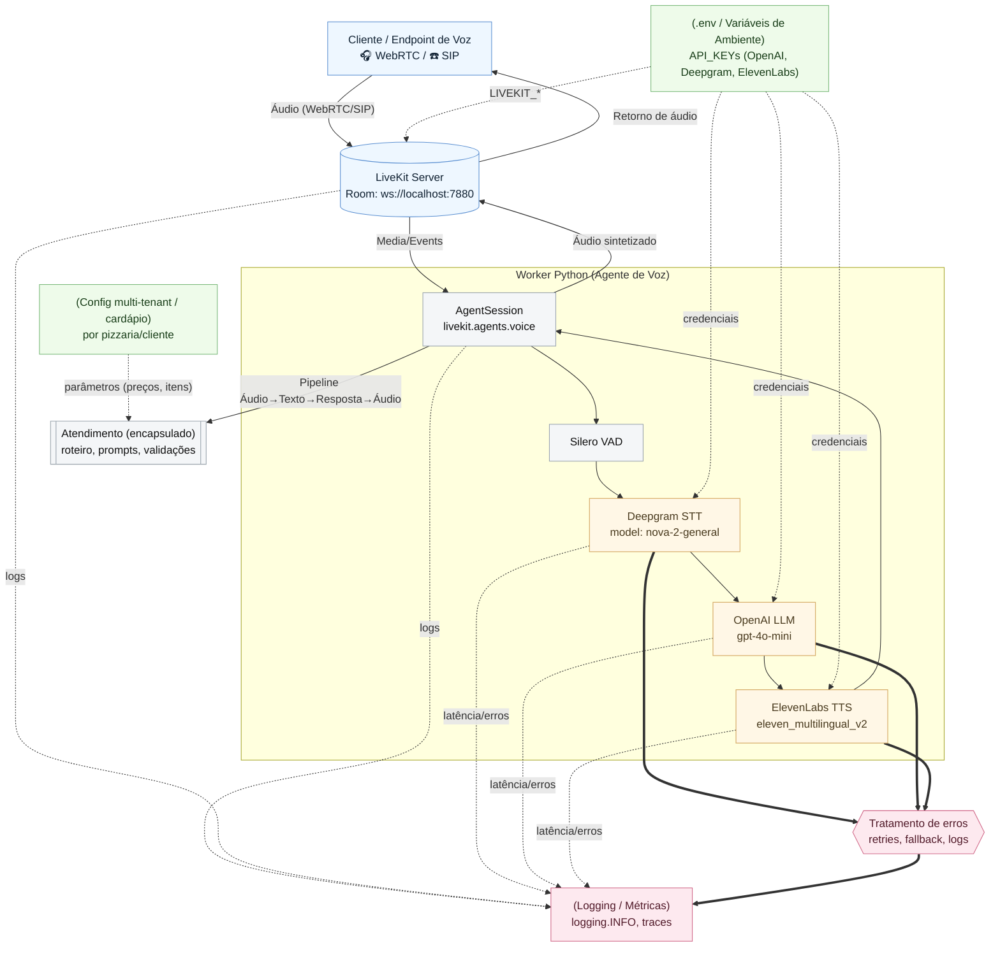

#### RESUMO TÉCNICO PARA EMBEDDING

Este projeto implementa um robô de atendimento por voz multi-tenant para restaurantes, desenvolvido em Python 3.12 com um backend Flask que expõe uma API RESTful para gerenciamento de sessões. A arquitetura centraliza-se no LiveKit Voice Agents para comunicação em tempo real via WebRTC/SIP. O pipeline de processamento de voz integra Silero VAD para detecção de atividade de fala, Deepgram (modelo nova-2-general) para Speech-to-Text (STT), OpenAI GPT-4o-mini como Large Language Model (LLM) para geração de respostas inteligentes, e ElevenLabs (modelo eleven_multilingual_v2) para Text-to-Speech (TTS) customizável. A solução é multi-tenant, permitindo a personalização de cardápios através de um sistema de OCR com Pytesseract e Pillow, que extrai texto de imagens para construir prompts dinâmicos. A qualidade do código é garantida por uma suíte de DevOps utilizando Makefile para automação de tarefas como linting com `ruff`, verificação de tipos com `mypy` e testes com `pytest`. O sistema é projetado para ser observável, com logging e monitoramento de tráfego SIP via `sngrep` e CLI do LiveKit.

#### CLASSIFICAÇÃO DE TECNOLOGIAS E CONCEITOS

| Categoria | Tecnologias e Conceitos |
| :--- | :--- |
| **AI & Machine Learning** | OpenAI GPT-4o-mini, Deepgram (STT), ElevenLabs (TTS), Silero VAD (Voice Activity Detection), Pytesseract (OCR), Pillow (Image Processing), LLM |
| **Software Development** | Python 3.12, Flask, Makefile, Ruff (linter/formatter), MyPy (type checking), Pytest, virtual environment (venv) |
| **Architecture**| Arquitetura Multi-tenant, Voice Agents, WebRTC, SIP, Worker (Agent Pattern) |
| **Cloud Computing** | LiveKit (Real-time voice/video infrastructure) |
| **API RESTFul development** | Flask, multipart/form-data, POST /create-voice-support, GET /api/agent-status/, POST /api/stop-agent |
| **Frontend Development** | Interação via formulário de navegador (HTML) |
| **Mobile Development** | N/A |
| **Database** | N/A |
| **Data Management** | OCR de imagem, Processamento de áudio em tempo real |
| **Content Management - CMS** | N/A |
| **System Administration** | Tesseract OCR (instalação), sngrep (monitoramento de rede SIP) |
| **DevOps** | Makefile (run, fix, lint, type, test, quality, ci), CI/CD pipeline, Gerenciamento de dependências (requirements.txt), Variáveis de Ambiente (.env) |
| **Leadership** | N/A |
| **Coaching** | N/A |
| **Agile Project Management** | N/A |

***

### 🚀 Challenge:  Cat Guardian

#### 🎯 Visão Geral e Arquitetura da Solução

Viver com sete gatos — cada um com sua personalidade e rotina — traz uma preocupação constante: o que aconteceria se um deles escapasse? Registros de saúde em papel se perdem facilmente, e as tradicionais coleiras de identificação expõem dados sensíveis do dono (como telefone e endereço) para qualquer pessoa na rua.

O **Cat Guardian** nasceu dessa dor real e evoluiu para um passaporte digital de segurança felina. A plataforma combina um gerador de perfis de identificação via IA, medalhas dinâmicas de QR Code e um engenhoso sistema de "Blind Contact Relay". Do ponto de vista arquitetural, o sistema opera sob o princípio de *Privacy-First*. Quando um gato se perde e o dono ativa o "Lost Mode", a plataforma gera um alerta público. Se alguém encontra o animal e escaneia a coleira, a aplicação renderiza um passaporte de resgate público que omite os contatos do dono. A comunicação ocorre por meio de uma interface segura onde a mensagem de quem encontrou o gato é roteada pelo back-end diretamente para o e-mail do dono, garantindo anonimato e rapidez no reencontro.

#### 👨‍💻 Meu Papel no Projeto

* **Engenheiro de Software Full-Stack:** Liderança no desenvolvimento de ponta a ponta utilizando React 19, Vite e TypeScript, garantindo uma interface responsiva baseada em Glassmorphism e alta performance no lado do cliente.
* **Arquiteto de Soluções & Banco de Dados:** Modelagem do banco de dados relacional no Supabase (PostgreSQL), focando em esquemas multilingues nativos via `JSONB` e na aplicação rigorosa de políticas de segurança em nível de linha (RLS).
* **Integrador de IA:** Implementação de prompts estruturados conectando a aplicação à API do Gemini 2.0 Flash para gerar descrições físicas precisas com base nas características visuais dos felinos.

#### ✨ Pontos Fortes e Desafios Superados

O principal triunfo técnico do Cat Guardian é a forma como ele equilibra utilidade pública com extrema privacidade. O maior desafio inicial foi desenhar um fluxo onde quem encontra o animal pudesse contatar o dono sem que números de telefone fossem expostos no front-end ou inspecionáveis via código. Superamos isso desenvolvendo o **Blind Contact Relay**: integramos a API do Resend no back-end e configuramos o Supabase para que a tabela de `sightings` (avistamentos) acionasse notificações seguras via servidor, sem que o cliente tivesse acesso aos dados do proprietário.

Outro desafio importante foi manter a consistência e a rastreabilidade do banco de dados em um ambiente de prototipagem ágil. Estabelecemos uma cultura estrita de engenharia de dados onde nunca atualizamos migrações existentes no Supabase; em vez disso, sempre criamos novas migrações (*forward-only*), garantindo um histórico seguro e reproduzível. Além disso, a barreira do idioma foi superada ao adotar uma arquitetura `JSONB` que armazena perfis gerados por IA nativamente tanto em inglês quanto em português (pt-BR).

#### 🌱 Pontos para Evolução Futura

* Integração com coleiras IoT para rastreamento de localização GPS ativo e delimitação de cercas virtuais (Geofencing).
* Expansão das funcionalidades de saúde preventiva para permitir upload e extração de dados via OCR de exames e carteiras de vacinação físicas.

---

#### 🛠️ Pilha de Tecnologias (Tech Stack)

| Componente | Tecnologia Utilizada | Papel na Arquitetura |
| --- | --- | --- |
| **Front-End Core** | **React 19 & Vite 6** | Responsável pela interface interativa, renderização do dashboard de segurança e geração do QR Code dinâmico do passaporte. |
| **Banco de Dados & Autenticação** | **Supabase (PostgreSQL)** | Armazena registros médicos, perfis multilingues (`JSONB`) e gerencia sessões de usuários com forte controle de acesso via RLS (Row Level Security). |
| **Motor de Inteligência Artificial** | **Google Gemini 2.0 Flash** | Processa características inseridas pelo usuário para gerar perfis de identificação visual estruturados e guias de saúde preventiva. |
| **Mensageria Segura** | **Resend API** | Atua como o motor do *Blind Contact Relay*, disparando e-mails seguros de quem encontrou o pet para o dono, sem expor dados pessoais. |
| **Qualidade & Testes** | **Vitest & TypeScript 5.7** | Garante a tipagem estrita de todos os esquemas de dados e executa a suíte de testes automatizados nas regras de negócios essenciais (Jidoka Gate). |

---

#### 🗺️ Diagrama da Arquitetura

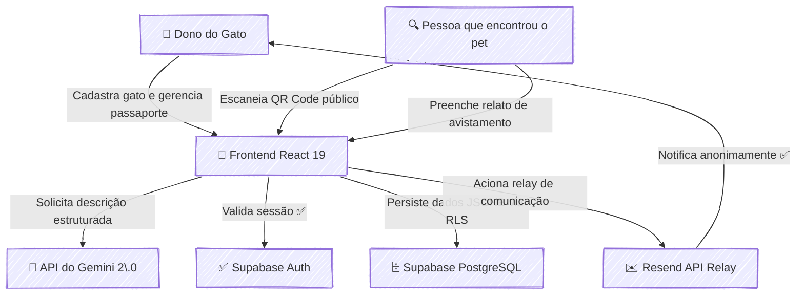

***

### 🚀 Challenge:  Gerenciador de Tarefas Conversacional via E-mail 📥 Postmark Challenge

#### 🎯 Visão Geral e Arquitetura da Solução

Este projeto nasceu para solucionar uma dor comum no dia a dia de qualquer profissional: a fricção de transformar e-mails em tarefas acionáveis. Em vez de alternar entre a caixa de entrada e um aplicativo de To-Do, a solução transforma o próprio e-mail em uma poderosa interface de gerenciamento. O usuário pode criar, atualizar, comentar e concluir tarefas simplesmente enviando um e-mail para um endereço dedicado ou respondendo a uma conversa existente, utilizando comandos simples e intuitivos como `#prioridade` ou `#concluir`.

A arquitetura foi desenhada para ser ágil e orientada a eventos. O fluxo se inicia quando o **Postmark API** recebe um e-mail e, através de um **Inbound Webhook**, notifica a aplicação **Laravel** em tempo real. Um motor de comandos customizado entra em ação, analisando o corpo do e-mail em busca de "hashtags" de ação. Cada comando aciona a lógica de negócio correspondente, atualizando o estado da tarefa no banco de dados. Para a visualização, uma interface web reativa, construída com **Livewire** e **Tailwind CSS**, exibe a lista de tarefas, que se atualiza dinamicamente sem a necessidade de recarregar a página, proporcionando uma experiência de usuário fluida e moderna.

#### 👨‍💻 Meu Papel no Projeto

Como idealizador e desenvolvedor da solução, minhas principais responsabilidades foram:

  * **Arquitetura do Processamento de E-mails:** Implementar a lógica de recebimento e interpretação de e-mails em tempo real utilizando Postmark Inbound Webhooks, que servem como gatilho para todo o fluxo da aplicação.
  * **Desenvolvimento do Motor de Comandos:** Criar um processador de comandos em Laravel para analisar o corpo do e-mail, identificar hashtags de ação (ex: `#comentario`, `#concluir`) e executar as operações de negócio correspondentes.
  * **Construção do Frontend Reativo:** Desenvolver a interface de usuário para visualização das tarefas com Livewire e Tailwind CSS, garantindo atualizações dinâmicas e uma experiência moderna sem a complexidade de uma Single Page Application (SPA).
  * **Garantia de Qualidade:** Assegurar a robustez e a confiabilidade do sistema, especialmente do motor de comandos, através de uma suíte de testes completa escrita com Pest.

#### ✨ Pontos Fortes e Desafios Superados

O grande trunfo do projeto é sua simplicidade e elegância: ele se integra a um fluxo de trabalho que o usuário já domina — o e-mail. A solução elimina a necessidade de um novo software, transformando uma ferramenta de comunicação em uma plataforma de produtividade.

O principal desafio técnico foi criar um sistema robusto para "traduzir" o texto não estruturado de um e-mail em comandos de sistema precisos e confiáveis. Superamos isso com o **desenvolvimento de um motor de comandos customizado**, capaz de analisar o conteúdo de forma inteligente. Outra vitória foi a escolha do **Livewire**, que permitiu construir uma interface reativa e performática com a produtividade do ecossistema Laravel, evitando a complexidade de gerenciar um frontend desacoplado.

#### 🌱 Pontos para Evolução Futura

Para o futuro, a solução poderia evoluir com a implementação de um processamento de linguagem natural (PLN) mais avançado, permitindo que os usuários escrevam comandos de forma mais livre, sem a rigidez das hashtags. Outra evolução seria a integração com calendários (Google Calendar, Outlook) para agendar tarefas com datas de vencimento.

-----

#### 🛠️ Pilha de Tecnologias (Tech Stack)

| Componente | Tecnologia Utilizada | Papel na Arquitetura |
| :--- | :--- | :--- |
| **Backend** | **Laravel** | Orquestra toda a lógica de negócio, rotas, processamento de webhooks e interação com o banco de dados. |
| **Frontend Reativo** | **Livewire & Tailwind CSS** | Constrói uma interface de usuário dinâmica e moderna para a visualização das tarefas, com atualizações em tempo real. |
| **Testes Automatizados**| **Pest** | Garante a confiabilidade e a robustez das regras de negócio e do motor de comandos com uma suíte de testes limpa. |
| **Gateway de E-mail** | **Postmark API & Webhooks** | Recebe os e-mails, dispara os eventos via webhook para a aplicação e gerencia o envio de respostas. |
| **Modelo Arquitetural** | **Arquitetura Orientada a Eventos** | Permite que a aplicação reaja de forma assíncrona aos e-mails recebidos, garantindo um fluxo desacoplado e escalável. |

-----

#### 🔗 Links e Recursos
* **🎬 Apresentação em Vídeo:** [Assista no YouTube](https://www.youtube.com/watch?v=NDFgcH2X1ZI)
* **📂 Repositório Open Source:** [Veja o código no GitHub](https://github.com/lfrichter/Interactive-email-management)

---

#### 🗺️ Diagrama da Arquitetura

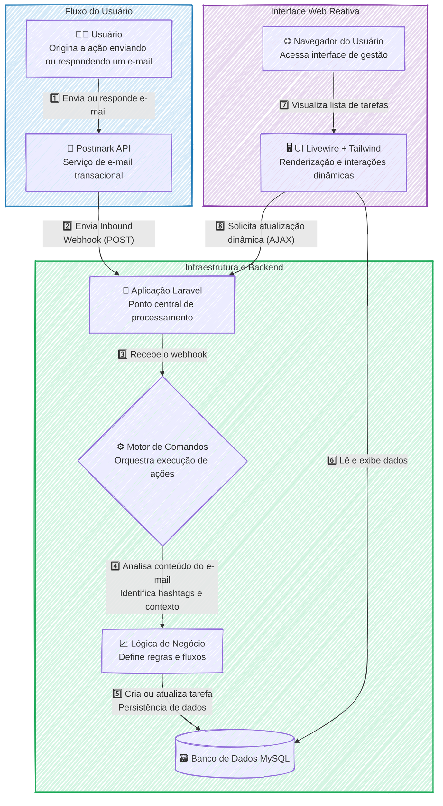

---
#### RESUMO TÉCNICO PARA EMBEDDING

A solução é um gerenciador de tarefas conversacional implementado em uma arquitetura orientada a eventos, acionada por e-mails. O fluxo é iniciado por um Inbound Webhook da Postmark API, que notifica uma aplicação backend em Laravel. Um motor de comandos customizado, com lógica de negócio robusta validada por testes automatizados em Pest, processa o corpo do e-mail para identificar e executar ações baseadas em hashtags, como `#prioridade` ou `#concluir`. O estado das tarefas é persistido em um banco de dados MySQL. A interface de usuário para visualização é um frontend reativo construído com Livewire e Tailwind CSS, garantindo atualizações dinâmicas da lista de tarefas sem a necessidade de recarregar a página. O principal desafio superado foi a tradução de texto não estruturado de e-mails em comandos de sistema precisos através do motor de comandos, evitando a complexidade de uma SPA desacoplada ao utilizar a stack TALL (Tailwind, Alpine, Livewire, Laravel). Futuras evoluções contemplam o uso de processamento de linguagem natural (PLN).

#### CLASSIFICAÇÃO DE TECNOLOGIAS E CONCEITOS

| Categoria | Tecnologias e Conceitos |
| :--- | :--- |
| **AI & Machine Learning** | Processamento de Linguagem Natural (PLN) |
| **Software Development** | Laravel, Pest, Motor de Comandos Customizado |
| **Architecture**| Arquitetura Orientada a Eventos, Inbound Webhook, Sistema Desacoplado, Sistema Escalável |
| **Cloud Computing** | Postmark API (SaaS) |
| **API RESTFul development** | Postmark API, Webhooks |
| **Frontend Development** | Livewire, Tailwind CSS, Interface Reativa |
| **Mobile Development** | N/A |
| **Database** | MySQL |
| **Data Management** | Persistência de Dados |
| **Content Management - CMS** | N/A |
| **System Administration** | N/A |
| **DevOps** | Testes Automatizados |
| **Leadership** | Idealizador, Desenvolvedor da Solução |
| **Coaching** | N/A |
| **Agile Project Management** |  N/A |

***

### 🚀 SideProject:  Air Combat 3D - Um Estudo de Caso sobre Produtividade com IAs

#### 🎯 Visão Geral e Arquitetura da Solução

Este projeto nasceu de uma questão estratégica: qual o impacto real de ferramentas de IA generativa na produtividade de um desenvolvedor full-stack? Para responder a isso, conduzi um estudo de caso prático, desenvolvendo do zero um jogo 3D de combate aéreo multiplayer. O objetivo não era apenas criar um jogo, mas sim mensurar a aceleração no ciclo de vida do desenvolvimento.

A solução é uma aplicação web onde jogadores podem entrar em uma arena e pilotar aviões de combate em tempo real. O frontend, construído com **Three.js**, é responsável por toda a renderização 3D, desde os modelos das aeronaves até o ambiente de batalha e os controles interativos. A comunicação em tempo real, coração da experiência multiplayer, é garantida por um backend robusto em **Node.js** e **Express**, utilizando **WebSockets** para sincronizar as ações dos jogadores com latência mínima. Toda a aplicação foi conteinerizada com **Docker**, garantindo a portabilidade e a consistência do ambiente, e implantada na nuvem através do **Render.com**.

O resultado mais expressivo foi a validação da hipótese inicial: o uso de IDEs assistidas por IA (Cursor, Trae) resultou em uma **redução de aproximadamente 40% no tempo total de desenvolvimento**, desde a concepção até a entrega final.

#### 👨‍💻 Meu Papel no Projeto

Como único desenvolvedor e pesquisador neste estudo de caso, atuei de ponta a ponta, assumindo os seguintes papéis:

  * **Arquiteto e Desenvolvedor Full-Stack:** Idealizei a arquitetura, desenvolvi o frontend interativo com Three.js, construí o servidor de backend em Node.js para a lógica de jogo e comunicação em tempo real via WebSockets.
  * **Engenheiro DevOps:** Fui responsável por todo o ciclo de vida da infraestrutura, incluindo a conteinerização da aplicação com Docker e a automação do processo de deploy contínuo na plataforma Render.com.
  * **Pesquisador de Fluxo de Trabalho:** Defini a metodologia para o estudo, integrei as ferramentas de IA generativa no meu fluxo de trabalho diário e mensurei ativamente o ganho de produtividade em comparação com métodos tradicionais.

#### ✨ Pontos Fortes e Desafios Superados

O principal ponto forte do projeto é a demonstração clara e quantificável do poder da IA como uma ferramenta de alavancagem para desenvolvedores. O jogo funcional é a prova de conceito que materializa essa conclusão.

  * **Desafio Superado:** O maior desafio técnico foi garantir a **sincronização de estado em tempo real** entre múltiplos jogadores. Manter a posição e as ações de cada avião consistentes para todos os clientes, com baixa latência, é complexo. Superei isso implementando um loop de jogo eficiente no servidor Node.js que processa as entradas dos jogadores e transmite o estado atualizado do jogo de volta aos clientes através de uma conexão WebSocket estável.
  * **Vitória Estratégica:** A maior vitória, no entanto, foi a **validação bem-sucedida do fluxo de trabalho assistido por IA**. Provar uma redução de 40% no tempo de desenvolvimento transformou uma crença intuitiva em um dado concreto, oferecendo um forte argumento para a adoção moderna de ferramentas no ciclo de desenvolvimento de software.

#### 🌱 Pontos para Evolução Futura

Embora o projeto tenha cumprido seu objetivo principal, ele possui um grande potencial para evolução. Como próximos passos, poderíamos implementar um sistema de **persistência de pontuação e ranking de jogadores**, utilizando um banco de dados como PostgreSQL ou Redis. Outra melhoria seria a criação de **salas de jogo privadas e diferentes modos de batalha** (como "Team Deathmatch"), enriquecendo a experiência multiplayer.

-----

#### 🛠️ Pilha de Tecnologias (Tech Stack)

| Componente | Tecnologia Utilizada | Papel na Arquitetura |
| :--- | :--- | :--- |
| **Renderização e Interação 3D** | **Three.js** | Criação do ambiente 3D, renderização dos aviões e gerenciamento da câmera e controles do jogador no navegador. |
| **Servidor de Aplicação** | **Node.js com Express** | Orquestra a lógica de negócio, gerencia o matchmaking e serve como a base para a comunicação em tempo real. |
| **Comunicação em Tempo Real** | **WebSockets** | Estabelece um canal de comunicação bidirecional e de baixa latência entre o cliente e o servidor para sincronizar as ações. |
| **Conteinerização** | **Docker** | Empacota a aplicação e suas dependências em um contêiner, garantindo consistência entre os ambientes de desenvolvimento e produção. |
| **Hospedagem e Deploy** | **Render.com** | Plataforma de nuvem utilizada para hospedar a aplicação conteinerizada e disponibilizá-la publicamente online. |
| **Aceleração de Código** | **IA Generativa (Cursor, Trae)** | Ferramentas integradas à IDE para acelerar a escrita de código, prototipagem de funcionalidades e resolução de problemas. |

-----

#### 🗺️ Diagrama da Arquitetura

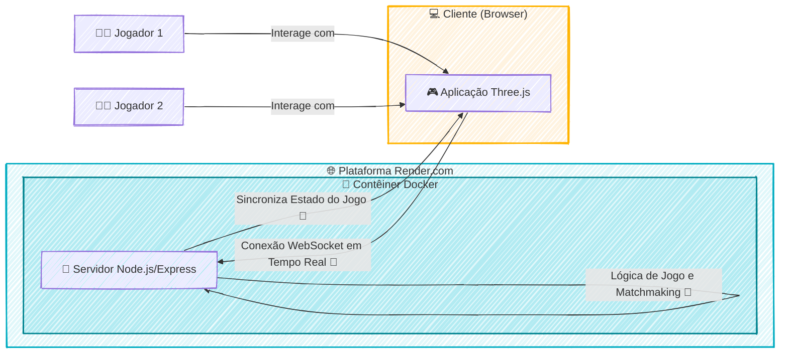

---
#### RESUMO TÉCNICO PARA EMBEDDING

Estudo de caso prático sobre o impacto de IA generativa na produtividade, materializado no desenvolvimento de um jogo 3D multiplayer de combate aéreo. A arquitetura da solução emprega um frontend em **Three.js** para renderização 3D e um backend em **Node.js** com **Express** para a lógica de jogo. O principal desafio técnico, a **sincronização de estado em tempo real** entre múltiplos jogadores, foi solucionado com **WebSockets** para comunicação de baixa latência. A aplicação foi conteinerizada com **Docker**, garantindo portabilidade e consistência, com o ciclo de **deploy contínuo** automatizado na plataforma de nuvem **Render.com**. O uso de IDEs assistidas por **IA generativa (Cursor, Trae)** validou uma redução de 40% no tempo de desenvolvimento. Evoluções futuras planejadas incluem a implementação de persistência de dados com **PostgreSQL** ou **Redis** para rankings e pontuações.

#### CLASSIFICAÇÃO DE TECNOLOGIAS E CONCEITOS

| Categoria | Tecnologias e Conceitos |
| :--- | :--- |
| **AI & Machine Learning** | IA Generativa, Cursor, Trae |
| **Software Development** | Desenvolvedor Full-Stack, Loop de jogo, Prototipagem, Ciclo de vida do desenvolvimento |
| **Architecture**| Arquitetura de aplicação web, Multiplayer em tempo real, Sincronização de estado, Matchmaking |
| **Cloud Computing** | Render.com, Hospedagem em nuvem |
| **API RESTFul development** | Node.js, Express |
| **Frontend Development** | Three.js, Renderização 3D, Controles interativos |
| **Mobile Development** | N/A |
| **Database** | PostgreSQL, Redis |
| **Data Management** | Persistência de pontuação |
| **Content Management - CMS** | N/A |
| **System Administration** | N/A |
| **DevOps** | Docker, Conteinerização, Deploy Contínuo |
| **Leadership** | N/A |
| **Coaching** | N/A |
| **Agile Project Management** | N/A |

***

### 🚀 SideProject:  E-Commerce Performance Engineering: End-to-End Observability

#### 🎯 Visão Geral e Arquitetura da Solução
Este projeto transcende a execução básica de scripts de teste, estabelecendo uma suíte robusta de **Engenharia de Performance** baseada nos princípios de *Infrastructure as Code* (IaC) e *Observability*. O objetivo central foi simular jornadas de usuário de alta carga em uma plataforma de e-commerce .NET (Tricentis Demo Web Shop), garantindo que tanto a saúde do backend quanto a experiência do usuário no frontend fossem mensuradas com precisão.

A arquitetura foi desenhada para ser "Plug & Play", utilizando Docker Compose para orquestrar não apenas os geradores de carga, mas todo o pipeline de dados. A solução implementa uma abordagem híbrida: combina a robustez protocolar do **Apache JMeter** com a agilidade moderna e orientada a desenvolvedores do **k6** (TypeScript). Para completar a visão 360º, o **Playwright** é acionado para capturar métricas visuais críticas (Web Vitals) simulando um navegador real, garantindo que métricas como *LCP* e *DOM Interactive* sejam correlacionadas com a carga no servidor.

#### 👨‍💻 Meu Papel no Projeto
Atuei como **Engenheiro de Performance e Arquiteto de Automação**, liderando a concepção e implementação completa da solução. Minhas responsabilidades incluíram:

* **Arquitetura de Observabilidade:** Design e provisionamento automático da stack de monitoramento (InfluxDB e Grafana) via Docker.
* **Desenvolvimento de Scripts de Carga:** Criação de scripts complexos em Java (JMeter) e TypeScript (k6), implementando lógicas avançadas de correlação.
* **Automação de Frontend:** Implementação de testes E2E com Playwright focados na captura de métricas de performance visual (Navigation Timing API).
* **Engenharia de Resiliência:** Desenvolvimento de lógica para tratar condições de corrida e estados dinâmicos da aplicação alvo.

#### ✨ Pontos Fortes e Desafios Superados
O grande diferencial desta solução é a implementação da filosofia **"Performance as Code"**. O ambiente é efêmero e reprodutível: scripts de shell e configurações de *provisioning* do Grafana garantem que dashboards analíticos estejam prontos segundos após o início dos containers.

**Desafios Técnicos e Superações:**
* **Correlação Dinâmica e Segurança:** A aplicação alvo utiliza tokens Anti-CSRF e Cookies de Sessão que variam a cada requisição. O desafio foi superado implementando extratores robustos (Regex e parsers HTML) tanto no JMeter quanto no k6, garantindo a manutenção da sessão do usuário virtual.
* **Condições de Corrida no Checkout:** O fluxo de "One Page Checkout" dependia fortemente de AJAX e atualizações de DOM assíncronas. Scripts de carga tradicionais falhavam ao tentar avançar antes da conclusão do processamento. Solucionei isso criando lógicas de espera explícita (wait strategies) que aguardam a conclusão de animações de acordeão e *loading overlays* antes de prosseguir, garantindo a integridade da transação.
* **Gestão de Dados:** Para evitar poluição métrica entre execuções, implementei *entrypoints* customizados no Docker que realizam a limpeza automática de relatórios HTML e dados antigos do InfluxDB, mantendo a análise de resultados sempre limpa e confiável.

#### 🌱 Pontos para Evolução Futura
* **Integração CI/CD:** Incorporar a execução do `npm run test:full` em pipelines do GitHub Actions ou Jenkins para feedback contínuo a cada *commit*.
* **Testes de Carga Distribuídos:** Evoluir a configuração do k6 e JMeter para suportar execução em modo *cluster* (Kubernetes), permitindo a simulação de cargas massivas distribuídas geograficamente.

---

#### 🛠️ Pilha de Tecnologias (Tech Stack)

| Componente | Tecnologia Utilizada | Papel na Arquitetura |
| :--- | :--- | :--- |
| **Geração de Carga (Backend)** | **Apache JMeter 5.5** | Execução de testes baseados em threads/protocolo para estresse pesado do servidor e validação de APIs. |
| **Geração de Carga (Modern)** | **k6 (TypeScript)** | Testes de carga leves e orientados a código, com compilação via Webpack para modularização e fácil manutenção. |
| **Performance Frontend** | **Playwright** | Simulação de navegador real para captura de *Web Vitals* (FCP, LCP) e validação da experiência do usuário final. |
| **Banco de Dados** | **InfluxDB 1.8** | Banco de dados de séries temporais (TSDB) responsável por armazenar métricas em tempo real de todas as ferramentas de teste. |
| **Visualização** | **Grafana 10.0** | Dashboards pré-provisionados (IaC) para análise visual e correlação de dados de infraestrutura e aplicação. |
| **Orquestração** | **Docker Compose** | Gerenciamento de containers, redes internas e volumes, garantindo a portabilidade e isolamento do ambiente. |

---

#### 🗺️ Diagrama da Arquitetura

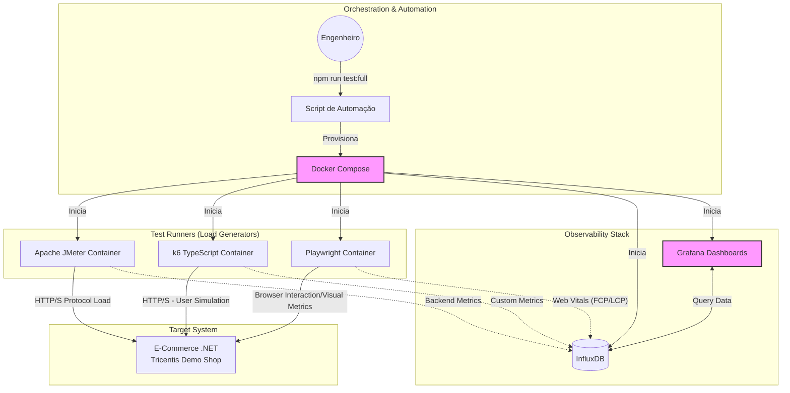
#### RESUMO TÉCNICO PARA EMBEDDING

Este projeto open-source é uma Suíte de Engenharia de Performance projetada para simular jornadas de usuário sob alta carga em uma plataforma de e-commerce .NET (Tricentis Demo Web Shop). A arquitetura é construída sob o paradigma de Infraestrutura como Código (IaC) e "Performance as Code", orquestrada via Docker Compose. A solução utiliza uma abordagem híbrida de geração de carga: Apache JMeter para estresse baseado em protocolo, e k6 (com TypeScript compilado via Webpack) para testes leves e modernos. Para validação de UX, o Playwright simula um navegador real interagindo com a Navigation Timing API para capturar Web Vitals (como FCP e LCP). O pipeline de observabilidade em tempo real é composto por InfluxDB para armazenamento de séries temporais e Grafana para dashboards pré-provisionados. Desafios técnicos superados incluem a Correlação Dinâmica para gerenciamento de tokens Anti-CSRF e Cookies de sessão via regex e parsing HTML, além do tratamento de _race conditions_ assíncronas (AJAX overlays/accordions) no fluxo de "One Page Checkout". Scripts em Shell e entrypoints Docker customizados garantem um ambiente _Plug & Play_ e realizam limpeza automática (auto-cleanup) de artefatos residuais para evitar poluição de dados.

#### CLASSIFICAÇÃO DE TECNOLOGIAS E CONCEITOS

| **Categoria**                | **Tecnologias e Conceitos**                                                                                   |
| ---------------------------- | ------------------------------------------------------------------------------------------------------------- |
| **AI & Machine Learning**    | N/A                                                                                                           |
| **Software Development**     | TypeScript, JavaScript, Shell Scripting, Webpack, Regex, HTML Parsing                                         |
| **Architecture**             | Infrastructure as Code (IaC), Performance as Code, End-to-End Observability, Plug & Play Architecture         |
| **Cloud Computing**          | N/A                                                                                                           |
| **API RESTFul development**  | Autenticação (Anti-CSRF Tokens, Session Cookies)                                                              |
| **Frontend Development**     | Web Vitals (FCP, LCP, domComplete), Navigation Timing API, AJAX, Race Conditions                              |
| **Mobile Development**       | N/A                                                                                                           |
| **Database**                 | InfluxDB (Time-Series Database - TSDB)                                                                        |
| **Data Management**          | Data Pollution Prevention (Auto-Cleanup)                                                                      |
| **Content Management - CMS** | N/A                                                                                                           |
| **System Administration**    | N/A                                                                                                           |
| **DevOps**                   | Docker, Docker Compose, Grafana (Provisioning), Apache JMeter, k6, Playwright, Continuous Performance Testing |
| **Leadership**               | Engenharia de Performance, Arquitetura de Automação                                                           |
| **Coaching**                 | N/A                                                                                                           |
| **Agile Project Management** | N/A                                                                                                           |

***

### 🚀 SideProject:  Favorite Products API

#### 🎯 Visão Geral e Arquitetura da Solução

A **Favorite Products API** é uma solução RESTful robusta, desenvolvida em Laravel, que serve como um backend completo para gerenciar usuários e suas listas de produtos favoritos. O principal objetivo foi criar uma API que não apenas fosse funcional, mas que também exemplificasse as melhores práticas de design de software, como **SOLID**, **Clean Architecture** e segurança.

A arquitetura foi desenhada para ser desacoplada, testável e escalável. O fluxo de uma requisição é orquestrado de forma limpa e eficiente:

1.  As requisições chegam aos **Controllers**, que atuam como uma fina camada de entrada, delegando imediatamente a lógica de validação e autorização para classes de **Form Request** dedicadas. Isso mantém os controllers enxutos e focados em sua responsabilidade principal: gerenciar o fluxo HTTP.
2.  Uma vez validada, a requisição é passada para a **Camada de Serviços**, o coração da lógica de negócio. Serviços como `FavoriteProductService` orquestram as operações, como buscar os IDs dos produtos favoritos no banco de dados (PostgreSQL) e, em seguida, solicitar os detalhes completos desses produtos.
3.  A comunicação com a API externa (`FakeStoreAPI`) é abstraída por um **Contrato (Interface)**, o `ProductServiceContract`. Essa inversão de dependência permite que a implementação concreta (`FakeStoreApiService`) seja facilmente trocada ou "mockada" em testes, garantindo flexibilidade e altíssima testabilidade.
4.  Para garantir a consistência e a segurança dos dados, a aplicação utiliza **DTOs (Data Transfer Objects)** para representar os produtos internamente, desacoplando a lógica de negócio da estrutura da API externa.
5.  Finalmente, todas as respostas são padronizadas através de **API Resources**, que garantem um contrato de API consistente e seguro, evitando o vazamento de dados sensíveis do banco de dados.

Todo o sistema é protegido por **Laravel Sanctum**, uma solução de autenticação leve e ideal para SPAs e aplicações móveis. Para completar, a API é auto-documentada usando **OpenAPI (Swagger)**, gerando uma documentação interativa diretamente a partir de anotações no código, o que acelera drasticamente a integração com equipes de frontend.

Este projeto é **open-source** e o código-fonte completo está disponível no GitHub: **[https://github.com/lfrichter/favorite-products-api](https://github.com/lfrichter/favorite-products-api)**.

#### 👨‍💻 Meu Papel no Projeto

Como **Arquiteto de Soluções** e **Desenvolvedor Back-End Sênior**, fui responsável por:

  * **Desenhar a arquitetura da aplicação**, focando em desacoplamento, testabilidade e escalabilidade através da implementação de padrões como Services, Contracts e DTOs.
  * **Implementar a lógica de negócio principal**, incluindo a integração com a API externa e a gestão do ciclo de vida dos produtos favoritos.
  * **Garantir a segurança da API**, implementando autenticação com Sanctum e corrigindo vulnerabilidades críticas como Insecure Direct Object Reference (IDOR).
  * **Otimizar o desempenho da aplicação**, identificando e solucionando gargalos como o problema de requisições N+1.
  * **Estruturar um ambiente de desenvolvimento robusto** com Docker e estabelecer uma suíte de testes automatizados com Pest para garantir a qualidade e a estabilidade do código.

#### ✨ Pontos Fortes e Desafios Superados

O projeto se destaca por sua arquitetura limpa e resiliente, mas o caminho até ela envolveu superar desafios técnicos significativos:

  * **Desafio de Desempenho (N+1 Requisições):** A abordagem inicial para buscar os detalhes dos produtos favoritos era extremamente ineficiente, gerando uma chamada de API externa para cada item na lista de um usuário.

      * **Superação:** Refatorei a camada de serviço para implementar um método de busca em massa (`findProductsByIds`). Essa mudança transformou N requisições HTTP em uma única operação orquestrada, resultando em uma melhoria drástica na latência e na experiência do usuário.

  * **Vulnerabilidade de Segurança (IDOR):** Uma falha crítica de autorização permitia que qualquer usuário autenticado modificasse o perfil de outro usuário, bastando conhecer seu ID.

      * **Superação:** Implementei uma lógica de autorização baseada em propriedade diretamente na `Form Request` correspondente. A regra agora verifica se o ID do usuário autenticado corresponde ao ID do recurso que ele está tentando modificar. Para garantir que a falha não retorne, criei testes de feature que cobrem cenários de sucesso (200), falha de autorização (403) e não autenticado (401), blindando a aplicação contra regressões.

  * **Rigidez e Baixa Testabilidade:** O acoplamento direto com a implementação do cliente HTTP e a classe de serviço concreta dificultava a criação de testes unitários rápidos e isolados.

      * **Superação:** Adotei os princípios da **Inversão de Dependência (SOLID)**, introduzindo uma interface (`ProductServiceContract`) para o serviço de produtos e utilizando injeção de dependência. Isso desacoplou completamente os controllers da implementação, permitindo "mockar" a dependência nos testes e tornando o sistema flexível para futuras mudanças, como trocar a fonte de dados dos produtos.

  * **Falhas Silenciosas em Serviços Externos:** A API mascarava erros de comunicação com o serviço externo, retornando respostas vazias com status `200 OK`, o que confundia o usuário final e dificultava a depuração.

      * **Superação:** Implementei um tratamento explícito de falhas. Agora, o serviço lança uma exceção customizada (`FakeStoreApiException`) quando a integração falha. Um handler global captura essa exceção e retorna uma resposta HTTP semanticamente correta (ex: `503 Service Unavailable`), comunicando a falha de forma transparente para o cliente.

#### 🌱 Pontos para Evolução Futura

Embora a solução atual seja robusta, a arquitetura foi preparada para evoluções futuras, como:

  * **Implementação de Cache com Redis:** O método `findProductsByIds` cria a base perfeita para adicionar uma camada de cache, reduzindo ainda mais a latência e o número de chamadas à API externa.
  * **Paralelização de Requisições:** A lógica de busca em lote pode ser otimizada utilizando `Promise` ou `Pool` para executar as chamadas HTTP à API externa em paralelo, melhorando o tempo de resposta para listas de favoritos muito grandes.

-----

#### 🛠️ Pilha de Tecnologias (Tech Stack)

| Componente | Tecnologia Utilizada | Papel na Arquitetura |
| :--- | :--- | :--- |
| **Linguagem & Framework** | **PHP 8.3 & Laravel 12** | Base da aplicação, fornecendo um ecossistema robusto para roteamento, ORM e injeção de dependência. |
| **Banco de Dados** | **PostgreSQL** | Armazenamento persistente dos dados de usuários e da relação de seus produtos favoritos. |
| **Autenticação** | **Laravel Sanctum** | Prover autenticação segura e leve baseada em tokens de API, ideal para SPAs e clientes móveis. |
| **Ambiente Local** | **Docker & Docker Compose** | Containerização da aplicação, garantindo um ambiente de desenvolvimento consistente e portável. |
| **Testes Automatizados** | **Pest** | Escrita de testes de feature e unitários de forma elegante e eficiente para garantir a qualidade do código. |
| **Documentação da API** | **Swagger (OpenAPI)** | Geração automática de documentação interativa a partir de anotações no código-fonte. |
| **Integração Externa** | **Fake Store API Client** | Comunicação com o serviço de e-commerce externo para obter dados de produtos. |

-----

#### 🗺️ Diagrama da Arquitetura

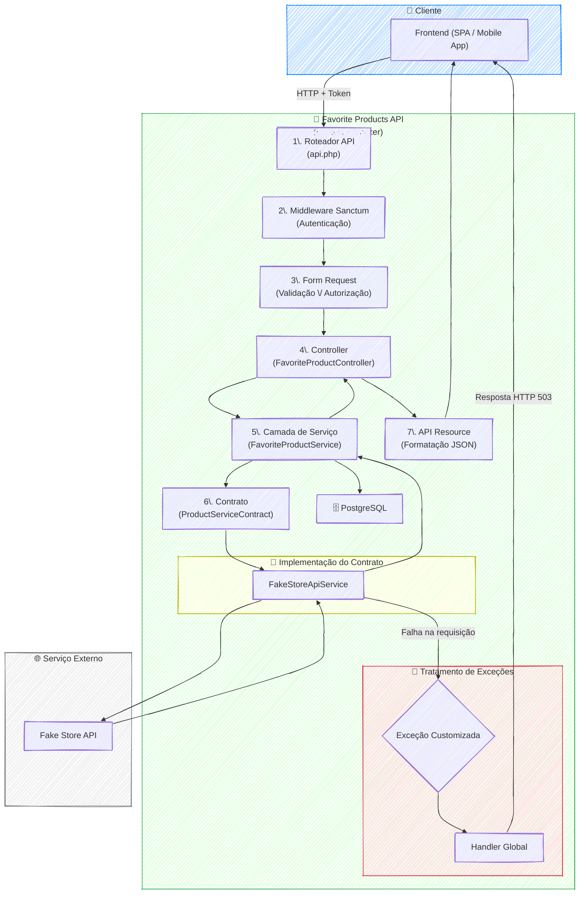

#### RESUMO TÉCNICO PARA EMBEDDING

Este documento detalha a arquitetura de uma **API RESTful**, a **Favorite Products API**, construída com **PHP 8.3** e **Laravel 12**, utilizando **PostgreSQL** como banco de dados. A arquitetura é fortemente baseada nos princípios **SOLID** e **Clean Architecture**, com uma clara separação de responsabilidades. A lógica de negócio é isolada em uma **Camada de Serviços** (`Services`), desacoplada dos `Controllers` através de **Contratos** (`Interfaces`), promovendo alta testabilidade e flexibilidade. A validação e autorização de requisições são gerenciadas por classes de **Form Request**, que também mitigam vulnerabilidades de segurança como **IDOR (Insecure Direct Object Reference)**. Para garantir a integridade e o desacoplamento dos dados, são utilizados **DTOs (Data Transfer Objects)**, e as respostas da API são padronizadas com **API Resources**. O ambiente de desenvolvimento é containerizado com **Docker** e **Docker Compose**, e a qualidade do código é assegurada por testes automatizados com **Pest**. A documentação da API é gerada automaticamente via **Swagger (OpenAPI)**. Desafios técnicos superados incluem a otimização de performance com a resolução do problema de **requisições N+1** na integração com uma API externa e o tratamento explícito de falhas com exceções customizadas. A autenticação é gerenciada pelo **Laravel Sanctum**.

#### CLASSIFICAÇÃO DE TECNOLOGIAS E CONCEITOS

| Categoria | Tecnologias e Conceitos |
| :--- | :--- |
| **AI & Machine Learning** | N/A |
| **Software Development** | PHP 8.3, Laravel 12, SOLID, Clean Code, Pest (Testes Automatizados), cURL |
| **Architecture**| Clean Architecture, RESTful API, Camada de Serviços, Contratos (Inversão de Dependência), DTOs (Data Transfer Objects), Tratamento de Exceções Customizadas, ADRs (Architecture Decision Records) |
| **Cloud Computing** | N/A |
| **API RESTFul development** | Laravel Sanctum, Swagger (OpenAPI), API Resources, Form Requests, Validação de Requisições, Autorização (IDOR Prevention), Integração com APIs Externas (Fake Store API) |
| **Frontend Development** | Vite, TailwindCSS, TypeScript |
| **Mobile Development** | N/A |
| **Database** | PostgreSQL, Migrations & Seeders, Otimização de Queries (N+1) |
| **Data Management** | N/A |
| **Content Management - CMS** | N/A |
| **System Administration** | Docker |
| **DevOps** | Docker Compose, Testes Automatizados |
| **Leadership** | Arquitetura de Soluções |
| **Coaching** | N/A |
| **Agile Project Management** | N/A |

***

### 🚀 SideProject:  Framework de Engenharia de Software Guiado por IA v2.0 Master

#### 🎯 Visão Geral e Arquitetura da Solução

A integração de Inteligência Artificial no desenvolvimento de software frequentemente esbarra em um obstáculo crítico: tratar os modelos como "geradores mágicos" acaba gerando códigos insustentáveis, alucinações e perda do controle arquitetural. Para resolver essa dor, criei o **Framework v2.0 Master**, um ecossistema definitivo que transforma IAs em membros estruturados e operacionais da equipe de engenharia.

A solução atua como um maestro rigoroso. No coração do sistema, abandonamos o código-fonte como fonte primária da verdade e adotamos o paradigma *Spec-as-Code* através da **META SPEC** (Constituição do Projeto). A arquitetura orquestra um "Enxame" de agentes (via conceitos do *Ruflo*) liderados por um orquestrador central (*Chief of Staff*). Para garantir que a IA não saia dos trilhos, implementei as diretrizes de Andrej Karpathy para o comportamento dos agentes e o princípio *Jidoka* (Andon Cord) — garantindo que qualquer anomalia no código ou desvio da arquitetura interrompa a execução imediatamente para um "reset limpo", impedindo que erros se propaguem em cascata ao longo das 7 fases do ciclo de vida **SPARC+DD**.

#### 👨‍💻 Meu Papel no Projeto

* **Arquiteto de Soluções de IA:** Idealizei e desenhei a topologia de enxames hierárquicos e o subsistema de memória isolada.
* **Tech Lead:** Estruturei as diretrizes de governança técnica, definindo os checkpoints de validação rigorosa (Jidoka) e adaptando as regras comportamentais de Karpathy para o contexto de agentes autônomos.
* **Engenheiro de Processos:** Criei o ciclo de vida SPARC+DD e o modelo de engenharia de contexto (WSCI) para garantir escalabilidade na automação do código.

#### ✨ Pontos Fortes e Desafios Superados

O framework brilha ao trazer o rigor da engenharia de software tradicional para o universo estocástico das IAs.

Um dos desafios mais profundos e complexos que enfrentamos foi a **degradação da janela de contexto** (envenenamento e distração) quando os agentes precisavam lidar com bases de código muito grandes ou execuções longas. Superamos isso implementando a **Engenharia de Contexto WSCI** (Write, Select, Compress, Isolate). Ao invés de jogar todo o repositório para o LLM, estruturamos ferramentas precisas que selecionam apenas a AST necessária, comprimem o histórico e isolam a execução em sub-agentes especialistas utilizando **Git Worktrees** (*Superpowers*). Isso não apenas zerou as colisões de arquivos, como blindou a memória de trabalho da IA, permitindo execuções cirúrgicas e altamente confiáveis.

#### 🌱 Pontos para Evolução Futura

* Implementar um mecanismo de **telemetria descentralizada** para medir a eficiência (tempo/tokens) de cada sub-agente sem comprometer a política *Zero-Trust* e a soberania dos dados.
* Automatizar a geração dos registros de decisão (ADRs) a partir de debates síncronos entre múltiplos agentes durante a fase de Arquitetura do SPARC+DD.

---

#### 🛠️ Pilha de Tecnologias (Tech Stack)

| Componente | Tecnologia / Conceito Utilizado | Papel na Arquitetura |
| --- | --- | --- |
| **Governança de IA** | **Spec-as-Code (META SPEC)** | Atua como a "Constituição" imutável do projeto, servindo como a fonte da verdade para o alinhamento e regras de negócio lidas pelos agentes. |
| **Engenharia de Contexto** | **Framework WSCI** | Gerencia a carga cognitiva da IA executando persistência (Write), curadoria de arquivos (Select), sumarização (Compress) e isolamento em sub-agentes (Isolate). |
| **Orquestração de Agentes** | **Ruflo (Queen-Led Swarm)** | Mantém a topologia de enxame onde um nó central (Chief of Staff) coordena tarefas em paralelo para agentes especialistas em janelas de contexto separadas. |
| **Gestão Visual e UI** | **Open Design (MCP)** | Subsistema condicional (`ui_enabled`) via Model Context Protocol para injetar componentes padronizados quando o agente atua no Frontend. |
| **Controle de Qualidade** | **Jidoka & Superpowers** | Realiza validações Andon Cord contínuas, forçando testes reproduzíveis e utilizando *Git Worktrees* para isolar o código de possíveis execuções destrutivas. |

---

#### 🗺️ Diagrama da Arquitetura

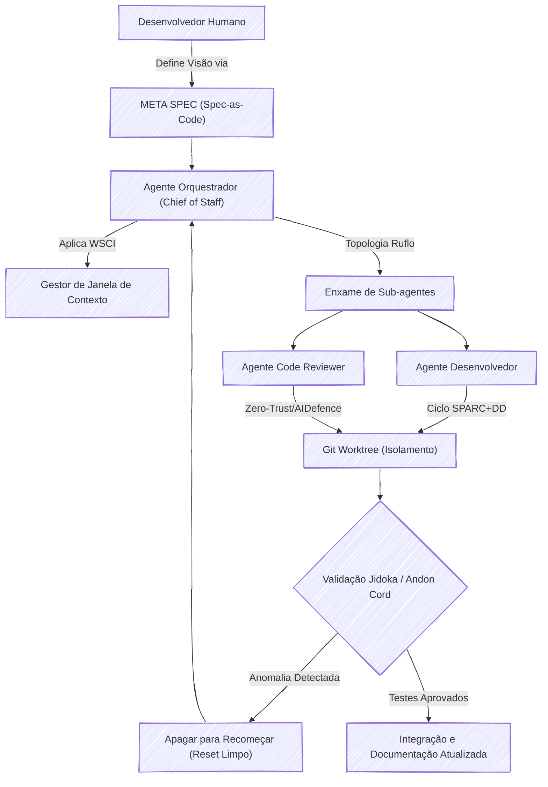

***

### 🚀 SideProject:  Telegram Course Tools

#### 🎯 Visão Geral e Arquitetura da Solução

Em um cenário onde o Telegram se tornou um vasto repositório de conhecimento, o projeto **Telegram Course Tools** emerge como uma solução estratégica para um desafio comum: a desorganização. A plataforma, embora excelente para comunicação, não foi projetada para e-learning, transformando o acompanhamento de múltiplos cursos em uma tarefa frustrante.

Para resolver isso, projetei uma suíte de automação modular em Python, que transforma coleções dispersas de mensagens em uma biblioteca de aprendizado pessoal, organizada e pronta para consumo. A arquitetura foi pensada em um fluxo de trabalho de três etapas independentes e sequenciais, garantindo clareza e manutenibilidade:

1.  **Descoberta e Mapeamento (`listarGrupos.py`):** A primeira etapa atua como um radar, conectando-se à API do Telegram para catalogar todos os cursos em que o usuário está inscrito. O resultado é um "mapa" em formato JSON (`cursos-telegram.json`), que serve como a fonte da verdade para o restante do processo.
2.  **Indexação e Estruturação (`listarVideos.py`):** O coração da solução. Este módulo consome o mapa gerado e, para cada curso, extrai meticulosamente o histórico de mensagens. Usando expressões regulares para identificar padrões como "Módulo" e "Aula", ele estrutura o conteúdo bruto e o converte em sumários elegantes em formato Markdown, um para cada curso.
3.  **Consumo e Download (`downloadVideosById.py`):** Com os sumários em mãos, o usuário pode tomar decisões estratégicas sobre o que estudar. Esta etapa final permite o download sob demanda de todo o conteúdo de vídeo de um curso específico, de forma otimizada para evitar duplicatas e com uma barra de progresso (`tqdm`) para uma experiência de usuário aprimorada.

O resultado final é o empoderamento do usuário, que agora possui uma biblioteca de aprendizado curada, acessível e pronta para consumo offline.

#### 👨‍💻 Meu Papel no Projeto

Como idealizador e único desenvolvedor deste projeto, minhas responsabilidades abrangeram todo o ciclo de vida da solução:

  * **Arquiteto da Solução:** Defini a arquitetura modular em três etapas, garantindo que cada componente tivesse uma responsabilidade única e que o fluxo de dados entre eles fosse limpo e eficiente.
  * **Desenvolvedor Python:** Escrevi todo o código para os scripts de automação, desde a interação com a API do Telegram usando a biblioteca `Telethon` até a lógica de parsing com expressões regulares e a manipulação do sistema de arquivos.
  * **Engenheiro de Dados (em pequena escala):** Modelei o fluxo de dados, definindo como as informações seriam extraídas (dados brutos), armazenadas temporariamente (JSON) e transformadas em um produto final de valor (sumários em Markdown).
  * **Product Owner:** Identifiquei a dor inicial (minha própria necessidade), defini os objetivos e requisitos do projeto e validei que a solução final atendia efetivamente ao problema proposto.

#### ✨ Pontos Fortes e Desafios Superados

A principal força do projeto reside em sua capacidade de **transformar caos em clareza**. O maior desafio era lidar com conteúdo valioso, porém totalmente não estruturado, dentro do Telegram.

  * **Superação do Caos com Inteligência de Parsing:** O ponto de virada técnico foi a implementação de uma lógica de parsing robusta com expressões regulares (`re`). Essa "inteligência" permitiu que o script `listarVideos.py` lesse textos de formato livre e os organizasse em uma hierarquia lógica de módulos e aulas, criando os sumários que são o principal entregável de valor do projeto.
  * **Eficiência e Experiência do Usuário:** Em vez de uma abordagem simplista, o script de download foi projetado para ser eficiente. Ele verifica a existência e o tamanho dos arquivos antes de iniciar o download, economizando tempo e banda. A inclusão da biblioteca `tqdm` foi uma decisão consciente para melhorar a experiência do usuário em processos demorados, fornecendo feedback visual claro e profissional.
  * **Arquitetura Modular:** A separação em três scripts distintos não só organiza o código, mas também permite a execução seletiva. O usuário pode apenas atualizar o mapa de cursos ou re-gerar um sumário sem precisar executar o fluxo completo, tornando a ferramenta flexível e ágil.

#### 🌱 Pontos para Evolução Futura

Embora a solução seja totalmente funcional para seu propósito inicial, existem caminhos claros para evolução:

1.  **Interface Gráfica (UI):** Desenvolver uma interface de usuário simples (Web com Flask/Streamlit ou Desktop com PyQt) para eliminar a necessidade de executar scripts manualmente via terminal, tornando a ferramenta acessível a um público menos técnico.
2.  **Busca Avançada:** Implementar uma funcionalidade de busca que permita ao usuário pesquisar por palavras-chave em todos os sumários gerados, ajudando a encontrar aulas específicas sobre um determinado tópico em toda a sua biblioteca de cursos.

-----

#### 🛠️ Pilha de Tecnologias (Tech Stack)

| Componente | Tecnologia Utilizada | Papel na Arquitetura |
| :--- | :--- | :--- |
| **Linguagem Principal** | **Python 3.8+** | A base para toda a automação, orquestrando a lógica, a interação com APIs e a manipulação de arquivos. |
| **Comunicação com API** | **Telethon** | Cliente assíncrono para interagir com a API do Telegram, permitindo buscar históricos e baixar mídias de forma robusta. |
| **Interface de Usuário (CLI)** | **tqdm** | Fornece feedback visual com barras de progresso durante os downloads, melhorando significativamente a experiência do usuário. |
| **Estruturação de Conteúdo** | **`re` (Expressões Regulares)** | O motor de inteligência para identificar padrões em texto não-estruturado e organizar as aulas em módulos nos sumários. |
| **Manipulação de Dados** | **`json`** | Utilizado como o formato de intercâmbio de dados entre a etapa de mapeamento e a de indexação, garantindo um "contrato" claro. |
| **Gestão do Sistema** | **`os`** | Essencial para interações com o sistema de arquivos, como criar diretórios para os cursos e verificar a existência de vídeos. |
| **Programação Assíncrona** | **`asyncio`** | Usado implicitamente pelo Telethon para otimizar a comunicação de rede com a API do Telegram, tornando as operações mais rápidas. |

-----

#### 🗺️ Diagrama da Arquitetura

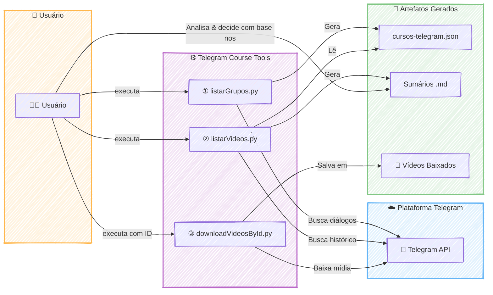

---
#### RESUMO TÉCNICO PARA EMBEDDING

Este projeto implementa uma suíte de automação em Python para organizar conteúdo de cursos dispersos no Telegram. A arquitetura é modular e sequencial, composta por três scripts independentes. O primeiro (`listarGrupos.py`), usando a biblioteca `Telethon` e `asyncio`, conecta-se à API do Telegram para mapear os cursos do usuário, gerando um inventário em formato `JSON`. O segundo script (`listarVideos.py`) consome o `JSON`, extrai o histórico de mensagens e aplica expressões regulares (`re`) para fazer o parsing do conteúdo não-estruturado, identificando módulos e aulas para gerar sumários estruturados em `Markdown`. A etapa final (`downloadVideosById.py`) permite o download sob demanda dos vídeos, utilizando a biblioteca `tqdm` para exibir uma barra de progresso e o módulo `os` para gerenciar o sistema de arquivos, evitando downloads duplicados. A solução efetivamente transforma dados caóticos em uma biblioteca de aprendizado organizada, exemplificando um fluxo de ETL (Extract, Transform, Load) em pequena escala, focado em automação, parsing de dados e melhoria da experiência do usuário (UX) em uma interface de linha de comando (CLI).

#### CLASSIFICAÇÃO DE TECNOLOGIAS E CONCEITOS

| Categoria | Tecnologias e Conceitos |
| :--- | :--- |
| **AI & Machine Learning** | N/A |
| **Software Development** | Python, Automação de Scripts, Programação Assíncrona (asyncio), Manipulação de Sistema de Arquivos (os), Expressões Regulares (re), Modularidade, CLI (Command-Line Interface) |
| **Architecture**| Arquitetura Modular, Arquitetura de Solução, Fluxo de Dados (ETL), Design de Componentes Independentes |
| **Cloud Computing** | Consumo de API de Plataforma (Telegram API) |
| **API RESTFul development** | Consumo de API (Telethon) |
| **Frontend Development** | CLI User Experience (tqdm) |
| **Mobile Development** | N/A |
| **Database** | N/A |
| **Data Management** | Extração de Dados, Transformação de Dados (Parsing), JSON, Markdown, Dados Não-Estruturados |
| **Content Management - CMS** | N/A |
| **System Administration** | Gerenciamento de Arquivos e Diretórios |
| **DevOps** | N/A |
| **Leadership** | Arquitetura de Solução, Product Ownership, Tomada de Decisão Técnica |
| **Coaching** | N/A |
| **Agile Project Management** | Definição de Requisitos, Validação de Solução, Product Owner |

***

### 🚀 SideProject:  Twin Quest: Desafio Full-Stack

#### 🎯 Visão Geral e Arquitetura da Solução

O "Twin Quest" nasceu como uma resposta criativa a um desafio, a arquitetura foi desenhada para ser moderna, robusta e reativa. O coração da aplicação é um **backend em Laravel** que serve uma API RESTful segura e eficiente. Ele é o maestro que orquestra a comunicação com a API. No frontend, uma interface limpa e fluida, construída com **Vue 3 (Composition API) e TypeScript**, oferece uma experiência de usuário impecável. O estado da aplicação é gerenciado de forma centralizada pelo **Pinia**, garantindo que os dados fluam de maneira reativa e instantânea da API para a tela do usuário.

#### 👨‍💻 Meu Papel no Projeto

Como idealizador e único desenvolvedor deste projeto, atuei em todas as frentes como **Desenvolvedor Full-Stack**, com as seguintes responsabilidades:

  * **Arquitetura e Desenvolvimento Back-End:** Construí toda a API RESTful com Laravel, definindo os endpoints, a lógica de negócio e a orquestração da comunicação com o serviço de IA.
  * **Desenvolvimento Front-End:** Criei a interface de usuário reativa utilizando Vue 3, TypeScript e a Composition API, focando em uma experiência limpa e intuitiva.
  * **Gestão de Estado:** Implementei o Pinia para um gerenciamento de estado global eficiente e previsível no lado do cliente.
  * **Qualidade de Código e Testes:** Garanti a estabilidade e a confiabilidade da API escrevendo uma suíte de testes completa com Pest, adotando uma abordagem TDD.

#### ✨ Pontos Fortes e Desafios Superados

O maior trunfo do projeto é a sua **execução técnica coesa e moderna**, integrando perfeitamente o frontend e o backend. A utilização de TypeScript de ponta a ponta trouxe uma camada extra de segurança e manutenibilidade ao código.

Um desafio significativo foi implementação de uma **suíte de testes robusta com Pest** foi crucial para garantir que a lógica de negócio da API fosse à prova de falhas, um pilar para a qualidade do projeto.

#### 🌱 Pontos para Evolução Futura

Para o futuro, a aplicação poderia evoluir com a implementação de um **sistema de cache (como Redis)** para temas populares, otimizando custos de API e a velocidade de resposta. Outra melhoria seria adicionar **autenticação de usuários** para que eles possam salvar e revisitar seu histórico de "quests".

-----

#### 🛠️ Pilha de Tecnologias (Tech Stack)

| Componente                  | Tecnologia Utilizada        | Papel na Arquitetura                                                                                                |
| :-------------------------- | :-------------------------- | :------------------------------------------------------------------------------------------------------------------ |
| **Backend (API)**           | **Laravel**                 | Orquestra a lógica de negócio, gerencia as rotas da API e se comunica com o serviço de IA Generativa.               |
| **Frontend (UI)**           | **Vue 3 (Composition API)** | Constrói a interface de usuário reativa e dinâmica, permitindo uma interação fluida com o usuário.                  |
| **Tipagem de Código**       | **TypeScript**              | Garante a segurança de tipos em todo o projeto, tanto no frontend quanto no backend (se aplicável), reduzindo bugs. |
| **Gerenciamento de Estado** | **Pinia**                   | Centraliza e gerencia o estado da aplicação no frontend de forma simples, reativa e eficiente.                      |
| **Testes Automatizados**    | **Pest**                    | Garante a confiabilidade e a qualidade da API do Laravel através de uma suíte de testes elegante e poderosa (TDD).  |

-----

#### 🗺️ Diagrama da Arquitetura

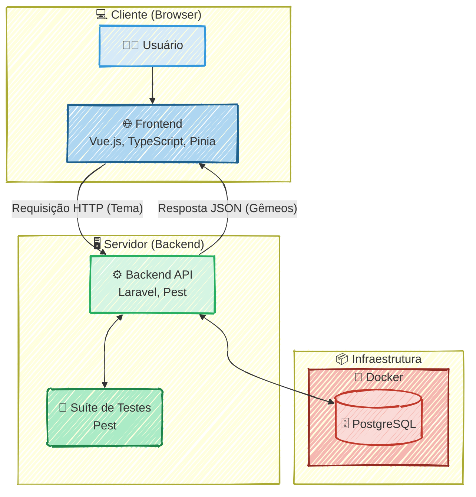

---
#### RESUMO TÉCNICO PARA EMBEDDING

Desenvolvimento de uma aplicação web full-stack, "Twin Quest", a arquitetura da solução é baseada em um backend com Laravel que serve uma API RESTful. O frontend é uma interface de usuário reativa construída com Vue 3, Composition API e TypeScript para garantir tipagem segura. O gerenciamento de estado global no lado do cliente é realizado de forma centralizada pelo Pinia. A qualidade e estabilidade da API foram asseguradas através de uma suíte de testes automatizados com Pest, adotando uma abordagem TDD (Test-Driven Development). A infraestrutura inclui PostgreSQL, com planos de evolução para implementar um sistema de cache com Redis e autenticação de usuários.

#### CLASSIFICAÇÃO DE TECNOLOGIAS E CONCEITOS

| Categoria                    | Tecnologias e Conceitos                                                                                               |
| :--------------------------- | :-------------------------------------------------------------------------------------------------------------------- |
| **Software Development**     | Desenvolvedor Full-Stack, Laravel, Vue 3, TypeScript, Pinia, Pest, Test-Driven Development (TDD), Qualidade de Código |
| **Architecture**             | Arquitetura Full-Stack, API RESTful, Gestão de Estado (Pinia), Sistema de Cache (Redis), Autenticação de Usuários     |
| **Cloud Computing**          | N/A                                                                                                                   |
| **API RESTFul development**  | API RESTful, Laravel, Endpoints, Requisição HTTP, Resposta JSON                                                       |
| **Frontend Development**     | Vue 3 (Composition API), TypeScript, Pinia, Interface de Usuário Reativa                                              |
| **Mobile Development**       | N/A                                                                                                                   |
| **Database**                 | PostgreSQL, Redis                                                                                                     |
| **Data Management**          | N/A                                                                                                                   |
| **Content Management - CMS** | N/A                                                                                                                   |
| **System Administration**    | N/A                                                                                                                   |
| **DevOps**                   | Testes Automatizados, Pest, Docker                                                                                    |
| **Leadership**               | Liderança Técnica (Idealizador e único desenvolvedor)                                                                 |
| **Coaching**                 | N/A                                                                                                                   |
| **Agile Project Management** | N/A                                                                                                                   |

***

### 🚀 SideProject:  Web3 React dApp Prototype

#### 🎯 Visão Geral e Arquitetura da Solução

A transição da Web2 para a Web3 pode ser um terreno intimidador, cheio de jargões e integrações complexas. O objetivo central deste projeto foi criar um *boilerplate* fundamental e limpo para aplicações descentralizadas (dApps). Ele resolve a dor inicial de configuração, entregando uma base robusta que demonstra as funcionalidades essenciais da Web3: conexão de carteira, leitura de dados *on-chain* e interação com *smart contracts* na rede de testes Sepolia.

Do ponto de vista arquitetural, a solução foi desenhada para ser rápida e reativa. O usuário interage com uma interface moderna servida pelo Vite e construída em React. Quando o usuário clica em "Connect", a aplicação utiliza os *hooks* do Wagmi para se comunicar com a extensão de carteira do navegador (como o MetaMask). A partir daí, o Viem atua como o motor de comunicação com a blockchain Ethereum (Sepolia), permitindo ler a saudação pública de um contrato inteligente "Greeter" e enviar transações para alterá-la, tudo com um gerenciamento de estado elegante fornecido pelo React Query.

#### 👨‍💻 Meu Papel no Projeto

Neste projeto, atuei de ponta a ponta na construção do front-end descentralizado, assumindo os seguintes chapéus:

* **Desenvolvedor Front-End Web3:** Responsável por estruturar a interface em React com TypeScript, garantindo uma tipagem estática segura e uma experiência de usuário fluida.
* **Integrador de Blockchain:** Configurei os clientes do Wagmi e Viem para estabelecer a ponte de comunicação entre a interface web e a rede Sepolia, gerenciando as conexões via *injected providers* (MetaMask).
* **Engenheiro de UX/UI para Web3:** Implementei o tratamento de estados de carregamento e confirmações de transações, transformando a latência natural da blockchain em uma experiência transparente para o usuário final.

#### ✨ Pontos Fortes e Desafios Superados

O grande ponto forte desta solução é a sua base tecnológica modernizada (Vite + Wagmi + Viem), que substitui bibliotecas legadas mais pesadas por uma abordagem reativa e otimizada para a experiência do desenvolvedor (DX).

O principal desafio técnico enfrentado foi **o gerenciamento do estado assíncrono das transações na blockchain**. Na Web3, uma transação não é instantânea; ela precisa ser assinada, enviada para a rede e minerada, o que pode deixar a interface congelada ou confusa se não for bem tratado.
**Como superamos:** Orquestramos um fluxo reativo utilizando os *hooks* `useContractWrite` e `useWaitForTransactionReceipt`. Em vez de fazer o usuário adivinhar o status da operação, a interface monitora ativamente o recibo da transação na blockchain. Assim que a rede confirma o bloco, o sistema dispara automaticamente uma nova leitura (`useContractRead`), atualizando a mensagem na tela em tempo real, sem a necessidade de *reloads* manuais, transformando um processo complexo em uma vitória de usabilidade.

#### 🌱 Pontos para Evolução Futura

* **Suporte a Múltiplas Carteiras:** Integrar o WalletConnect para permitir o acesso via carteiras mobile, expandindo a acessibilidade do dApp.
* **Suporte Multichain:** Abstrair a configuração de rede para permitir que o usuário alterne fluidamente entre Sepolia, Mainnet, Arbitrum ou Optimism diretamente pela interface.

---

#### 🛠️ Pilha de Tecnologias (Tech Stack)

| Componente | Tecnologia Utilizada | Papel na Arquitetura |
| --- | --- | --- |
| **Front-End / UI** | **React.js & Vite** | Responsável pela renderização da interface do usuário de forma reativa e pelo empacotamento ultrarrápido do código em ambiente de desenvolvimento. |
| **Linguagem** | **TypeScript** | Adiciona tipagem estática ao projeto, prevenindo erros em tempo de execução e melhorando a integração com os ABIs dos contratos inteligentes. |
| **Gerenciamento Web3** | **wagmi & React Query** | Fornece *hooks* React otimizados para interagir com contas, provedores e contratos, gerenciando o cache e o estado assíncrono das requisições com a blockchain. |
| **Comunicação Blockchain** | **Viem** | Atua como a biblioteca de baixo nível para interagir com a Ethereum, substituindo o ethers.js com foco em performance e tamanho de *bundle* reduzido. |
| **Carteira / Provedor** | **MetaMask (Injected)** | Gerencia as chaves privadas do usuário, injeta o provedor Web3 no navegador e assina as transações enviadas para a rede Sepolia. |

---

#### 🗺️ Diagrama da Arquitetura

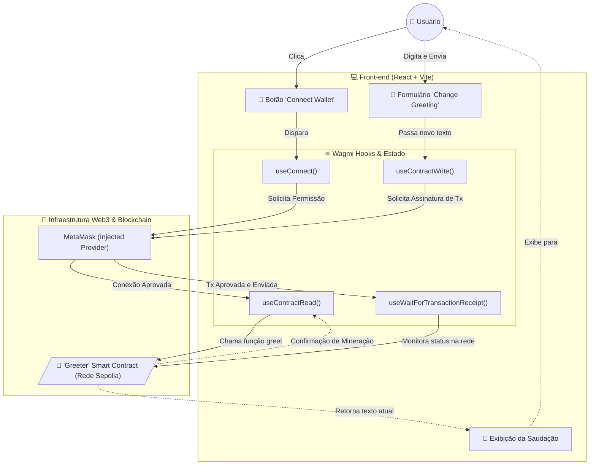