### 🚀 Project:  Controle de Produção Editorial — Workflow e Cronometragem de Livros
**Categoria:** ⚙️ Tier 2: Engenharia de Performance & Integrações

#### 🎯 Visão Geral e Arquitetura da Solução

Na **Editora FTD S/A**, um dos maiores desafios operacionais na publicação de obras didáticas e de literatura era a rastreabilidade e a gestão de prazos durante o ciclo de produção dos livros físicos e digitais. Cada obra passava por dezenas de etapas sequenciais e paralelas — redação, revisão de texto, iconografia, diagramação, checagem técnica e aprovação editorial —, gerando pontos cegos na esteira produtiva quando controlada por planilhas manuais.

Para solucionar essa complexidade, desenvolvi uma aplicação web corporativa interna voltada ao mapeamento digital, cronometragem precisa e controle de fluxo (*Workflow Management*). A arquitetura foi concebida utilizando desenvolvimento baseado em componentes (**CBD - Component-Based Development**) com **ColdFusion (Java Servlets)** sobre banco de dados **Microsoft SQL Server**, hospedada em ambiente corporativo **IIS / Windows Server**.

#### 👨‍💻 Meu Papel no Projeto

Como **Desenvolvedor Web & Engenheiro de Aplicações**:
- **Mapeamento de Processos:** Análise detalhada dos fluxos de trabalho editoriais junto a editores, revisores e designers.
- **Engenharia de Software (CBD):** Arquitetura e programação de componentes modulares reutilizáveis em ColdFusion (CFCs - ColdFusion Components), assegurando padronização do código.
- **Motor de Cronometragem & Workflow:** Desenvolvimento da lógica de transição de estados dos protótipos de livros e cronometragem de tempo de permanência em cada departamento.
- **Geração de Indicadores (Dashboard):** Criação de relatórios analíticos de produtividade e detecção antecipada de gargalos para a diretoria editorial.

#### 📊 Resultados Quantificados

- ⏱️ **Visibilidade em Tempo Real:** 100% de rastreabilidade do status e histórico de cada livro em produção na editora.
- 📉 **Redução de Gargalos Operacionais:** Identificação imediata de atrasos interdepartamentais, otimizando o cronograma de lançamentos para o ano letivo.
- 🧩 **Arquitetura Componentizada:** Redução significativa no tempo de manutenção através da reutilização de componentes (CBD).

#### 🛡️ Segurança & Mitigações OWASP Top 10

- **A01:2021 — Broken Access Control:** Controle de acesso hierárquico integrado à infraestrutura corporativa, garantindo que apenas departamentos autorizados avançassem o status dos protótipos.
- **A03:2021 — Injection:** Parametrização rígida de queries via tags `<cfqueryparam>` no ColdFusion, eliminando riscos de SQL Injection.
- **A07:2021 — Identification and Authentication Failures:** Gestão segura de sessões corporativas protegidas contra interceptação na intranet.

#### ✨ Pontos Fortes e Desafios Superados

- **Modelagem de Processo Produtivo Complexo:** A tradução de um fluxo editorial dinâmico e sujeito a idas e vindas de revisão em um modelo de máquina de estados confiável e intuitivo para equipes não técnicas.

#### 🌱 Pontos Para Evolução Futura

- Modernização para arquitetura de microsserviços com filas de mensageria assíncrona.
- Integração de notificações automáticas em tempo real para dispositivos móveis dos gestores.

---

#### 🛠️ Pilha de Tecnologias (Tech Stack)

| Componente | Tecnologia Utilizada | Papel na Arquitetura |
| :--- | :--- | :--- |
| **Backend & Componentes** | ColdFusion (Java Servlets / CFCs) | Lógica de workflow, máquina de estados e regras de negócio |
| **Arquitetura** | Component-Based Development (CBD) | Separação modular de responsabilidades e reuso de componentes |
| **Banco de Dados** | Microsoft SQL Server | Armazenamento relacional de etapas, prazos, logs e auditoria |
| **Servidor Web & Infra** | Windows Server / IIS | Hospedagem corporativa na intranet da Editora FTD |

---

#### 🗺️ Diagrama da Arquitetura

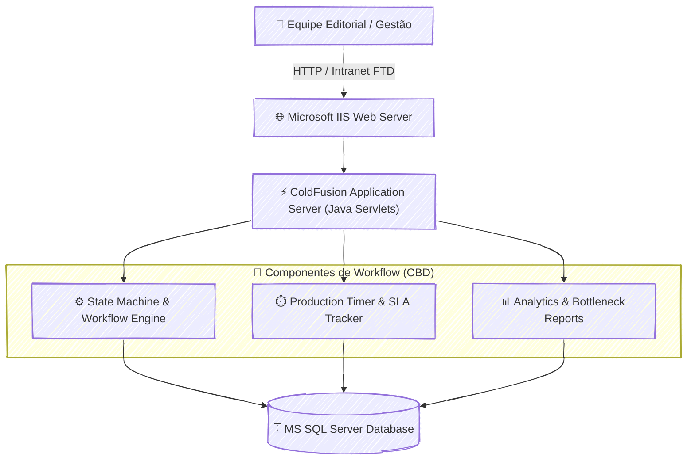

***

### 🚀 Project:  Gerenciador Iconográfico — Banco de Imagens Corporativo e Gestão DAM
**Categoria:** ⚙️ Tier 2: Engenharia de Performance & Integrações

#### 🎯 Visão Geral e Arquitetura da Solução

Na **Editora FTD S/A**, o acervo iconográfico (fotos, ilustrações científicas, mapas, infográficos e obras de arte) é um patrimônio estratégico essencial para a produção de centenas de títulos didáticos simultâneos. Antes da implantação do sistema, a localização de ativos e a conferência de contratos de direitos autorais e licenças de uso eram manuais, gerando lentidão no fechamento de livros e riscos jurídicos de uso indevido de imagens.

Para atender a essa demanda em escala corporativa, foi concebido o **Gerenciador Iconográfico**, uma plataforma completa de Gestão de Ativos Digitais (**DAM - Digital Asset Management**). A solução foi arquitetada em **ColdFusion (Java Servlets)** sobre **Microsoft SQL Server**, utilizando desenvolvimento baseado em componentes (**CBD**), proporcionando catalogação com metadados avançados, controle rigoroso de direitos autorais e motor de busca com múltiplos critérios de refinamento.

#### 👨‍💻 Meu Papel no Projeto

Como **Desenvolvedor Web & Membro da Equipe de Engenharia**:
- **Mecanismo de Busca Avançada:** Arquitetura e programação do motor de busca com refinamento dinâmico por palavras-chave, fotógrafos, datas, coleções e status de licenciamento.
- **Módulo de Catalogação & Metadados:** Desenvolvimento da interface e regras de negócio para associação de imagens a metadados essenciais (direitos autorais, vigência de licença, resoluções e restrições de uso).
- **Engenharia de Componentes (CBD):** Estruturação de componentes reutilizáveis em ColdFusion para garantir alta performance e escalabilidade no tráfego de arquivos e metadados.
- **Integração de Storage & Servidores:** Configuração de diretórios seguros de armazenamento em alta capacidade no Windows Server / IIS.

#### 📊 Resultados Quantificados

- 🔍 **Redução de 80% no Tempo de Busca de Imagens:** Designers e pesquisadores iconográficos passaram a localizar ativos em segundos através de filtros combinados.
- ⚖️ **Mitigação de Riscos Jurídicos:** Controle automatizado de vigência de licenças e direitos autorais preveniu o uso indevido de imagens expiradas.
- 📦 **Centralização de Acervo Massivo:** Unificação de milhares de ativos digitais de alta resolução em um repositório institucional confiável.

#### 🛡️ Segurança & Mitigações OWASP Top 10

- **A01:2021 — Broken Access Control:** Restrição estrita de download de arquivos originais em alta resolução baseada no perfil de permissão do usuário.
- **A03:2021 — Injection:** Parametrização rígida de consultas SQL com `<cfqueryparam>` no ColdFusion, blindando o motor de busca contra injeções.
- **A05:2021 — Security Misconfiguration:** Armazenamento de ativos fora da raiz pública do servidor web (Web Root), com entrega intermediada por scripts controlados de autorização.

#### ✨ Pontos Fortes e Desafios Superados

- **Performance na Busca Multidimensional:** A combinação de múltiplos critérios de busca em uma base com grande volume de registros foi otimizada com índices específicos no SQL Server e queries pré-compiladas.

#### 🌱 Pontos Para Evolução Futura

- Extração e indexação automática de metadados EXIF/IPTC no upload de novas imagens.
- Busca por similaridade visual utilizando visão computacional e inteligência artificial.

---

#### 🛠️ Pilha de Tecnologias (Tech Stack)

| Componente | Tecnologia Utilizada | Papel na Arquitetura |
| :--- | :--- | :--- |
| **Backend & Engine DAM** | ColdFusion (Java Servlets / CFCs) | Lógica de catalogação, motor de busca, autenticação e entrega de mídias |
| **Padrão de Projeto** | Component-Based Development (CBD) | Arquitetura modular e reuso de componentes |
| **Banco de Dados** | Microsoft SQL Server | Armazenamento de metadados, termos de busca, usuários e contratos de direitos |
| **Servidor Web & Infra** | Windows Server / IIS | Hospedagem corporativa e gerenciamento de armazenamento de alta capacidade |

---

#### 🗺️ Diagrama da Arquitetura

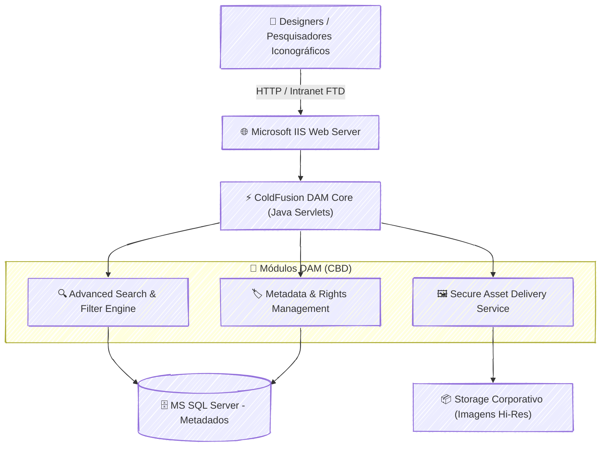

***

### 🚀 Project:  Gestão de Acessos Para Conteúdo Educacional — Plataforma Distribuída Multi-Filiais
**Categoria:** 🏆 Tier 1: AI, Cloud Architecture & SaaS

#### 🎯 Visão Geral e Arquitetura da Solução

A **Editora FTD S/A** opera nacionalmente com 24 filiais distribuídas por todas as regiões do Brasil. Com o avanço das mídias digitais e materiais de apoio pedagógico aos livros didáticos adotados, surgiu a necessidade crítica de uma plataforma centralizada e distribuída capaz de conceder acessos digitais exclusivos a professores, coordenadores e escolas parceiras com base estrita nas coleções físicas adquiridas.

O sistema original dependia de consultas diretas em tempo real ao ERP legado corporativo (**Progress DB**) via conexões ODBC, o que causava frequentes lentidões, timeouts e instabilidades de rede nas filiais. A solução envolveu a concepção de uma arquitetura distribuída moderna, introduzindo pioneiramente o **ColdFusion (Java Servlets)** na empresa em substituição ao ASP legado, combinada com uma estratégia de pipeline de extração e sincronização de dados (ETL) para um banco **Microsoft SQL Server** dedicado, proporcionando alta velocidade e governança descentralizada para as 24 filiais.

#### 👨‍💻 Meu Papel no Projeto

Como **Desenvolvedor Web Sênior & Co-Arquiteto da Solução**:
- **Pioneirismo Tecnológico:** Análise comparativa, recomendação técnica e introdução do **ColdFusion** como novo padrão de desenvolvimento web na Editora FTD, multiplicando a produtividade das equipes.
- **Estratégia de Dados & Desacoplamento de ERP:** Concepção da rotina de extração, transformação e carga dos dados comerciais do ERP Progress para um banco SQL Server otimizado para a web.
- **Co-Desenho da Arquitetura Distribuída:** Trabalho direto com *Felipe Richter* no desenho da topologia e lógica de concessão descentralizada de permissões para as filiais.
- **Segurança & Governança de Conteúdos:** Implementação das regras de autorização granulares baseadas em catálogos de livros e escolas associadas.

#### 📊 Resultados Quantificados

- ⚡ **Eliminação de 100% dos Timeouts de ERP:** O desacoplamento do Progress DB via banco SQL Server dedicado reduziu o tempo de consulta de acessos para milissegundos.
- 🏢 **24 Filiais Integradas em Tempo Real:** Autonomia completa para os administradores regionais gerenciarem acessos pedagógicos sem sobrecarregar a matriz.
- 📈 **Aumento Expressivo na Produtividade:** A transição do ASP legado para ColdFusion reduziu o tempo de entrega de novos módulos em mais de 40%.

#### 🛡️ Segurança & Mitigações OWASP Top 10

- **A01:2021 — Broken Access Control:** Validação rigorosa de vínculo entre a escola, coleção didática e professor antes de liberar o acesso a materiais de apoio exclusivos.
- **A03:2021 — Injection:** Parametrização rígida de consultas SQL com `<cfqueryparam>` no ColdFusion, eliminando vulnerabilidades de injeção.
- **A07:2021 — Identification and Authentication Failures:** Mecanismo seguro de autenticação com senhas protegidas e renovação de sessão por filial.

#### ✨ Pontos Fortes e Desafios Superados

- **Superação da Lentidão de Conexões ODBC Legadas:** O gargalo crítico de latência ao consultar diretamente o ERP Progress foi solucionado com uma arquitetura de dados intermediária em SQL Server, isolando a carga transacional do ERP de retaguarda.
- **Transformação Cultural de Tecnologia:** A introdução bem-sucedida de uma nova stack de desenvolvimento (ColdFusion/Java Servlets) em uma empresa de grande porte, demonstrando liderança técnica e visão de inovação.

#### 🌱 Pontos para Evolução Futura

- Transição para single sign-on (SSO) com federação de identidades para redes de ensino.
- Disponibilização de APIs seguras para integração direta com os ambientes virtuais de aprendizagem (LMS) das escolas.

---

#### 🛠️ Pilha de Tecnologias (Tech Stack)

| Componente | Tecnologia Utilizada | Papel na Arquitetura |
| :--- | :--- | :--- |
| **Backend & Aplicação Web** | ColdFusion (Java Servlets / CFCs) | Lógica de governança de acessos, autenticação e regras de negócio |
| **Banco de Dados Web** | Microsoft SQL Server | Armazenamento de alta performance para acessos, usuários e permissões |
| **ERP Corporativo (Legado)** | Progress Database (via ODBC) | Fonte primária de dados comerciais e de faturamento de livros |
| **Tecnologia Legada Substituída**| ASP Clássico | Stack original migrado com sucesso para ColdFusion |
| **Servidor Web & Infra** | Windows Server / IIS | Hospedagem corporativa e distribuição multi-filiais |

---

#### 🗺️ Diagrama da Arquitetura

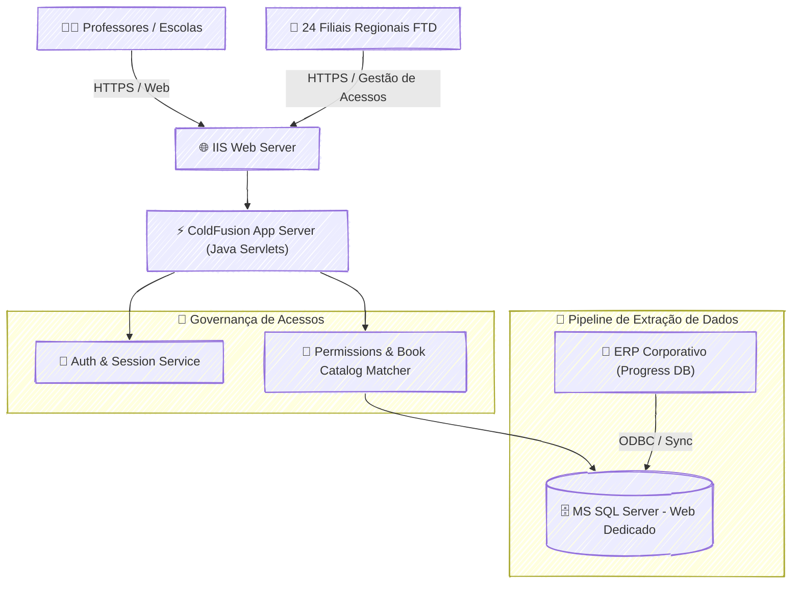

***

### 🚀 Project:  ASO — Reconstrução e Modernização de Sistema de Gestão de Saúde
**Categoria:** ⚙️ Tier 2: Engenharia de Performance & Integrações

#### 🎯 Visão Geral e Arquitetura da Solução

O projeto na **ASO** consistiu na recuperação emergencial e subsequente reconstrução completa de uma plataforma legada corporativa de gestão hospitalar, clínicas e prontuários médicos desenvolvida em **PHP Orientado a Objetos**. O sistema original sofria de instabilidade crônica, alto acoplamento e frequentes quedas de banco de dados, colocando em risco a continuidade dos atendimentos clínicos diários.

A intervenção foi estruturada em duas fases estratégicas: uma estabilização emergencial nos primeiros 15 dias para restabelecer a operação hospitalar crítica, seguida por um ciclo profundo de 10 meses de engenharia de software para refatoração arquitetural, reescrita de módulos centrais e migração de servidores locais para a nuvem **Amazon Web Services (AWS)**.

#### 👨‍💻 Meu Papel no Projeto

Como **Desenvolvedor Full-Stack Sênior & Responsável Técnico**:
- **Diagnóstico & Recuperação Emergencial:** Identificação de gargalos estruturais de concorrência e aplicação de correções críticas em 15 dias.
- **Engenharia de Reconstrução:** Reescrita completa do código em PHP OOP moderno com separação estrita de camadas (Domain, Service, Data Access).
- **Otimização de Banco de Dados:** Normalização de esquemas, reindexação de tabelas relacionais em **MySQL** e eliminação de queries bloqueantes.
- **Arquitetura em Nuvem & Migração AWS:** Planejamento e execução do deploy na AWS utilizando **EC2** para computação, **Amazon RDS (MySQL)** para alta disponibilidade e **S3** para armazenamento de prontuários e laudos médicos.

#### 📊 Resultados Quantificados

- 🚨 **Estabilização Crítica em 15 Dias:** Recuperação do sistema garantindo continuidade ininterrupta para hospitais e clínicas clientes.
- 🏗️ **100% de Refatoração Arquitetural:** Eliminação de débito técnico acumulado e transição para arquitetura desacoplada e manutenível.
- ☁️ **Migração AWS Concluída:** Adoção de infraestrutura em nuvem elástica com redução significativa de paradas operacionais.

#### 🛡️ Segurança & Mitigações OWASP Top 10 (Compliance em Saúde)

- **A01:2021 — Broken Access Control:** Controle rigoroso de papéis e permissões para acesso a prontuários e dados médicos confidenciais.
- **A02:2021 — Cryptographic Failures:** Criptografia de dados sensíveis e comunicação segura via TLS em toda a infraestrutura hospitalar.
- **A03:2021 — Injection:** Parametrização integral de comandos SQL via PDO/Prepared Statements, eliminando vulnerabilidades de injeção presentes no legado.

#### ✨ Pontos Fortes e Desafios Superados

- **Operação de Alto Risco em Ambiente de Saúde:** Manutenção e refatoração de sistemas em produção contínua sem permitir indisponibilidade para médicos e pacientes durante a reescrita do core.
- **Modernização de Banco de Dados Legado:** Migração segura de gigabytes de dados médicos sem perda de integridade histórica.

#### 🌱 Pontos Para Evolução Futura

- Adoção de padrão **FHIR (Fast Healthcare Interoperability Resources)** para interoperabilidade com outros ecossistemas hospitalares.
- Implementação de auditoria imutável de logs de acesso aos prontuários médicos.

---

#### 🛠️ Pilha de Tecnologias (Tech Stack)

| Componente | Tecnologia Utilizada | Papel na Arquitetura |
| :--- | :--- | :--- |
| **Backend Core** | PHP (OOP Moderno / Clean Code) | Lógica de negócios de saúde, prontuários, agendamentos e faturamento |
| **Frontend UI** | JavaScript / HTML5 / CSS3 | Interfaces de atendimento clínico, painel de enfermagem e recepção |
| **Banco de Dados** | MySQL / Amazon RDS | Armazenamento relacional estruturado com backups automatizados |
| **Nuvem & Infraestrutura** | AWS (EC2, RDS, S3) | Hospedagem elástica, armazenamento de exames e alta disponibilidade |

---

#### 🗺️ Diagrama da Arquitetura

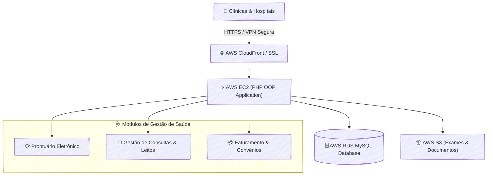

***

### 🚀 Project:  Fanoty — Modernização de Backend e Otimização de API Para App de Esportes
**Categoria:** ⚙️ Tier 2: Engenharia de Performance & Integrações

#### 🎯 Visão Geral e Arquitetura da Solução

O **Fanoty** é um aplicativo mobile iOS voltado para fãs de futebol, oferecendo acompanhamento em tempo real de estatísticas, escalações, placares e eventos dinâmicos de partidas esportivas. O backend da plataforma enfrentava gargalos severos de latência e divergência de dados durante picos de tráfego em jogos ao vivo, causados pela complexidade na ingestão síncrona da API externa da **OPTA Sports** e por uma base de código desatualizada em **Laravel 5.0**.

A missão do projeto consistiu em reestruturar a camada de integração de dados esportivos, atualizar o framework para **Laravel 5.1**, eliminar inconsistências na apuração em tempo real e estabelecer um fluxo de entrega contínua com **GitHub Actions** e contêineres **Docker**, garantindo alta disponibilidade, estabilidade e capacidade de rollback instantâneo.

#### 👨‍💻 Meu Papel no Projeto

Como **Desenvolvedor Backend Líder**, atuei em sprints semanais em estreita colaboração com o Desenvolvedor iOS (*Alex Jackson*) e a Gerente de Projetos (*Emma Fairlie*):
- **Engenharia de Ingestão de Dados:** Reescrita completa da rotina de consumo e parsing dos feeds de dados esportivos da **OPTA Sports API**.
- **Refatoração & Atualização de Framework:** Migração do core da aplicação de Laravel 5.0 para Laravel 5.1, modernizando contratos de serviços, repositórios e tratamento de exceções.
- **DevOps & Automação CI/CD:** Criação de pipelines automatizados de teste e deploy com **GitHub Actions** e **Docker**.
- **Garantia de Qualidade:** Criação de suíte de testes automatizados com **PHPUnit** cobrindo cenários críticos de sincronização de placares.

#### 📊 Resultados Quantificados

- ⚡ **50% de Redução no Tempo de Ingestão:** A reescrita do pipeline de dados reduziu o tempo de processamento dos feeds esportivos pela metade.
- 🎯 **100% de Confiabilidade em Placares ao Vivo:** Eliminação total das inconsistências e discrepâncias nas estatísticas durante partidas simultâneas.
- ⏱️ **Deploy Zero-Downtime:** Redução do tempo de deploy de processos manuais lentos para pipelines automatizados em menos de 5 minutos com suporte a rollback.

#### 🛡️ Segurança & Mitigações OWASP Top 10

- **A01:2021 — Broken Access Control:** Validação rigorosa de tokens de sessão e autenticação de requisições provenientes do app mobile.
- **A03:2021 — Injection:** Parametrização e sanitização estrita de todas as consultas via Eloquent ORM e Query Builder, prevenindo SQL Injection.
- **A05:2021 — Security Misconfiguration:** Hardening das variáveis de ambiente e segredos de API da OPTA Sports isolados no cofre de segredos do CI/CD.

#### ✨ Pontos Fortes e Desafios Superados

- **Tratamento de Payload Massivo da OPTA:** O maior desafio foi lidar com variações repentinas na estrutura de dados enviada pelos webhooks e feeds XML/JSON da OPTA Sports. A criação de uma camada de normalização (Data Mappers) isolou o domínio da aplicação contra mudanças externas.
- **Evolução Segura de Framework Legado:** A migração de versão do Laravel sem interromper a operação dos usuários ativos foi conquistada através da expansão prévia de testes de regressão automatizados.

#### 🌱 Pontos para Evolução Futura

- Implementação de cache distribuído em **Redis** para endpoints públicos de consulta de estatísticas históricas.
- Transição do modelo de polling para mensageria push via WebSockets para atualizações de placar instantâneas.

---

#### 🛠️ Pilha de Tecnologias (Tech Stack)

| Componente | Tecnologia Utilizada | Papel na Arquitetura |
| :--- | :--- | :--- |
| **Backend Core** | PHP 7.x / Laravel 5.1 | API RESTful, camada de regras de negócio e endpoints mobile |
| **Feed Esportivo** | OPTA Sports API | Fonte oficial de dados, placares e estatísticas de futebol |
| **Banco de Dados** | MySQL | Persistência relacional de partidas, equipes, atletas e métricas |
| **Qualidade & Testes** | PHPUnit | Suíte de testes unitários e de integração de rotinas de cálculo |
| **CI/CD & DevOps** | GitHub Actions / Docker | Pipeline automatizado de linting, testes, build e deploy em contêineres |

---

#### 🗺️ Diagrama da Arquitetura

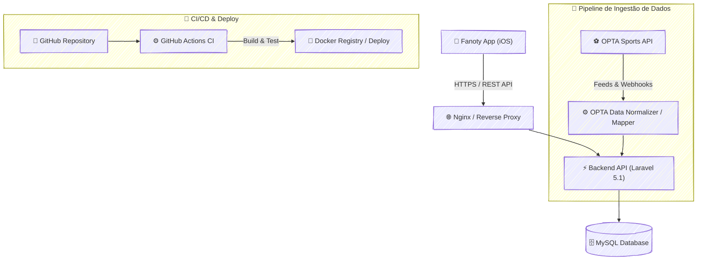

***

### 🚀 Project:  Grappl — Modernização de API e Entrega Rápida de Funcionalidades
**Categoria:** ⚙️ Tier 2: Engenharia de Performance & Integrações

#### 🎯 Visão Geral e Arquitetura da Solução

O **Grappl** é uma plataforma e rede comunitária voltada para fãs de wrestling e esportes de combate, permitindo aos usuários acompanhar, avaliar e catalogar combates e eventos históricos. Em um ciclo focado de entrega de 2 meses, o objetivo foi atuar diretamente com a liderança executiva da Evoke Mobile (*Dave Brown*) para resolver gargalos severos de carregamento na página inicial da aplicação, refatorar a camada de consultas SQL e implantar novas frentes de produto, como busca avançada multidimensional e monetização por publicidade.

A solução envolveu a reconstrução dos principais endpoints da API REST em **Laravel**, reestruturação do gerenciamento de sessões de usuário e desenvolvimento de um módulo integrado no CMS administrativo para gestão autônoma de banners e parcerias comerciais.

#### 👨‍💻 Meu Papel no Projeto

Como **Desenvolvedor Backend Sênior**, atuei em regime ágil de ciclo curto diretamente com o CEO:
- **Refatoração de Endpoints Críticos:** Reconstrução da API da página inicial (*Home Feed*), eliminando consultas N+1 e indexando tabelas essenciais.
- **Mecanismo de Busca Avançada:** Arquitetura e desenvolvimento da engine de busca com múltiplos filtros combinados (lutadores, promoções, datas, avaliações).
- **Módulo de Monetização (CMS Ad Server):** Criação de área administrativa no CMS para publicação, agendamento e rastreamento de anúncios.
- **Gestão de Sessão & Autenticação:** Implementação de gerenciamento seguro de estado e sessão de usuários para navegação persistente e customizada.

#### 📊 Resultados Quantificados

- 🚀 **Carregamento da Home em < 400ms:** Redução expressiva no tempo de resposta da API principal, proporcionando uma experiência de navegação imediata.
- 🔍 **Aumento no Engajamento:** A nova busca avançada possibilitou aos usuários encontrar lutas e eventos de nicho em frações de segundo.
- 💰 **Monetização Ativada no Mês 1:** Lançamento bem-sucedido do módulo de anúncios, habilitando receita publicitária imediata para a plataforma.

#### 🛡️ Segurança & Mitigações OWASP Top 10

- **A01:2021 — Broken Access Control:** Controle de acesso baseado em papéis (RBAC) no painel administrativo do CMS, protegendo a gestão de publicidade e configurações da plataforma.
- **A03:2021 — Injection:** Tratamento estrito de parâmetros da busca avançada através de bindings preparados no ORM, neutralizando vetores de SQL Injection.
- **A07:2021 — Identification and Authentication Failures:** Renovação segura de identificadores de sessão e proteção contra ataques de Session Fixation.

#### ✨ Pontos Fortes e Desafios Superados

- **Entrega de Alto Impacto em 60 Dias:** Entrega de escopo completo de modernização de backend e novas features de produto com alta estabilidade dentro de um prazo extremamente enxuto.
- **Otimização de Consultas Complexas:** A agregação de notas e avaliações médias de centenas de lutas por evento exigiu refatoração profunda de queries SQL e estratégias de prefetching eficiente.

#### 🌱 Pontos Para Evolução Futura

- Implementação de motor de busca textual distribuído com **Elasticsearch** para busca fonética e sugestões automáticas (*autocomplete*).
- Arquitetura de cache em camada edge com **Cloudflare** para payloads estáticos da API pública.

---

#### 🛠️ Pilha de Tecnologias (Tech Stack)

| Componente | Tecnologia Utilizada | Papel na Arquitetura |
| :--- | :--- | :--- |
| **Backend Core** | PHP / Laravel | API RESTful, controle de regras de negócio e camada de serviços |
| **Banco de Dados** | MySQL | Modelagem relacional de lutas, atletas, eventos, avaliações e anúncios |
| **Mecanismo de Busca** | Query Builder / SQL Tuning | Filtragem dinâmica multi-critério e consultas otimizadas |
| **Painel Administrativo** | Laravel Blade / CMS | Gestão de anúncios, moderação de conteúdos e relatórios |
| **Ambiente & Deploy** | Docker / Linux | Conteinerização e hospedagem do ambiente de produção |

---

#### 🗺️ Diagrama da Arquitetura

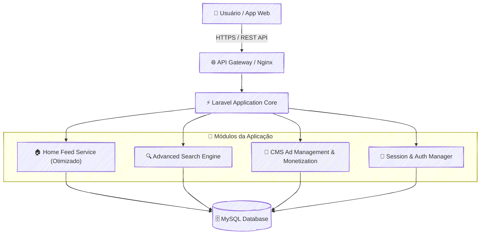

***

### 🚀 Project:  Huktup - Plataforma de Agendamento e Gestão Para Provedores de Serviço

#### 🎯 Visão Geral e Arquitetura da Solução

No cenário de serviços, a gestão descentralizada de agendamentos, pagamentos e comunicação com clientes é um grande obstáculo para o crescimento. O Huktup nasceu para resolver exatamente essa dor, oferecendo um ecossistema completo onde provedores de serviço podem centralizar toda a sua operação.

A solução foi arquitetada em torno de uma **API RESTful robusta, construída com Laravel (PHP)**, que serve como o cérebro de toda a plataforma. Esta API orquestra desde a criação de um agendamento até a análise de performance financeira. Para os provedores, desenvolvi um **dashboard analítico interativo com Vue.js e Chart.js**, que transforma dados brutos de faturamento e aquisição de clientes em insights visuais e acionáveis, permitindo filtros dinâmicos para uma análise aprofundada. A comunicação com o cliente final é automatizada e eficiente, graças à integração com a **Twilio API**, que gerencia o envio de lembretes, alertas e a coleta de feedbacks via SMS, reduzindo o não comparecimento e melhorando o engajamento.

#### 👨‍💻 Meu Papel no Projeto

Atuando como o principal desenvolvedor backend, minhas responsabilidades foram cruciais para a fundação e o sucesso da plataforma:

  - **Desenvolvimento do Core:** Construí a API RESTful em Laravel, que centraliza todas as regras de negócio, desde o agendamento até a gestão de ofertas.
  - **Criação do Dashboard Analítico:** Desenvolvi a interface de gestão para os provedores utilizando Vue.js, com foco na visualização de dados com Chart.js para apresentar métricas de negócio de forma clara e objetiva.
  - **Integração de Serviços:** Implementei integrações essenciais com a **Twilio API** para automação da comunicação via SMS e com o **Firebase Authentication** para garantir um processo de onboarding e login seguro (incluindo SSO).
  - **Garantia de Qualidade e Colaboração:** Colaborei ativamente com a equipe de QA para definir cenários de teste e validar a qualidade das entregas. Elaborei a documentação completa da API no padrão **Swagger**, o que foi fundamental para alinhar e acelerar o trabalho da equipe de frontend.

#### ✨ Pontos Fortes e Desafios Superados

O maior trunfo da plataforma é sua capacidade de **unificar a jornada do provedor em um único lugar**. A combinação de uma API sólida com um dashboard intuitivo oferece um controle sem precedentes sobre o negócio.

Um dos principais desafios foi **garantir uma comunicação confiável e automatizada em escala**. Superamos isso ao desenhar fluxos de conversa inteligentes com a Twilio, não apenas enviando lembretes, mas criando um canal de mão dupla para feedback. Outro desafio significativo foi **criar um ambiente seguro e colaborativo para as equipes de desenvolvimento**. A padronização da documentação da API com Swagger foi uma vitória, pois eliminou ambiguidades e permitiu que as equipes de frontend e backend trabalhassem em paralelo com muito mais eficiência.

#### 🌱 Pontos Para Evolução Futura

Para o futuro, a plataforma poderia evoluir com a implementação de duas funcionalidades de alto valor:

1. Um módulo de **notificações push** no aplicativo para complementar a comunicação via SMS.
2. A integração de um sistema de **Inteligência Artificial** para analisar padrões de agendamento e sugerir horários de maior rentabilidade para os provedores.

-----

#### 🛠️ Pilha de Tecnologias (Tech Stack)

| Componente | Tecnologia Utilizada | Papel na Arquitetura |
| :--- | :--- | :--- |
| **Backend (API Core)** | **Laravel (PHP)** | Orquestra todas as regras de negócio, dados e integrações como o núcleo da plataforma. |
| **Frontend (Dashboard)** | **Vue.js** | Constrói a interface reativa e interativa para os provedores de serviço gerenciarem seus negócios. |
| **Visualização de Dados** | **Chart.js** | Renderiza gráficos dinâmicos no dashboard para análise de faturamento, reservas e clientes. |
| **Banco de Dados** | **MySQL** | Armazena de forma persistente todos os dados relacionais da aplicação (agendamentos, usuários, etc.). |
| **Autenticação de Usuários**| **Firebase Authentication** | Gerencia o onboarding, login e segurança dos usuários (provedores) com suporte a SSO. |
| **Comunicação por SMS** | **Twilio API** | Automatiza o envio de lembretes, alertas transacionais e coleta de feedback dos clientes finais. |
| **Documentação da API** | **Swagger (OpenAPI)** | Padroniza e documenta os endpoints da API para facilitar a integração entre equipes. |
| **Ambiente de Dev** | **Docker** | Garante a consistência e portabilidade do ambiente de desenvolvimento e produção. |

-----

#### 🗺️ Diagrama da Arquitetura

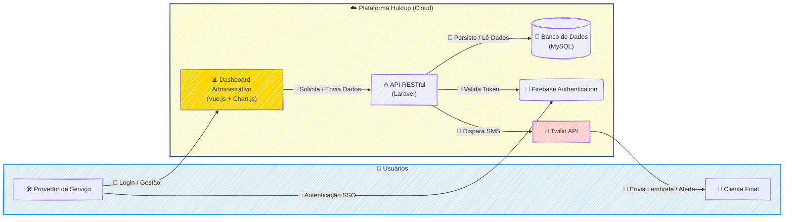

---
#### RESUMO TÉCNICO PARA EMBEDDING

Desenvolvimento de uma plataforma de agendamento, Huktup, com arquitetura centrada em uma API RESTful em Laravel (PHP) atuando como core para todas as regras de negócio. O frontend consiste em um dashboard analítico reativo para provedores de serviço, construído com Vue.js e utilizando Chart.js para visualização de dados e métricas de faturamento e aquisição de clientes. A solução integra serviços de terceiros para funcionalidades críticas: Firebase Authentication para onboarding, login e segurança com suporte a SSO, e a Twilio API para automação da comunicação via SMS, incluindo lembretes e coleta de feedback. A persistência de dados é garantida por um banco de dados MySQL. O ambiente de desenvolvimento é padronizado com Docker, garantindo portabilidade. A colaboração entre equipes de backend e frontend foi otimizada pela documentação da API no padrão Swagger (OpenAPI), permitindo o desenvolvimento paralelo e a validação de entregas com a equipe de QA. Desafios superados incluem a criação de fluxos de comunicação escaláveis e a eliminação de ambiguidades no desenvolvimento através de documentação padronizada.

#### CLASSIFICAÇÃO DE TECNOLOGIAS E CONCEITOS

| Categoria                    | Tecnologias e Conceitos                                                |
| :--------------------------- | :--------------------------------------------------------------------- |
| **AI & Machine Learning**    | Sugestão de IA para otimização de agendamentos (evolução futura)       |
| **Software Development**     | Laravel, PHP, Vue.js, Docker, Chart.js                                 |
| **Architecture**             | Arquitetura baseada em API, Single Sign-On (SSO)                       |
| **Cloud Computing**          | Firebase Authentication, Plataforma em Nuvem                           |
| **API RESTFul development**  | API RESTful, Laravel, Twilio API, Swagger, OpenAPI                     |
| **Frontend Development**     | Vue.js, Chart.js, Dashboard Analítico, Visualização de Dados           |
| **Mobile Development**       | Notificações Push (evolução futura)                                    |
| **Database**                 | MySQL                                                                  |
| **Data Management**          | Análise de métricas financeiras, Visualização de dados                 |
| **Content Management - CMS** | N/A                                                                    |
| **System Administration**    | N/A                                                                    |
| **DevOps**                   | Docker, Documentação de API (Swagger), Colaboração com QA              |
| **Leadership**               | Desenvolvedor principal, Alinhamento de equipes                        |
| **Coaching**                 | N/A                                                                    |
| **Agile Project Management** | Desenvolvimento paralelo (Backend/Frontend), Colaboração entre equipes |

***

### 🚀 Project:  OnePush - Plataforma SaaS para Notificações Web Push

#### 🎯 Visão Geral e Arquitetura da Solução

Em um cenário digital onde a comunicação direta e instantânea com o usuário é um diferencial competitivo, nasceu o OnePush. Trata-se de uma plataforma SaaS (Software as a Service) completa, projetada para empoderar empresas com a capacidade de enviar notificações web push, criando um canal de engajamento poderoso para aumentar o retorno e a fidelização de visitantes em seus websites.

A espinha dorsal da solução é uma **arquitetura modular e orientada a eventos**, construída sobre o robusto framework Laravel. Essa escolha estratégica garantiu não apenas a separação clara de responsabilidades entre os diferentes domínios do sistema — como notificações, pagamentos e gestão de clientes —, mas também proporcionou alta coesão e baixo acoplamento. Na prática, quando um cliente cadastra um novo website ou agenda uma notificação, a plataforma dispara eventos que são processados de forma assíncrona por filas (queues). Isso garante que a interface do usuário permaneça ágil e responsiva, enquanto tarefas mais pesadas, como a comunicação com APIs externas, acontecem em segundo plano.

O fluxo é elegante e eficiente: o cliente da plataforma instala um simples script JavaScript em seu site, que se comunica com a API da OneSignal para registrar os assinantes. Pelo painel administrativo do OnePush, o cliente pode então segmentar seu público e disparar notificações, que são orquestradas pelo nosso backend e entregues pela infraestrutura global da OneSignal, garantindo performance e escalabilidade.

#### 👨‍💻 Meu Papel no Projeto

Atuei como o principal arquiteto e desenvolvedor da solução, sendo responsável pelo ciclo de vida completo do produto, desde a concepção até a implementação. Minhas principais responsabilidades incluíram:

  * **Desenho da Arquitetura:** Idealizei e implementei a arquitetura modular e orientada a eventos, garantindo a escalabilidade e manutenibilidade do sistema.
  * **Desenvolvimento Back-End:** Construí todo o core da aplicação utilizando Laravel (PHP), incluindo a lógica de negócio, o sistema de filas, e a modularização dos componentes.
  * **Integração de APIs:** Realizei a integração completa com serviços de terceiros essenciais: a **OneSignal API** como motor de envio das notificações e a **Pagar.me API** para a gestão de planos e assinaturas.
  * **Construção do Painel Administrativo:** Desenvolvi um painel de controle completo, utilizando o Homer Dashboard, que abrange desde a gestão de notificações e websites até o monitoramento de logs, estatísticas de engajamento e um sistema de suporte com funcionalidade de "impersonation" para resolução ágil de problemas.
  * **Sistema de Pagamentos:** Implementei todo o ciclo de vida de assinaturas, integrando o gateway de pagamentos para processar transações de cartão de crédito e boleto de forma segura com JWT.

#### ✨ Pontos Fortes e Desafios Superados

O grande trunfo do OnePush reside na sua arquitetura resiliente e desacoplada, que foi a resposta direta a um desafio central: como construir uma plataforma SaaS multitenant que fosse ao mesmo tempo robusta, performática e fácil de manter?

A resposta foi a adoção de uma **arquitetura orientada a eventos**. Ao invés de acoplar a criação de uma notificação diretamente ao seu envio, o sistema dispara um evento `NotificationCreated`. Um listener, operando de forma independente, captura esse evento e enfileira uma tarefa para se comunicar com a API da OneSignal. Essa abordagem trouxe vitórias significativas:

1.  **Resiliência:** Se a API da OneSignal estivesse temporariamente indisponível, a tarefa poderia ser reprocessada automaticamente pela fila, sem perda de dados ou impacto na experiência do usuário.
2.  **Performance:** A interface do usuário respondia instantaneamente, pois a lógica de envio era delegada para um processo em segundo plano.
3.  **Escalabilidade:** Aumentar a capacidade de envio de notificações se tornou uma questão de adicionar mais workers para processar a fila, uma solução horizontalmente escalável.

Outro ponto de destaque foi a criação de um **painel administrativo centrado na experiência de suporte**. A funcionalidade de "impersonation" permitiu que nossa equipe técnica acessasse a conta de um cliente de forma segura para diagnosticar e resolver problemas, o que reduziu drasticamente o tempo de suporte e aumentou a satisfação do cliente.

#### 🌱 Pontos para Evolução Futura

Embora a plataforma seja robusta, existem caminhos claros para sua evolução. Duas melhorias de alto impacto seriam:

1.  **Testes A/B para Notificações:** Implementar uma funcionalidade que permita aos clientes testar diferentes textos e imagens em suas notificações para otimizar as taxas de clique.
2.  **Automação e Jornadas de Usuário:** Criar um sistema de automação onde os clientes possam configurar "jornadas" de notificações baseadas no comportamento do usuário (ex: notificação de carrinho abandonado).

-----

#### 🛠️ Pilha de Tecnologias (Tech Stack)

| Componente | Tecnologia Utilizada | Papel na Arquitetura |
| :--- | :--- | :--- |
| **Framework Back-End** | **Laravel 5.4 (PHP)** | Core da aplicação, gerenciando toda a lógica de negócio, APIs, modularização e orquestração de eventos. |
| **Banco de Dados** | **MySQL** | Armazenamento principal para dados de usuários, websites, notificações, assinaturas e transações. |
| **Filas e Eventos** | **Laravel Queues** | Gerencia o processamento assíncrono de tarefas, como o envio de notificações, garantindo performance e resiliência. |
| **Motor de Notificações** | **OneSignal API** | Serviço externo utilizado como a infraestrutura principal para registro de assinantes e entrega de notificações web push. |
| **Gateway de Pagamento**| **Pagar.me API** | Responsável por processar pagamentos de assinaturas (cartão de crédito e boleto) de forma segura. |
| **Frontend (Admin)** | **Homer Dashboard** | Template utilizado para a construção da interface do painel administrativo, oferecendo uma UI rica e responsiva. |
| **Autenticação API** | **tymondesigns/jwt-auth**| Biblioteca para proteger rotas de API (como as de pagamento) utilizando JSON Web Tokens (JWT). |
| **Logs de Atividade** | **spatie/activitylog** | Pacote utilizado para rastrear e registrar todas as ações importantes realizadas pelos usuários na plataforma. |

-----

#### 🗺️ Diagrama da Arquitetura

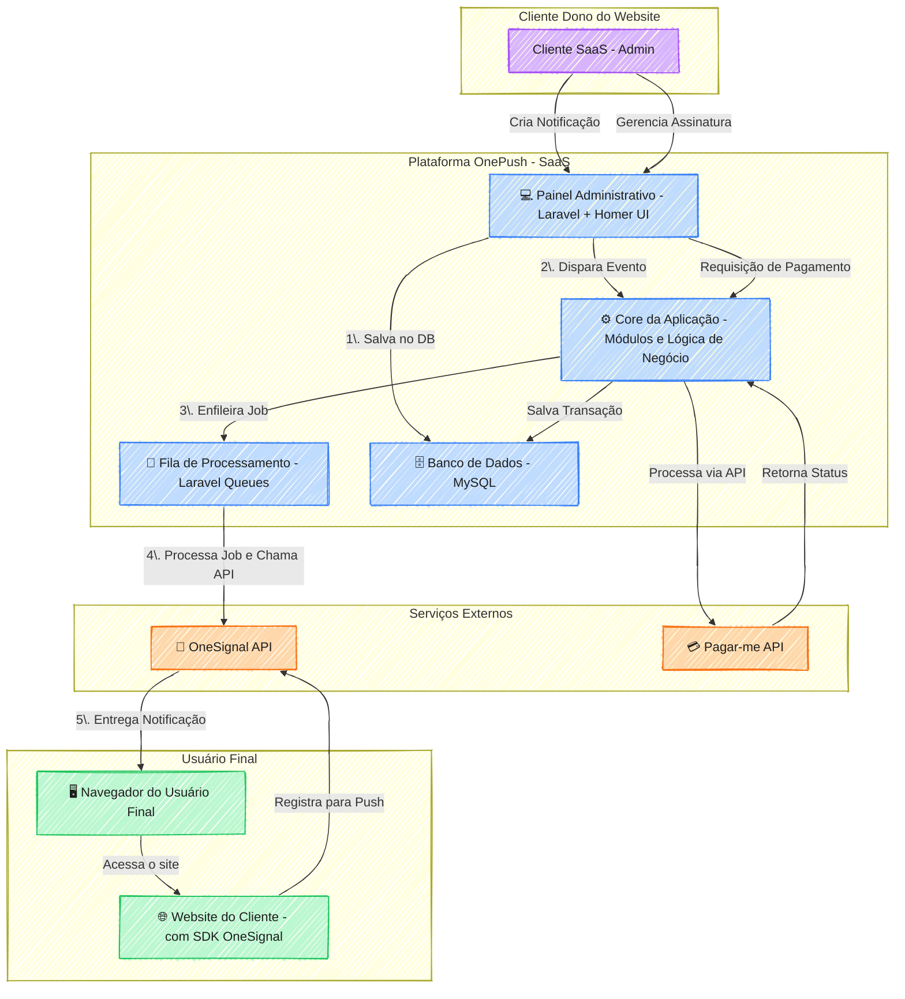

#### RESUMO TÉCNICO PARA EMBEDDING

Desenvolvimento de uma plataforma SaaS multitenant, OnePush, para envio de notificações web push, utilizando uma arquitetura modular e orientada a eventos. O core da aplicação foi construído com Laravel (PHP) e MySQL, implementando o padrão de filas (Laravel Queues) para processamento assíncrono de tarefas, garantindo resiliência, performance e escalabilidade horizontal. A solução integra-se com a API da OneSignal para o registro de assinantes e entrega de notificações e com a API da Pagar.me para a gestão de assinaturas e processamento de pagamentos (cartão de crédito, boleto), com rotas de API protegidas por JSON Web Tokens (JWT). O painel administrativo, desenvolvido com Homer Dashboard, inclui funcionalidades de gestão, monitoramento de logs (`spatie/activitylog`), estatísticas e um sistema de "impersonation" para suporte técnico. A arquitetura desacoplada resolveu o desafio de comunicação com APIs externas, permitindo o reprocessamento de tarefas em caso de falha e mantendo a UI responsiva.

#### CLASSIFICAÇÃO DE TECNOLOGIAS E CONCEITOS

| Categoria | Tecnologias e Conceitos |
| :--- | :--- |
| **AI & Machine Learning** | Testes A/B (evolução futura), Automação de Jornadas (evolução futura) |
| **Software Development** | Laravel 5.4, PHP, Modularização, Baixo Acoplamento, Alta Coesão, `tymondesigns/jwt-auth`, `spatie/activitylog` |
| **Architecture**| Arquitetura Modular, Arquitetura Orientada a Eventos, SaaS (Software as a Service), Arquitetura Multitenant, Arquitetura Desacoplada, Escalabilidade Horizontal, Resiliência |
| **Cloud Computing** | SaaS (Software as a Service) |
| **API RESTFul development** | Integração de APIs, OneSignal API, Pagar.me API, JSON Web Tokens (JWT), Gateway de Pagamento |
| **Frontend Development** | Homer Dashboard, JavaScript |
| **Mobile Development** | Notificações Web Push |
| **Database** | MySQL |
| **Data Management** | Logs de Atividade, Estatísticas de Engajamento, Monitoramento de Logs |
| **Content Management - CMS** | N/A |
| **System Administration** | Impersonation, Suporte Técnico, Monitoramento de Logs |
| **DevOps** | Filas (Queues), Processamento Assíncrono, Workers |
| **Leadership** | Arquiteto da solução, Ciclo de vida completo do produto, Concepção de produto |
| **Coaching** | N/A |
| **Agile Project Management** | N/A |

***

### 🚀 Project:  Plataforma de Simulados Para Exames de Especialidade Médica (MVP)
**Categoria:** 🏆 Tier 1: AI, Cloud Architecture & SaaS

#### 🎯 Visão Geral e Arquitetura da Solução

O projeto consistiu no desenvolvimento de ponta a ponta do Produto Mínimo Viável (MVP) de uma plataforma de tecnologia educacional (*EdTech*) focada na preparação de médicos para exames de especialidades e títulos em Portugal. O sistema precisava permitir a criação flexível de bancos de questões, orquestração de simulados com limite de tempo e cálculo imediato de notas com feedback pedagógico, além de monetização imediata através de cobrança por assinatura e pacotes de provas.

A arquitetura foi concebida como uma aplicação web robusta em **Laravel**, integrando o gateway de pagamentos português **EuPago.pt** e uma esteira automatizada de infraestrutura e deploy com contêineres **Docker**, viabilizando a validação comercial do produto no mercado desde o primeiro dia de operação.

#### 👨‍💻 Meu Papel no Projeto

Como **Desenvolvedor Full-Stack Líder**, fui o único responsável pelo ciclo de engenharia, sob a gerência executiva de *Miguel*:
- **Modelagem de Domínio & Backend:** Estruturação do modelo relacional para gestão de questões categorizadas, gabaritos, tentativas de prova e auditoria de respostas.
- **Engine de Simulados:** Desenvolvimento do motor de execução de provas com controle de tempo, embaralhamento dinâmico e apuração instantânea de resultados.
- **Integração Financeira (EuPago.pt):** Implementação do fluxo de checkout, emissão de referências de pagamento (Multibanco/MB Way) e tratamento de webhooks assíncronos de confirmação.
- **Infraestrutura & CI/CD:** Configuração completa do servidor em nuvem, conteinerização com **Docker** e automação do pipeline de entrega contínua.

#### 📊 Resultados Quantificados

- 🚀 **MVP Entregue em 60 Dias:** Ciclo completo de especificação, desenvolvimento, testes e deploy produtivo em 2 meses.
- 💶 **Monetização Ativa desde o Dia 1:** Integração com **EuPago.pt** viabilizou vendas automáticas de pacotes de simulados com conciliação imediata.
- 📈 **Taxa de Disponibilidade de 99.9%:** Arquitetura leve e eficiente em contêineres garantiu estabilidade durante sessões simultâneas de provas.

#### 🛡️ Segurança & Mitigações OWASP Top 10

- **A01:2021 — Broken Access Control:** Isolamento rigoroso de gabaritos e validação de permissões de tentativa de prova no backend, impedindo que o frontend acesse respostas antes da finalização.
- **A02:2021 — Cryptographic Failures:** Comunicação criptografada de ponta a ponta via HTTPS/TLS e validação de assinaturas criptográficas em webhooks de pagamento do EuPago.pt.
- **A03:2021 — Injection:** Sanitização e parametrização estrita de dados via Eloquent ORM.

#### ✨ Pontos Fortes e Desafios Superados

- **Integridade e Cronometragem de Provas:** O desafio de garantir que interrupções de conexão ou fechamento acidental de abas pelo aluno não corrompessem o tempo restante da prova foi superado com sincronização periódica de estado e verificação temporal no servidor.
- **Resiliência no Processamento de Pagamentos:** Construção de rotinas idempotentes para processamento de webhooks de pagamento, evitando duplicidades de liberação de acesso.

#### 🌱 Pontos para Evolução Futura

- Algoritmo adaptativo de questões baseado na Teoria de Resposta ao Item (TRI) para calibragem automática do nível de dificuldade.
- Geração inteligente de relatórios comparativos de desempenho por especialidade médica com auxílio de IA.

---

#### 🛠️ Pilha de Tecnologias (Tech Stack)

| Componente | Tecnologia Utilizada | Papel na Arquitetura |
| :--- | :--- | :--- |
| **Backend & API** | PHP / Laravel | Engine de provas, regras de negócio e controle de acessos |
| **Frontend UI** | Blade / JavaScript / Bootstrap | Interface responsiva para realização de simulados e dashboard do aluno |
| **Gateway de Pagamento** | EuPago.pt API / Webhooks | Cobrança, conciliação e faturamento no mercado português |
| **Banco de Dados** | MySQL | Armazenamento relacional de questões, respostas, transações e usuários |
| **DevOps & Infra** | Docker / CI/CD Pipeline | Provisionamento, conteinerização e deploy automatizado |

---

#### 🗺️ Diagrama da Arquitetura

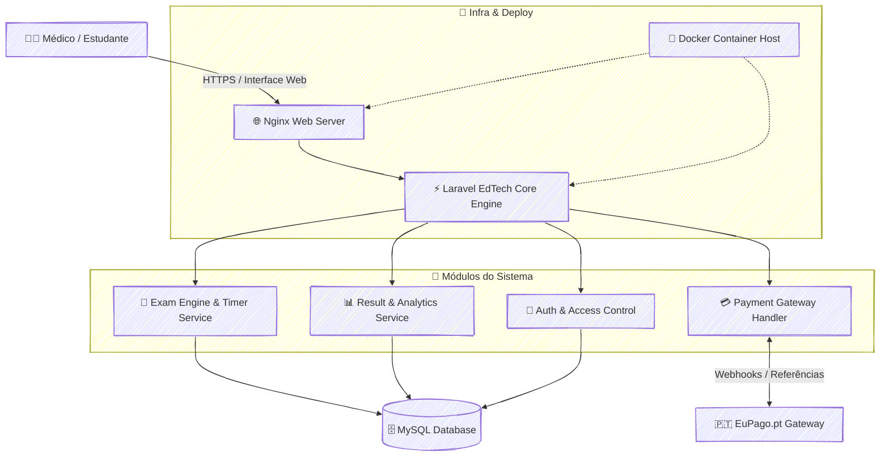

***

### 🚀 Project:  Sisporta - Sincronização Inteligente de Dados

#### 🎯 Visão Geral e Arquitetura da Solução

O projeto Sisporta nasceu de um desafio clássico no mundo do software: a necessidade de modernizar sem poder tocar no legado. Uma empresa especialista em portões de garagem precisava de um sistema ágil para gerar orçamentos personalizados, mas seus dados vitais (produtos, revendedores) residiam em um ERP com um banco de dados SQL Server intocável.

A solução foi arquitetar um **pipeline de dados desacoplado e resiliente**. O coração da operação é um script Python que atua como um agente de extração, lendo os dados do SQL Server e os enviando em formato JSON para uma API na nova aplicação Laravel. Para não sobrecarregar nenhum dos sistemas, a API não processa os dados imediatamente; ela os enfileira usando o **Laravel Horizon**. Essa abordagem assíncrona permite que *workers* em segundo plano processem as informações em lotes. O resultado é um fluxo de dados contínuo e eficiente, que alimenta o novo sistema de orçamentos com **um espelho de dados sempre atualizado** do ERP, sem comprometer a performance do legado.

#### 👨‍💻 Meu Papel no Projeto

Neste projeto, atuei como a principal força de engenharia, combinando as funções de **Arquiteto de Soluções e Desenvolvedor Full-Stack**. Minhas responsabilidades incluíram:

  - **Idealizar e desenhar** a arquitetura de integração assíncrona para garantir performance e desacoplamento.
  - **Desenvolver o script de extração** em Python, responsável por coletar e formatar os dados do sistema legado.
  - **Implementar a aplicação Laravel**, incluindo o endpoint da API de ingestão e os jobs de processamento em background com Laravel Horizon.
  - **Garantir a qualidade do código** através da criação de testes unitários e de integração.
  - **Configurar o pipeline de CI/CD** no Bitbucket para automatizar testes e deploys.

#### ✨ Pontos Fortes e Desafios Superados

O maior desafio era a restrição de não poder modificar o sistema ERP. A superação veio com a **arquitetura de processamento assíncrono**, que transformou essa limitação em um ponto forte. A solução se destaca por:

  - **Alto Desempenho e Resiliência:** A utilização de filas (Laravel Horizon) evita gargalos. Se a aplicação de destino ficasse offline, os dados simplesmente aguardariam na fila para serem processados, sem perdas.
  - **Consistência de Dados Inteligente (Espelhamento):** A solução implementa um **espelhamento completo (full refresh)** com uma estratégia de **"delete-by-absence"** (exclusão por ausência). Em vez de uma sincronização incremental complexa, o sistema extrai o conjunto completo de dados *ativos* do ERP. Após os *workers* processarem todos os registros (inserindo novos e atualizando existentes), um job de "limpeza" é executado. Este job **remove automaticamente quaisquer registros do destino que não vieram na carga atual**, garantindo que o sistema de orçamentos seja um espelho fiel do ERP, sem acumular dados órfãos ou obsoletos.
  - **Automação e Qualidade:** Com testes automatizados e um pipeline de CI/CD no Bitbucket, o processo de manutenção e evolução tornou-se seguro e ágil.

#### 🌱 Pontos Para Evolução Futura

Para evoluir ainda mais a solução, poderíamos implementar um **dashboard de monitoramento avançado** para observar a saúde das filas e o tempo de processamento dos jobs, além de configurar um mecanismo de ***Dead Letter Queue*** para tratar falhas de processamento de forma isolada, sem interromper o fluxo principal.

-----

#### 🛠️ Pilha de Tecnologias (Tech Stack)

  - **Linguagens:** Python, PHP
  - **Framework:** Laravel
  - **Bancos de Dados:** SQL Server, MySQL
  - **Filas e Jobs:** Laravel Horizon
  - **DevOps:** Bitbucket Pipelines

-----

#### 🗺️ Diagrama da Arquitetura

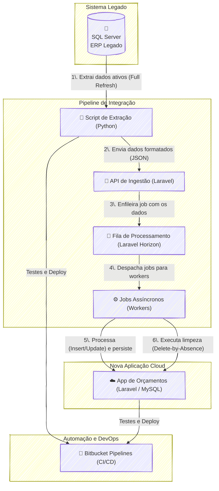

-----

#### RESUMO TÉCNICO PARA EMBEDDING

O projeto implementa um pipeline de dados desacoplado para integração entre um sistema ERP legado com banco de dados SQL Server e uma aplicação moderna em Laravel (PHP) com MySQL, ambos hospedados em nuvem. A solução resolve o desafio da sincronização de dados sem acesso para modificação do ERP. Um script Python atua como agente de ETL, extraindo dados, formatando-os em JSON e enviando para um endpoint de API RESTful na aplicação Laravel. Para garantir alta performance e evitar gargalos, a ingestão é assíncrona, utilizando Laravel Horizon para enfileirar e gerenciar jobs de processamento. A consistência de dados é mantida através de uma estratégia de **sincronização completa (full refresh) com "delete-by-absence"**: após a ingestão em lote, uma rotina de limpeza remove registros do destino que não estavam presentes na extração atual, garantindo um espelhamento fiel do ERP. Todo o ciclo de desenvolvimento é automatizado por um pipeline de CI/CD no Bitbucket Pipelines.

#### CLASSIFICAÇÃO DE TECNOLOGIAS E CONCEITOS

| Categoria | Tecnologias e Conceitos |
| :--- | :--- |
| **AI & Machine Learning** | N/A |
| **Software Development** | Python, PHP, Laravel, JSON, Testes Unitários, Testes de Integração |
| **Architecture**| Arquitetura Desacoplada, Processamento Assíncrono, Processamento em Lotes, Resiliência, Escalabilidade, Pipeline de Dados, Sincronização Unidirecional |
| **Cloud Computing** | Aplicação Cloud, Banco de dados hospedado na nuvem |
| **API RESTFul development** | Endpoint de API, Ingestão de Dados via API |
| **Frontend Development** | N/A |
| **Mobile Development** | N/A |
| **Database** | SQL Server, MySQL |
| **Data Management** | ETL (Extração, Transformação e Carga), Sincronização de Dados (**Full Refresh**, **Delete-by-Absence**), Espelhamento de Dados (Data Mirroring), Integridade de Dados, Consistência de Dados, Limpeza de Dados (Data Cleansing) |
| **Content Management - CMS** | N/A |
| **System Administration** | N/A |
| **DevOps** | Bitbucket Pipelines, CI/CD (Integração Contínua, Implantação Contínua), Laravel Horizon, Background Workers, Gerenciamento de Filas (Queueing), Automação de Deploy |
| **Leadership** | N/A |
| **Coaching** | N/A |
| **Agile Project Management** | N/A |

***

### 🚀 Project:  Spider - Hub de Integração E-commerce

#### 🎯 Visão Geral e Arquitetura da Solução

No coração de um ecossistema de e-commerce complexo e multifacetado, o projeto Spider nasceu como a espinha dorsal de automação, um hub de integração projetado para orquestrar o fluxo de operações para múltiplos clientes. O objetivo era claro: conectar de forma transparente e confiável sistemas de ERP (como Bling e bancos de dados customizados), plataformas de marketplace (Plugg.to, Skyhub, B2W) e ferramentas de gestão, garantindo um fluxo de dados à prova de falhas para produtos, estoque, preços e pedidos.

A solução foi arquitetada como um sistema centralizado, construído em **PHP/Laravel**, que adota uma abordagem orientada a serviços e eventos. Do ponto de vista funcional, o Spider opera como o cérebro da operação:

  * **Recebe Dados:** Ele ingere informações de diversas fontes, utilizando **webhooks** para notificações em tempo real (ex: uma nota fiscal emitida no Bling) e **Artisan Commands** agendados para importações em lote (ex: buscar novos pedidos da Plugg.to).
  * **Processa de Forma Inteligente:** Ao receber os dados, o Spider não apenas os armazena. Ele os enriquece e processa. Um pedido, por exemplo, passa por um job que identifica o cliente correto com base nos SKUs dos produtos antes de ser enviado ao ERP adequado.
  * **Garante a Consistência:** Para tarefas críticas como atualizações de estoque e preço, o sistema utiliza um robusto mecanismo de **filas em Redis**. Isso garante que as operações sejam processadas de forma assíncrona, resiliente e controlada, evitando sobrecarga nas APIs externas e garantindo que as informações fluam de maneira ordenada para todos os canais de venda.
  * **Centraliza a Informação:** Todas as operações, dados e logs são persistidos em um banco de dados **MongoDB**, que serve como a única fonte da verdade para o estado de pedidos, produtos e transações financeiras.

#### 👨‍💻 Meu Papel no Projeto

Como **Engenheiro de Integração**, minha atuação foi central na concepção, desenvolvimento e manutenção deste ecossistema. Minhas principais responsabilidades incluíram:

  * **Arquitetura de Integração:** Desenhar os fluxos de dados, modelar entidades críticas no MongoDB (como a de `checking_account` para controle financeiro) e definir a arquitetura de webhooks para processamento de eventos em tempo real.
  * **Desenvolvimento Back-End:** Construir e manter os pilares da plataforma, incluindo Artisan Commands para importação, Jobs para processamento assíncrono e a lógica de integração com APIs de terceiros como Bling, Plugg.to e Skyhub.
  * **Orquestração do Ciclo de Pedidos:** Automatizar o fluxo completo de um pedido, desde sua criação no marketplace, passando pelo envio ao ERP, até a atualização de seu status após o faturamento, tratando inclusive cancelamentos.
  * **Sincronização Multi-plataforma:** Implementar a complexa lógica de sincronização de estoque e preços, garantindo consistência entre o "dono" do estoque (ERP) e múltiplos canais de venda para evitar overselling.
  * **Onboarding e Migração de Clientes:** Liderar os processos técnicos para integrar novos clientes à plataforma, incluindo a migração massiva de produtos e pedidos de sistemas como Magento e Plugg.to.
  * **Manutenção e Qualidade:** Criar ferramentas internas, como o `LogTrait` para padronizar logs, e executar scripts de manutenção no MongoDB para garantir a qualidade e a integridade dos dados.

#### ✨ Pontos Fortes e Desafios Superados

O maior ponto forte da solução é sua **arquitetura assíncrona e resiliente**. O uso intensivo de filas (Queues) não apenas tornou a plataforma mais responsiva, mas também permitiu escalar o processamento de um volume massivo de dados sem comprometer a estabilidade.

Um dos desafios mais significativos foi **garantir a sincronização de estoque em tempo real**. Vender um produto que não existe no estoque (overselling) é um dos maiores problemas do e-commerce. Superamos isso abandonando o polling ineficiente e implementando uma **arquitetura reativa a eventos**. Ao configurar webhooks no Bling, o Spider passou a ser notificado instantaneamente sobre qualquer mudança, disparando jobs para filas dedicadas (`pluggto`, `skyhub`) que atualizavam os marketplaces de forma quase imediata e controlada. Essa mudança transformou um ponto de fragilidade em uma fortaleza da plataforma.

Outro grande desafio foi lidar com a **inconsistência de dados** provenientes de múltiplas fontes. Enfrentamos SKUs inválidos, produtos duplicados e pedidos sem associação clara de cliente. A vitória aqui foi conquistada através da engenharia: desenvolvi scripts e rotinas de tratamento, como o job `ProcessCodeOrders`, que implementou uma lógica robusta para **identificar e associar corretamente os pedidos aos seus respectivos clientes**, utilizando os SKUs dos itens como chave primária. Essa automação eliminou um processo manual e propenso a erros, garantindo a fluidez da operação.

#### 🌱 Pontos para Evolução Futura

Apesar da robustez da solução, sempre há espaço para melhorias. Duas evoluções naturais seriam:

1.  **Dashboard de Observabilidade:** Implementar um painel de controle visual para monitorar em tempo real a saúde das filas, o status dos jobs e as métricas de integração, oferecendo uma visão proativa sobre possíveis gargalos.
2.  **Centralização de Logs Avançada:** Expandir o `LogTrait` para integrar-se a uma plataforma de observabilidade como Datadog ou ELK Stack, permitindo buscas complexas e criação de alertas inteligentes sobre o comportamento das integrações.

-----

#### 🛠️ Pilha de Tecnologias (Tech Stack)

| Componente | Tecnologia Utilizada | Papel na Arquitetura |
| :--- | :--- | :--- |
| **Backend & Lógica** | **PHP / Laravel** | Framework principal para toda a aplicação, incluindo Artisan Commands para tarefas agendadas e Jobs para processamento em segundo plano. |
| **Banco de Dados Principal** | **MongoDB** | Banco de dados NoSQL central para armazenar produtos, pedidos, clientes e logs, oferecendo flexibilidade para modelos de dados complexos. |
| **Filas Assíncronas** | **Redis** | Utilizado como o motor do sistema de filas (Queues), garantindo o processamento assíncrono e resiliente de tarefas como atualizações de estoque e importações. |
| **Integrações (APIs)** | **REST & Webhooks** | Protocolos usados para comunicação com sistemas externos, tanto para buscar dados (REST) quanto para receber notificações em tempo real (Webhooks). |
| **Plataformas Conectadas** | **Plugg.to, Skyhub, Bling** | Principais sistemas de e-commerce (marketplaces e ERP) com os quais o Spider se integrava para orquestrar as operações. |
| **Infraestrutura & DevOps** | **Docker, AWS S3, SSH** | Docker para conteinerização do ambiente, S3 para armazenamento de arquivos (ex: planilhas de importação) e SSH para gerenciamento do servidor. |
| **Bancos de Dados Legados** | **MySQL** | Utilizado para integração direta com o sistema ERP de clientes específicos que não possuíam uma API moderna, como o Novo Século. |

-----

#### 🗺️ Diagrama da Arquitetura

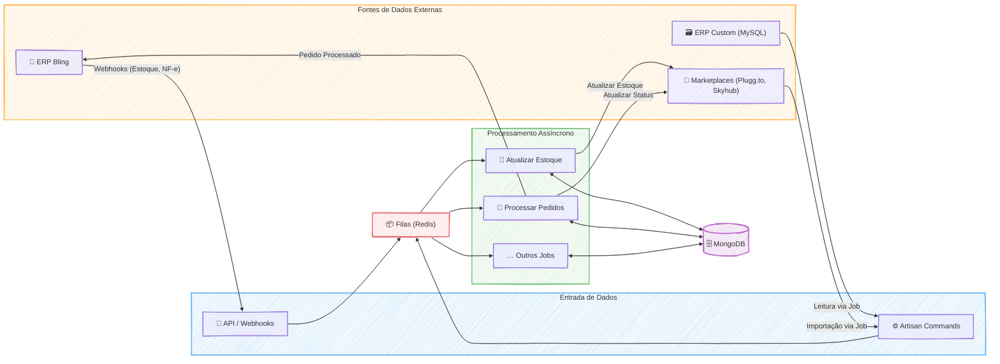

---
#### RESUMO TÉCNICO PARA EMBEDDING

Desenvolvimento e arquitetura do "Spider", um hub de integração de e-commerce centralizado, construído em **PHP/Laravel** para orquestrar operações entre múltiplos sistemas. A arquitetura é orientada a serviços e eventos, utilizando **processamento assíncrono** com **Jobs** e **filas em Redis** para garantir resiliência e escalabilidade. O sistema ingere dados via **APIs REST** e **Webhooks** de plataformas como **Bling**, **Plugg.to**, e **Skyhub**, além de realizar extrações de bancos de dados legados **MySQL**. As operações de **ETL (Extract, Transform, Load)** são executadas por **Artisan Commands** para migração e importação em massa. Todos os dados operacionais (pedidos, produtos, logs) são persistidos em um banco de dados **MongoDB**, que funciona como fonte única da verdade. Desafios de sincronização de estoque e preço foram solucionados implementando uma **arquitetura reativa a eventos**, abandonando o polling em favor de webhooks que disparam jobs para filas dedicadas, prevenindo overselling. A inconsistência de dados foi tratada com rotinas de normalização e enriquecimento, como o `ProcessCodeOrders`. A infraestrutura utiliza **Docker** para conteinerização, **AWS S3** para armazenamento e **SSH** para gerenciamento, com processos agendados via **cron**. A gestão do projeto foi feita com **Jira**, e a padronização de logs foi implementada com um `LogTrait` customizado.

#### CLASSIFICAÇÃO DE TECNOLOGIAS E CONCEITOS

| Categoria | Tecnologias e Conceitos |
| :--- | :--- |
| **AI & Machine Learning** | N/A |
| **Software Development** | PHP, Laravel, Artisan Commands, Jobs, Traits (`LogTrait`), Controllers, Backend Development |
| **Architecture**| Arquitetura Orientada a Serviços, Arquitetura Orientada a Eventos, Arquitetura Assíncrona, Arquitetura Reativa, Hub de Integração, Modelagem de Entidades, Fluxos de Dados |
| **Cloud Computing** | AWS S3 |
| **API RESTFul development** | API REST, Webhooks, Consumo de API (Bling, Plugg.to, Skyhub) |
| **Frontend Development** | N/A |
| **Mobile Development** | N/A |
| **Database** | MongoDB, Redis, MySQL, SQLite, NoSQL |
| **Data Management** | ETL (Extração, Transformação, Carga), Migração de Dados (Magento, Plugg.to), Sincronização de Dados (Estoque, Preço), Qualidade de Dados, Normalização de Dados, Logs (`LogTrait`) |
| **Content Management - CMS** | N/A |
| **System Administration** | Gerenciamento de Servidor (SSH), Cron Jobs |
| **DevOps** | Docker, Docker Compose, Monitoramento, Logging, Automação de Tarefas |
| **Leadership** | Liderança Técnica, Documentação Técnica, Mentoria (Coaching) |
| **Coaching** | N/A |
| **Agile Project Management** | Jira, Gestão de Tarefas, Acompanhamento de Status |


---

***

### 🚀 Project:  Startup Center — Ecossistema de Ferramentas Para Apoio a Startups
**Categoria:** 🏆 Tier 1: AI, Cloud Architecture & SaaS

#### 🎯 Visão Geral e Arquitetura da Solução

O **Startup Center** foi concebido como uma plataforma all-in-one para fomentar a colaboração, ideação e crescimento de novos empreendedores e startups em estágio inicial. O objetivo era reunir em um único ecossistema ferramentas de validação de mercado, networking em tempo real, economia interna gamificada e integração de serviços terceirizados, eliminando a fragmentação de ferramentas que costuma encarecer a jornada de fundadores.

Como único arquiteto e engenheiro do projeto, desenvolvi toda a solução em **Laravel**, integrando videoconferência via **TokBox WebRTC**, sinalização e mensageria em tempo real com **Pusher**, pesquisas dinâmicas de opinião e pagamentos via **PayPal**, orquestrando uma infraestrutura multi-cloud com deploy inicial na **IBM Bluemix** e migração posterior para a **AWS**.

#### 👨‍💻 Meu Papel no Projeto

Como **Arquiteto de Software & Engenheiro Full-Stack (Solo Developer)**:
- **Concepção & Arquitetura do Ecossistema:** Definição completa da arquitetura em camadas e integração de múltiplos serviços terceirizados em tempo real.
- **Módulo StarCoffee (Salas Virtuais):** Implementação de salas de reunião interativas com vídeo e chat em tempo real via **TokBox (Vonage) WebRTC** e **Pusher**.
- **Módulo de Gamificação & Moeda Virtual (StarCoin):** Engenharia da economia interna da plataforma com cálculo de pontos *"Seeder"* e saldo em moedas virtuais para troca de serviços.
- **Módulo StarIdea & Pagamentos:** Desenvolvimento de ferramenta de validação de ideias com pesquisas personalizadas e cobrança via **PayPal Express Checkout**.
- **Infraestrutura Multi-Cloud:** Configuração e gestão de servidores na **IBM Bluemix** e subsequente migração e provisionamento na **AWS** (EC2, RDS, S3).

#### 📊 Resultados Quantificados

- 🌐 **Comunicação WebRTC com Baixa Latência:** Suporte a reuniões interativas com áudio e vídeo de alta fidelidade sem necessidade de plugins locais.
- 🪙 **Economia Gamificada Ativa:** Ciclo de incentivo com milhares de transações simuladas de *StarCoins*, estimulando a troca de mentorias e serviços entre empreendedores.
- ☁️ **Migração Multi-Cloud Concluída com Sucesso:** Transição transparente de cargas de trabalho da IBM Bluemix para AWS com ganho de flexibilidade e custos otimizados.

#### 🛡️ Segurança & Mitigações OWASP Top 10

- **A01:2021 — Broken Access Control:** Controle estrito de acesso a salas de conferência privadas e transações de moedas virtuais no backend.
- **A02:2021 — Cryptographic Failures:** Tokenização de pagamentos via PayPal e canais WebRTC criptografados (DTLS/SRTP).
- **A03:2021 — Injection:** Parametrização integral de entradas em pesquisas dinâmicas e transações financeiras.

#### ✨ Pontos Fortes e Desafios Superados

- **Orquestração de Múltiplos Serviços em Tempo Real:** A combinação simultânea de APIs externas de WebRTC (TokBox), mensageria (Pusher) e checkout (PayPal) foi estabilizada através de adaptadores e barramento de eventos desacoplado.
- **Flexibilidade Multi-Cloud:** O gerenciamento do ciclo de vida da aplicação em duas nuvens diferentes (IBM Bluemix e AWS) consolidou uma infraestrutura resiliente e portável.

#### 🌱 Pontos para Evolução Futura

- Modernização para arquitetura Serverless com **AWS Lambda** e **Amazon Chime SDK**.
- Integração de modelos de IA para análise de sentimento e geração automática de resumos de reuniões virtuais.

---

#### 🛠️ Pilha de Tecnologias (Tech Stack)

| Componente | Tecnologia Utilizada | Papel na Arquitetura |
| :--- | :--- | :--- |
| **Backend & Core** | PHP / Laravel | API, gerenciamento de regras de negócio, gamificação e controle de sessões |
| **Videoconferência** | TokBox (Vonage) API / WebRTC | Salas de conferência, transmissão de áudio/vídeo e streaming em tempo real |
| **Sinalização & Chat** | Pusher API | Canais de comunicação instantânea, notificações e presença de usuários |
| **Monetização & Checkout** | PayPal Express Checkout API | Transações de compra de créditos e assinaturas |
| **Banco de Dados** | MySQL | Modelagem relacional de usuários, salas, moedas virtuais e pesquisas |
| **Infraestrutura Nuvem** | AWS (EC2, RDS, S3) / IBM Bluemix | Hospedagem, balanceamento de carga e armazenamento de dados |

---

#### 🗺️ Diagrama da Arquitetura

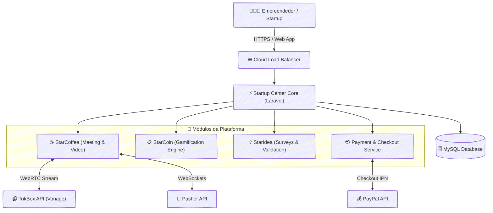

***

### 🚀 Project:  Toot - Resiliência no Processamento de Jornadas Longas

#### 🎯 Visão Geral e Arquitetura da Solução

No projeto Toot, o desafio inicial parecia ser apenas performance: otimizamos um processo de síncrono para assíncrono com filas, alcançando uma aceleração de **500x**. Contudo, essa vitória revelou um adversário mais complexo: a fragilidade no processamento de jornadas de dados muito longas.

O sistema original, mesmo sendo rápido, operava como um job monolítico. Uma única falha em qualquer etapa — uma API externa indisponível ou um cálculo imprevisto — resultava na perda total do processamento e, pior, na inconsistência dos dados. A depuração era um processo reativo e ineficiente, uma verdadeira "caixa-preta".

Para resolver essa questão fundamental, a solução foi redesenhar a arquitetura de processamento aplicando o **Padrão de Design SAGA**. Em vez de um único job gigante, a lógica foi decomposta em uma cadeia de micro-jobs granulares e com responsabilidade única. Utilizando o `Bus::chain()` do Laravel como um orquestrador (Coordenador SAGA), garantimos que cada etapa da jornada — validação, chamadas a APIs como Google Maps, cálculos e pontuação — fosse executada em uma sequência transacional. Se qualquer elo dessa corrente falhasse, a execução era imediatamente interrompida e, através de transações de compensação (`.catch()`), o sistema revertia seu estado, garantindo a atomicidade e a integridade dos dados.

#### 👨‍💻 Meu Papel no Projeto

Como **Arquiteto de Soluções e Desenvolvedor Sênior**, minhas principais responsabilidades foram:

  * **Diagnosticar** a causa raiz dos problemas de processamento, identificando que a falta de resiliência era mais crítica do que a velocidade.
  * **Desenhar a nova arquitetura** baseada no padrão SAGA para orquestrar os jobs de forma transacional e resiliente.
  * **Implementar a solução** de ponta a ponta utilizando PHP e Laravel, com foco no sistema de filas `Bus::chain()` para o encadeamento e `.catch()` para as ações de compensação.
  * **Estruturar a observabilidade** do processo com o Laravel Horizon, transformando a depuração de reativa para proativa.

#### ✨ Pontos Fortes e Desafios Superados

O maior triunfo deste projeto foi transformar um processo frágil em um workflow robusto e transparente. Os pontos fortes da solução são:

  * **Resiliência e Recuperação de Falhas:** O maior desafio era a falha em cascata. Com a SAGA, falhas pontuais (ex: timeout de uma API) não destroem mais todo o processamento. A cadeia simplesmente para, permitindo uma análise precisa do erro.
  * **Consistência Absoluta dos Dados:** Superamos o risco de dados parciais. A natureza da SAGA garante que ou a jornada é 100% processada com sucesso, ou o sistema é revertido a um estado limpo e consistente através das ações de compensação.
  * **Observabilidade e Depuração Simplificada:** O desafio da "caixa-preta" foi eliminado. Com o Laravel Horizon, ganhamos uma visão granular de cada micro-job na cadeia. Identificar, analisar e até mesmo reprocessar uma etapa específica tornou-se uma tarefa trivial, otimizando drasticamente o tempo de manutenção.

#### 🌱 Pontos para Evolução Futura

A arquitetura atual é sólida, mas poderia evoluir com:

1.  **Dead Letter Queue (DLQ) Sofisticada:** Implementar uma fila dedicada para jobs que falharam repetidamente, permitindo uma análise assíncrona e um processo de re-tentativa manual mais estruturado.
2.  **Transações de Compensação Granulares:** Evoluir a lógica de `.catch()` para disparar jobs de compensação específicos para a etapa que falhou, em vez de um rollback genérico, tornando a reversão ainda mais precisa.

-----

#### 🛠️ Pilha de Tecnologias (Tech Stack)

  * **Linguagem:** PHP
  * **Framework:** Laravel
  * **Ferramentas e Bibliotecas:** Laravel Horizon, Laravel Queues (`Bus::chain`)
  * **Infraestrutura de Fila:** Redis
  * **Banco de Dados:** PostgreSQL / MySQL
  * **Integrações de API:** Google Maps API, Overpass API

-----

#### 🗺️ Diagrama da Arquitetura

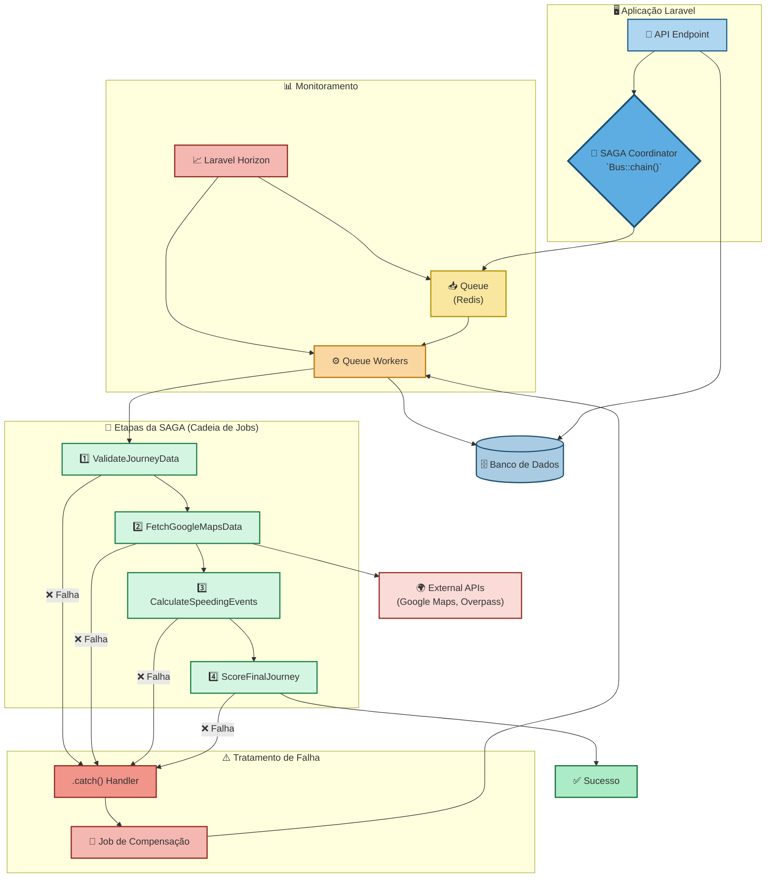
#### RESUMO TÉCNICO PARA EMBEDDING

O projeto implementou uma arquitetura resiliente para processamento de jornadas de dados longas, migrando de um job monolítico e frágil para um sistema assíncrono baseado no Padrão de Design SAGA. A orquestração foi realizada com o `Bus::chain()` do Laravel, funcionando como um Coordenador SAGA que encadeia uma sequência de micro-jobs transacionais (validação, chamadas a APIs, cálculos, pontuação). Para garantir a atomicidade e a consistência dos dados, transações de compensação foram implementadas com blocos `.catch()`, revertendo o estado do sistema em caso de falha em qualquer etapa, como timeouts na integração com Google Maps API ou Overpass API. A solução, desenvolvida em PHP com o framework Laravel, utiliza Redis para a infraestrutura de filas e PostgreSQL/MySQL como banco de dados. A observabilidade do processo foi alcançada com o Laravel Horizon, permitindo um monitoramento e depuração proativa dos queue workers, eliminando a natureza de "caixa-preta" do sistema anterior e garantindo a recuperação de falhas de forma robusta.

#### CLASSIFICAÇÃO DE TECNOLOGIAS E CONCEITOS

|Categoria|Tecnologias e Conceitos|
|---|---|
|**AI & Machine Learning**|N/A|
|**Software Development**|PHP, Laravel, Laravel Queues (`Bus::chain`), `.catch()`, Depuração Proativa|
|**Architecture**|Padrão de Design SAGA, Arquitetura Assíncrona, Micro-Jobs, Coordenador SAGA, Transações de Compensação, Resiliência, Recuperação de Falhas, Dead Letter Queue (DLQ), Job Monolítico|
|**Cloud Computing**|N/A|
|**API RESTFul development**|Google Maps API, Overpass API|
|**Frontend Development**|N/A|
|**Mobile Development**|N/A|
|**Database**|PostgreSQL, MySQL, Redis|
|**Data Management**|Atomicidade, Consistência de Dados, Integridade de Dados|
|**Content Management - CMS**|N/A|
|**System Administration**|N/A|
|**DevOps**|Laravel Horizon, Observabilidade, Gerenciamento de Filas (Queues), Queue Workers|
|**Leadership**|Arquiteto de Soluções, Desenvolvedor Sênior|
|**Coaching**|N/A|
|**Agile Project Management**|N/A|

***

### 🚀 Project:  Toot - Otimização de Geodata (30x) e API Para Market Intelligence

#### 🎯 Visão Geral e Arquitetura da Solução

Este projeto nasceu da necessidade de transformar uma vasta quantidade de dados geoespaciais brutos em insights acionáveis para inteligência de mercado. O desafio era claro: como visualizar mais de 200.000 pontos de dados em um mapa interativo sem comprometer a performance? A solução foi arquitetada em torno de uma API robusta em Laravel, que não apenas servia os dados para um frontend em React, mas também replicava a complexa lógica de filtragem de relatórios do PowerBI, garantindo uma análise de dados consistente e poderosa. A arquitetura foi projetada para ser altamente eficiente, utilizando a biblioteca Superfetch para carregamento progressivo e renderização inteligente dos dados, o que permitiu uma experiência de usuário fluida e responsiva.

#### 👨‍💻 Meu Papel no Projeto

Como desenvolvedor backend da equipe, minhas principais responsabilidades foram:

  - **Desenvolvimento da API:** Criei os endpoints em Laravel/MySQL que serviam como a espinha dorsal da plataforma, fornecendo os dados para os dashboards e mapas geoespaciais.
  - **Otimização de Performance:** Identifiquei e resolvi um gargalo crítico de performance, aumentando a velocidade de interação com os mapas em 30 vezes.
  - **Documentação da API:** Utilizei o Swagger para documentar a API, facilitando a integração com o frontend em React.
  - **Colaboração Full-Stack:** Trabalhei em estreita colaboração com os desenvolvedores React e a equipe de QA para garantir a entrega contínua de uma plataforma estável e de alta qualidade.

#### ✨ Pontos Fortes e Desafios Superados

O ponto mais forte da solução foi, sem dúvida, a **otimização de performance geoespacial**. Aumentar em 30 vezes a velocidade de interação com os mapas, reduzindo o tempo de resposta de \~15s para \~0.5s, foi uma vitória técnica que transformou a experiência do usuário. Outro ponto de destaque foi o desenvolvimento de uma API que replicava com sucesso a complexa lógica de filtragem de relatórios do PowerBI, fornecendo uma base de dados sólida e confiável para a plataforma de Market Intelligence.

#### 🌱 Pontos Para Evolução Futura

Para evoluir o projeto, poderíamos explorar a implementação de um sistema de cache mais avançado, como o Redis, para otimizar ainda mais as consultas à API. Além disso, a plataforma de Market Intelligence poderia ser expandida para incluir mais fontes de dados e análises preditivas, agregando ainda mais valor ao negócio.

-----

#### 🛠️ Pilha de Tecnologias (Tech Stack)

| Componente | Tecnologia Utilizada | Papel na Arquitetura |
| :--- | :--- | :--- |
| **Backend** | **Laravel (PHP)** | Desenvolvimento da API para servir os dados geoespaciais e de BI. |
| **Banco de Dados** | **MySQL** | Armazenamento e consulta dos dados da plataforma. |
| **Frontend** | **React** | Construção da interface de usuário, incluindo os mapas interativos. |
| **Mapas** | **Google Maps API** | Renderização dos mapas e visualização dos dados geoespaciais. |
| **Otimização de Performance**| **Superfetch** | Carregamento progressivo e renderização inteligente dos dados nos mapas. |
| **Business Intelligence** | **PowerBI (integração)** | Análise e visualização de dados, com lógica de filtragem replicada na API. |
| **Testes** | **PHPUnit** | Testes unitários para garantir a qualidade e a estabilidade da API. |
| **Documentação da API**| **Swagger** | Documentação dos endpoints da API para facilitar a integração. |
| **DevOps** | **CI/CD** | Entrega contínua de novas features e correções de bugs. |

-----

#### 🗺️ Diagrama da Arquitetura

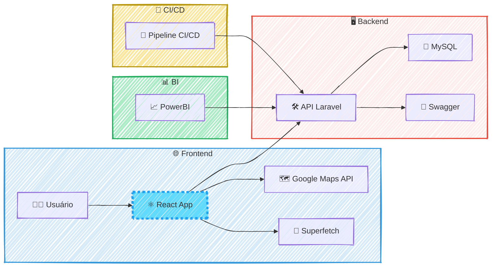

---
#### RESUMO TÉCNICO PARA EMBEDDING

Desenvolvimento de uma API backend em Laravel e MySQL para uma plataforma de Market Intelligence, focada na otimização de performance para visualização de mais de 200.000 pontos de geodata. A solução resolveu um gargalo crítico, aumentando a velocidade de interação em 30x (de ~15s para ~0.5s) em um frontend React com Google Maps API, utilizando a biblioteca Superfetch para carregamento progressivo. A API foi documentada com Swagger, testada com PHPUnit, e replicava a complexa lógica de filtragem de relatórios do PowerBI, sendo entregue via um pipeline de CI/CD. A arquitetura foi desenhada para ser responsiva e escalável, com futuras evoluções considerando a implementação de cache com Redis e análises preditivas.

#### CLASSIFICAÇÃO DE TECNOLOGIAS E CONCEITOS

| Categoria | Tecnologias e Conceitos |
| :--- | :--- |
| **AI & Machine Learning** | Análises Preditivas (Evolução Futura) |
| **Software Development** | Laravel (PHP), PHPUnit |
| **Architecture**| Otimização de Performance Geoespacial, Arquitetura de API, Cache (Redis - Evolução Futura) |
| **Cloud Computing** | N/A |
| **API RESTFul development** | API RESTFul, Laravel, Swagger, Integração com PowerBI |
| **Frontend Development** | React, Google Maps API, Superfetch |
| **Mobile Development** | N/A |
| **Database** | MySQL |
| **Data Management** | Geodata, Market Intelligence, Lógica de Filtragem de Dados |
| **Content Management - CMS** | N/A |
| **System Administration** | N/A |
| **DevOps** | CI/CD |
| **Leadership** | N/A |
| **Coaching** | N/A |
| **Agile Project Management** | Colaboração com QA, Entrega Contínua |

***

### 🚀 Project:  Índicos - Plataforma SaaS de Marketing de Indicação

#### 🎯 Visão Geral e Arquitetura da Solução

O projeto Índicos nasceu de uma visão ambiciosa: democratizar o marketing de indicação, permitindo que qualquer empresa, independentemente do seu tamanho, pudesse implementar um programa de recompensas multinível de forma autônoma e escalável. O desafio era criar uma plataforma SaaS **multi-tenant**, onde cada cliente (tenant) operasse em um ambiente seguro e isolado, mas sob a gestão de uma única aplicação centralizada.

A arquitetura foi concebida para ser robusta e flexível. Cada cliente acessava sua própria versão da plataforma através de um subdomínio exclusivo (ex: `empresa.indicos.com.br`). Um sistema de **middlewares personalizados** em Laravel atuava como o cérebro do roteamento, identificando o tenant a cada requisição. Isso garantia que todas as operações, desde a autenticação de usuários até as consultas no banco de dados **MySQL**, fossem rigorosamente segmentadas, prevenindo qualquer tipo de vazamento de dados entre os clientes. A solução final entregou um sistema onde cada empresa podia customizar suas próprias regras de negócio, produtos e comissões, gerenciando sua rede de indicadores com total autonomia.

#### 👨‍💻 Meu Papel no Projeto

Como arquiteto e desenvolvedor principal desta solução, minhas responsabilidades foram da concepção à entrega final. Atuei em frentes como:

  * **Arquitetura da Solução:** Desenhei e implementei toda a estrutura multi-tenant do zero, garantindo a segurança e o isolamento dos dados dos clientes.
  * **Desenvolvimento Back-End:** Codifiquei a complexa lógica de negócio para o sistema de comissionamento multinível, a automação de distribuição de prêmios e a gestão de produtos customizáveis por tenant.
  * **Desenvolvimento Front-End:** Criei os dashboards interativos, com destaque para a visualização dinâmica da rede de indicações, permitindo que os usuários acompanhassem o crescimento de suas hierarquias em tempo real.
  * **Infraestrutura e Resolução de Problemas:** Liderei a depuração de desafios de implantação, incluindo a investigação e superação de limitações no ambiente de hospedagem para habilitar funcionalidades críticas como os subdomínios dinâmicos.

#### ✨ Pontos Fortes e Desafios Superados

O maior ponto forte do Índicos reside em sua **arquitetura multi-tenant robusta**, que provou ser segura e escalável. No entanto, a jornada para alcançar esse resultado foi marcada por desafios que se tornaram grandes vitórias técnicas:

  * **O Mistério dos Subdomínios:** Um dos obstáculos mais frustrantes foi a falha na configuração de subdomínios dinâmicos no host contratado. Após uma exaustiva investigação que parecia apontar para uma falha no código, a persistência na depuração revelou a verdadeira causa: uma limitação da própria infraestrutura. Superar isso não foi apenas uma correção, mas uma lição valiosa sobre a importância de entender profundamente todo o ecossistema de deploy, transformando frustração em expertise.

  * **Visualizando a Complexidade:** Representar uma rede de indicação multinível de forma clara e intuitiva era um desafio por si só. A solução foi desenvolver um componente de visualização de diagramas dinâmicos, que renderizava a hierarquia de cada usuário em tempo real, exibindo os níveis e as porcentagens de ganho. Essa funcionalidade se tornou um diferencial da plataforma, transformando dados complexos em uma experiência de usuário engajadora.

#### 🌱 Pontos para Evolução Futura

Para o futuro, o projeto Índicos poderia evoluir com a implementação de duas frentes principais:

1.  **Integração com plataformas de e-commerce e CRMs** para automatizar ainda mais o ciclo de vendas e indicações.
2.  Um **módulo de analytics avançado** para que os clientes pudessem medir o ROI de seus programas de indicação com mais precisão.

-----

#### 🛠️ Pilha de Tecnologias (Tech Stack)

| Componente | Tecnologia Utilizada | Papel na Arquitetura |
| :--- | :--- | :--- |
| **Backend & Core da Aplicação** | **Laravel** | Responsável por toda a lógica de negócio, arquitetura multi-tenant, roteamento por subdomínios, autenticação dupla (master e tenants) e APIs. |
| **Banco de Dados** | **MySQL** | Persistência dos dados de todos os tenants, incluindo usuários, redes de indicação e configurações, com isolamento garantido por tenant. |
| **Frontend & Dinamismo** | **JavaScript / jQuery** | Utilizado para criar os diagramas de hierarquia dinâmicos no dashboard do usuário, proporcionando uma visualização interativa e em tempo real da rede. |
| **Ambiente de Deploy** | **Host Umbler** | Ambiente de nuvem onde a aplicação foi implantada. O entendimento de suas limitações foi crucial para a resolução de desafios de infraestrutura. |

-----

#### 🗺️ Diagrama da Arquitetura

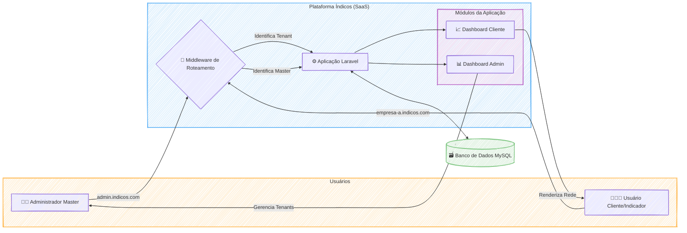

---
#### RESUMO TÉCNICO PARA EMBEDDING

A plataforma Índicos é um SaaS de marketing de indicação com uma arquitetura multi-tenant robusta, desenvolvida em Laravel. O core da solução reside em middlewares personalizados que gerenciam o roteamento por subdomínios dinâmicos, garantindo o total isolamento de dados de cada tenant em um banco de dados MySQL. O desenvolvimento back-end abrange a complexa lógica de negócio para um sistema de comissionamento multinível e automação de prêmios. No front-end, JavaScript e jQuery foram utilizados para criar dashboards interativos, destacando-se um componente de visualização de diagramas dinâmicos que renderiza a hierarquia da rede de indicações em tempo real. Um desafio técnico significativo superado foi a depuração e resolução de problemas de implantação relacionados a limitações da infraestrutura de hospedagem (Host Umbler) na configuração dos subdomínios, o que exigiu uma análise profunda do ambiente de deploy. A arquitetura foi projetada para ser escalável, com futuras evoluções planejadas para integração via API com CRMs e plataformas de e-commerce, além de um módulo de analytics avançado.

#### CLASSIFICAÇÃO DE TECNOLOGIAS E CONCEITOS

| Categoria | Tecnologias e Conceitos |
| :--- | :--- |
| **AI & Machine Learning** | Módulo de analytics avançado (evolução futura) |
| **Software Development** | Laravel, Middlewares personalizados, Lógica de comissionamento multinível, Automação de distribuição de prêmios, Depuração (Debugging) |
| **Architecture**| Arquitetura multi-tenant, SaaS (Software as a Service), Roteamento por subdomínios, Isolamento de dados, Integração com plataformas externas |
| **Cloud Computing** | Host Umbler, Infraestrutura de hospedagem |
| **API RESTFul development** | APIs para integração (evolução futura) |
| **Frontend Development** | JavaScript, jQuery, Dashboards interativos, Visualização de diagramas dinâmicos |
| **Mobile Development** | N/A |
| **Database** | MySQL |
| **Data Management** | Segmentação de dados por tenant, Visualização de dados hierárquicos |
| **Content Management - CMS** | N/A |
| **System Administration** | Configuração de subdomínios dinâmicos, Gestão de ambiente de hospedagem |
| **DevOps** | Implantação (Deploy), Resolução de problemas de infraestrutura |
| **Leadership** | Arquiteto de Soluções, Desenvolvedor Principal |
| **Coaching** | N/A |
| **Agile Project Management** | Gestão do ciclo de vida do projeto (concepção à entrega) |

***

### 🚀 Project:  Kpro After Sales - API para Otimização de Processos de Pós-Venda

#### 🎯 Visão Geral e Arquitetura da Solução

Em um cenário onde os processos de pós-venda da Kpro — abrangendo aluguéis, vendas e compras compartilhadas — precisavam de coesão e eficiência, a solução foi arquitetar e construir um núcleo digital central: uma **API RESTful robusta e escalável**. Este projeto nasceu para ser o "cérebro" da operação, orquestrando todo o ciclo de vida dos equipamentos, desde a gestão de checklists e documentos até o controle de status e histórico.

A API foi desenvolvida em **Laravel Lumen**, servindo como o backend desacoplado para uma moderna interface de usuário em Vue.js. Essa arquitetura garantiu não apenas uma separação clara de responsabilidades, mas também uma agilidade ímpar para as equipes de frontend e backend trabalharem em paralelo, conectadas por um contrato de API bem definido e documentado.

#### 👨‍💻 Meu Papel no Projeto

Atuando como **Desenvolvedor Back-End**, em estreita colaboração com o Arquiteto de Soluções, minhas principais responsabilidades foram:

  * **Construção da API:** Desenvolver os endpoints, implementar as regras de negócio e realizar a integração com serviços externos utilizando o framework Laravel Lumen.
  * **Otimização de Performance:** Realizar *query tuning* no banco de dados MySQL e implementar estratégias de cache para garantir a velocidade da aplicação.
  * **Garantia de Qualidade:** Criar uma suíte sólida de testes automatizados com PHPUnit para assegurar a estabilidade e evitar regressões.
  * **Facilitação da Integração:** Elaborar a documentação completa da API com Swagger/OpenAPI para acelerar o desenvolvimento e a integração com a equipe de frontend.

#### ✨ Pontos Fortes e Desafios Superados

O maior triunfo deste projeto foi transformar desafios técnicos complexos em vitórias mensuráveis para o negócio.

  * **Performance como Prioridade:** Um dos principais desafios era garantir que a API respondesse com baixa latência, mesmo sob carga. Enfrentei isso com uma otimização criteriosa das consultas ao banco de dados e a implementação de uma camada de cache inteligente. O resultado? Uma **melhora de 30% no tempo de resposta** dos endpoints críticos, impactando diretamente a experiência do usuário final.
  * **Qualidade e Estabilidade Inegociáveis:** Para construir uma base sólida e confiável, a estratégia foi investir pesado em automação de testes. O desafio era cobrir a complexidade das regras de negócio. Superamos isso ao desenvolver uma suíte de testes com **cobertura de código de aproximadamente 80%** usando PHPUnit, o que blindou a API contra bugs e regressões.
  * **Colaboração Acelerada por Documentação:** A sinergia entre backend e frontend é crucial. Para eliminar qualquer atrito, produzi uma documentação interativa e detalhada com **Swagger/OpenAPI**. Isso não apenas serviu como um contrato claro, mas também **acelerou o onboarding e a produtividade da equipe de frontend** em Vue.js, permitindo que eles consumissem os endpoints com total autonomia e clareza.

#### 🌱 Pontos para Evolução Futura

Como próximos passos para evoluir a maturidade da solução, poderíamos considerar:

1.  A implementação de um **pipeline de CI/CD** para automatizar os processos de build, teste e deploy.
2.  Adoção de uma ferramenta de **monitoramento e observabilidade** (como Prometheus/Grafana) para acompanhar a saúde da API em tempo real.

-----

#### 🛠️ Pilha de Tecnologias (Tech Stack)

| Componente               | Tecnologia Utilizada    | Papel na Arquitetura                                                                                                           |
| :----------------------- | :---------------------- | :----------------------------------------------------------------------------------------------------------------------------- |
| **Backend API**          | **Laravel Lumen (PHP)** | Núcleo da aplicação, responsável por toda a lógica de negócio, regras e exposição dos dados via endpoints RESTful.             |
| **Banco de Dados**       | **MySQL**               | Sistema de gerenciamento de banco de dados relacional para a persistência de todas as informações da plataforma.               |
| **Testes Automatizados** | **PHPUnit**             | Ferramenta utilizada para criar a suíte de testes unitários e de integração, garantindo a qualidade e estabilidade do código.  |
| **Documentação da API**  | **Swagger (OpenAPI)**   | Padrão utilizado para desenhar, construir e documentar a API, servindo como um contrato claro para os consumidores (frontend). |


-----

#### 🗺️ Diagrama da Arquitetura

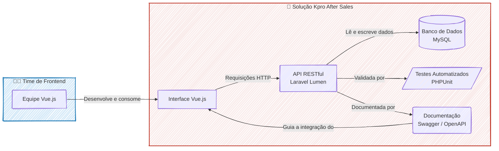


---
#### RESUMO TÉCNICO PARA EMBEDDING

Desenvolvimento de uma API RESTful em Laravel Lumen como núcleo de uma arquitetura desacoplada para otimização de processos de pós-venda (aluguéis, vendas, compras). A solução, com backend em PHP, orquestra o ciclo de vida de equipamentos, incluindo checklists e documentos, servindo uma interface em Vue.js. O foco foi em performance, com otimização via query tuning em MySQL e implementação de cache, resultando em 30% de melhora na latência. A qualidade foi assegurada por uma suíte de testes automatizados em PHPUnit com 80% de cobertura de código para evitar regressões. A integração com o frontend foi acelerada pela documentação da API com Swagger/OpenAPI, que serviu como contrato entre as equipes. Propostas de evolução incluem a implementação de um pipeline de CI/CD e a adoção de ferramentas de monitoramento e observabilidade como Prometheus/Grafana.

#### CLASSIFICAÇÃO DE TECNOLOGIAS E CONCEITOS

| Categoria                    | Tecnologias e Conceitos                                                                                        |
| :--------------------------- | :------------------------------------------------------------------------------------------------------------- |
| **AI & Machine Learning**    | N/A                                                                                                            |
| **Software Development**     | Laravel Lumen (PHP), PHPUnit, Testes Automatizados, Cobertura de Código, Regras de Negócio, Query Tuning |
| **Architecture**             | Arquitetura Desacoplada, API RESTful, Cache, Baixa Latência                                                |
| **Cloud Computing**          | N/A                                                                                                            |
| **API RESTFul development**  | API RESTful, Endpoints, Swagger (OpenAPI), Documentação da API                                              |
| **Frontend Development**     | Vue.js                                                                                                     |
| **Mobile Development**       | N/A                                                                                                            |
| **Database**                 | MySQL, Query Tuning                                                                                        |
| **Data Management**          | N/A                                                                                                            |
| **Content Management - CMS** | N/A                                                                                                            |
| **System Administration**    | Monitoramento e Observabilidade (Proposto), Prometheus/Grafana (Proposto)                                   |
| **DevOps**                   | CI/CD (Proposto), Monitoramento e Observabilidade (Proposto)                                                |
| **Leadership**               | Arquiteto de Soluções                                                                                    |
| **Coaching**                 | N/A                                                                                                            |
| **Agile Project Management** | N/A                                                                                                            |

***

### 🚀 Project:  Shosales Review - Otimização de Performance (10x) e Implantação de Testes E2E

#### 🎯 Visão Geral e Arquitetura da Solução

O projeto Shosales Review enfrentava um desafio clássico em sistemas legados: uma experiência de usuário lenta e uma base de código que a equipe hesitava em modificar por medo de introduzir bugs. A página de visualização de imóveis, um ponto crucial da jornada do usuário, levava longos 5 segundos para carregar, comprometendo a usabilidade e a satisfação do cliente.

A solução foi arquitetada em duas frentes estratégicas e complementares:

1.  **Otimização Cirúrgica de Performance:** Realizei um diagnóstico profundo na aplicação Laravel, identificando que a lentidão era causada por um excesso de 37 consultas ao banco de dados para renderizar uma única página. A estratégia foi refatorar a camada de acesso a dados, otimizando as queries com o Eloquent ORM, implementando índices estratégicos no MySQL e, como resultado, **reduzindo o número de consultas para apenas 4**. Essa intervenção resultou em uma **melhora de 10x na performance**, diminuindo o tempo de carregamento para aproximadamente 0.5 segundos.

2.  **Escudo de Qualidade Automatizado:** Para dar segurança à equipe e viabilizar futuras evoluções, implementei uma suíte completa de testes de ponta-a-ponta (E2E) com Laravel Dusk. Esses testes simulam os fluxos de usuário mais críticos e foram integrados a um pipeline de CI/CD (GitHub Actions/Jenkins), rodando automaticamente a cada nova alteração no código. Com a integração do CrossBrowserTesting, garantimos que a aplicação funcionava de forma consistente em múltiplos navegadores e dispositivos, eliminando regressões em produção.

#### 👨‍💻 Meu Papel no Projeto

Como o principal responsável pela modernização e garantia de qualidade da plataforma, minhas responsabilidades foram:

  * **Análise de Performance:** Liderar a investigação e o diagnóstico dos gargalos de performance da aplicação, utilizando ferramentas de profiling para identificar as queries ineficientes.
  * **Engenharia de Backend:** Refatorar o código PHP/Laravel, otimizar as interações com o banco de dados (MySQL) e ajustar o uso do ORM para alcançar a máxima eficiência.
  * **Automação de Testes (QA):** Desenhar, codificar e manter a suíte de testes E2E com Laravel Dusk, definindo os cenários críticos a serem cobertos.
  * **Cultura DevOps:** Estruturar e integrar a execução dos testes automatizados ao pipeline de CI/CD, garantindo que nenhuma alteração que quebrasse a funcionalidade existente chegasse à produção.

#### ✨ Pontos Fortes e Desafios Superados

O maior triunfo deste projeto foi transformar um ponto de grande frustração em um case de sucesso. O desafio não era apenas técnico, mas também cultural. A equipe tinha receio de mexer no código legado.

  * **Superação da Lentidão:** O ganho de performance de 10x não foi apenas uma métrica; foi uma mudança radical na experiência do usuário, visível e comprovável.
  * **Construindo Confiança com Código:** A suíte de testes E2E funcionou como uma "rede de segurança". Ao automatizar a validação dos fluxos críticos, demos à equipe a confiança necessária para refatorar e melhorar o sistema continuamente, sabendo que qualquer regressão seria detectada de forma imediata pelo pipeline. Isso quebrou o ciclo de medo e estagnação.

#### 🌱 Pontos para Evolução Futura

Com a base sólida de performance e qualidade estabelecida, os próximos passos naturais para evoluir o projeto seriam:

1.  **Cache Inteligente:** Expandir o uso do Redis para implementar cache em camadas mais altas da aplicação, como em fragmentos de views e resultados de API, para ganhos de performance ainda mais expressivos.
2.  **Testes de Regressão Visual:** Adicionar testes de regressão visual ao pipeline para detectar automaticamente quebras de layout na interface, garantindo consistência visual a cada deploy.

-----

#### 🛠️ Pilha de Tecnologias (Tech Stack)

| Componente | Tecnologia Utilizada | Papel na Arquitetura |
| :--- | :--- | :--- |
| **Backend** | **Laravel (PHP)** | Framework principal da aplicação, orquestrando as regras de negócio e a lógica de apresentação. |
| **Banco de Dados** | **MySQL** | Armazenamento persistente de todos os dados relacionados a imóveis e avaliações. |
| **Cache** | **Redis** | Utilizado para cache de sessão e otimizações pontuais de performance. |
| **Testes E2E** | **Laravel Dusk** | Ferramenta para automação de testes de ponta-a-ponta, simulando a interação do usuário no navegador. |
| **Testes Cross-Browser** | **CrossBrowserTesting** | Plataforma em nuvem para executar os testes do Dusk em múltiplos navegadores e sistemas operacionais. |
| **CI/CD** | **GitHub Actions / Jenkins** | Orquestradores do pipeline de integração e entrega contínua, automatizando build, testes e deploy. |

-----

#### 🗺️ Diagrama da Arquitetura de Qualidade e CI/CD

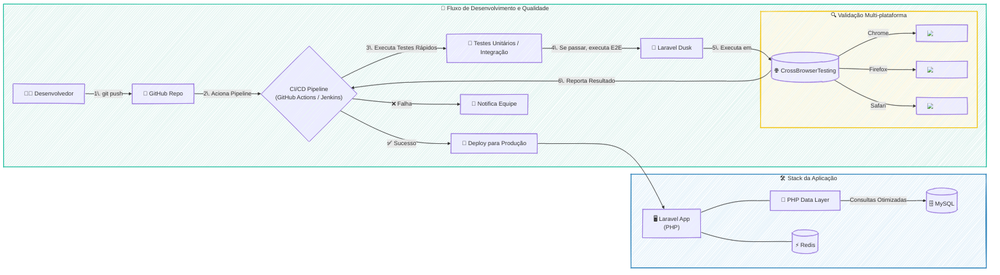


---
#### RESUMO TÉCNICO PARA EMBEDDING

O projeto consistiu na otimização de performance e implementação de um escudo de qualidade para uma aplicação legada em Laravel (PHP), o Shosales Review. O principal desafio foi a lentidão na renderização de páginas, causada por 37 consultas ineficientes ao banco de dados MySQL via Eloquent ORM. A solução envolveu uma refatoração profunda da camada de acesso a dados, com a otimização de queries e a criação de índices estratégicos no MySQL, resultando em uma redução para apenas 4 consultas e um ganho de performance de 10x. Para garantir a estabilidade e dar confiança à equipe para futuras modificações, foi implementada uma suíte de testes de ponta-a-ponta (E2E) com Laravel Dusk. Esses testes foram integrados a um pipeline de CI/CD utilizando GitHub Actions e Jenkins, com validação em múltiplos navegadores através da plataforma em nuvem CrossBrowserTesting. A automação de QA funcionou como uma rede de segurança contra regressões, fomentando uma cultura de melhoria contínua e superando o receio de modificar o código legado. As evoluções futuras planejadas incluem a implementação de cache com Redis e testes de regressão visual.

#### CLASSIFICAÇÃO DE TECNOLOGIAS E CONCEITOS

| Categoria | Tecnologias e Conceitos |
| :--- | :--- |
| **AI & Machine Learning** | N/A |
| **Software Development** | Laravel, PHP, Eloquent ORM, Legacy Code Refactoring, Performance Profiling |
| **Architecture**| Legacy System Modernization, Data Access Layer Optimization |
| **Cloud Computing** | CrossBrowserTesting |
| **API RESTFul development** | N/A |
| **Frontend Development** | User Experience (UX) Optimization, Visual Regression Testing (future work) |
| **Mobile Development** | N/A |
| **Database** | MySQL, Query Optimization, Database Indexing |
| **Data Management** | N/A |
| **Content Management - CMS** | N/A |
| **System Administration** | N/A |
| **DevOps** | CI/CD, GitHub Actions, Jenkins, QA Automation, E2E Testing, Laravel Dusk |
| **Leadership** | Technical Leadership, Project Modernization |
| **Coaching** | Team Confidence Building, Cultural Change Management |
|  **Agile Project Management** | Continuous Improvement, Regression Prevention |

***

### 🚀 Project:  Ask Richter - Meu CV Interativo Com IA

**Categoria:** 🏆 Tier 1: AI, Cloud Architecture & SaaS

#### 🎯 Visão Geral E Arquitetura Da Solução

Um currículo tradicional conta o que você fez no passado, mas e se ele pudesse conversar, raciocinar e demonstrar o seu conhecimento em tempo real? O **Ask Richter** nasceu dessa premissa: transformar uma trajetória profissional estática em uma experiência de diálogo interativo e dinâmico. Trata-se de um chatbot especialista na minha carreira, construído sobre uma arquitetura RAG (*Retrieval-Augmented Generation*) 100% Serverless.

Mais do que um simples portfólio, este projeto é uma aplicação "SaaS-like" e uma demonstração prática do *AI Engineering Framework v2.1*. Através de um motor RAG multilíngue (M15), a plataforma identifica o idioma do usuário (Português, Inglês ou Espanhol) e orquestra buscas vetoriais e léxicas para formular respostas factuais precisas. Toda a arquitetura foi desenhada para operar na nuvem da Vercel (Next.js App Router) comunicando-se com o Supabase e provedores de IA agnósticos (como Gemini e Ollama local), unindo inovação de produto com o máximo de governança, isolamento de escopo (WSCI) e resiliência de infraestrutura.

#### 👨‍💻 Meu Papel No Projeto

Como **AI Solutions Architect & Desenvolvedor Full-Stack**, atuei no projeto de ponta a ponta, assumindo os seguintes chapéus:

- **Arquiteto de Software & Nuvem:** Desenhei a arquitetura 100% Serverless (ADR-0007/0008), eliminando dependências nativas complexas e garantindo baixo custo operacional.
- **Engenheiro de IA (AI Engineer):** Implementei a camada RAG Híbrida (Busca Vetorial e Léxica), integrei o ecossistema Provider-Agnostic (Gemini, OpenRouter, Ollama) e desenvolvi a inteligência multilíngue.
- **Desenvolvedor Frontend:** Criei uma UI/UX moderna, reativa e resiliente com React 19, Next.js 15 e Framer Motion, garantindo feedback visual suave mesmo durante cold-starts de banco de dados.
- **Engenheiro de Confiabilidade (SRE/DevOps):** Estabeleci os protocolos estritos de governança (*Zero-Trust*, *Jidoka/Andon Cord*) e o pipeline de CI/CD via Turborepo.

#### 📊 Resultados Quantificados

- **Custos de Infraestrutura Minimizados:** Arquitetura 100% Serverless que elimina a necessidade de servidores dedicados 24/7, alavancando os *Free Tiers* da Vercel, Supabase e Google AI.
- **Alta Resiliência e SLA Calibrado:** SLA rigoroso de 300 segundos estipulado e calibrado em produção para o ciclo de inicialização do banco de dados (cold-start), garantindo transparência ao usuário.
- **Qualidade e Cobertura:** Pipeline protegido por uma suíte de 65 testes automatizados divididos em 8 módulos críticos (resiliência, roteamento, paridade vetorial e M15).
- **Engenharia de Performance e UX:** Eliminação total de dependências em C++ para buscas vetoriais, substituídas por implementações puras em TypeScript (TSVectorStore e SimpleTfIdf), acelerando o tempo de build e deploy.

#### 🛡️ Segurança & Mitigações OWASP Top 10

- **Isolamento de Credenciais Severas (OWASP A02: Cryptographic Failures):** A comunicação com a *Supabase Management API* ocorre de forma estritamente server-side (via `/api/supabase/restore`). O token administrativo (`SUPABASE_MANAGEMENT_TOKEN`) é mantido 100% isolado do navegador, aplicando o princípio de privilégio mínimo.
- **Prevenção de SSRF e Roteamento Inseguro (OWASP A10: Server-Side Request Forgery):** Implementação de Invariantes de Roteamento de Produção (*Zero Render Fallback*), que realizam sanitização automática de URLs em tempo de execução para forçar o uso exclusivo de rotas relativas nativas Vercel, bloqueando desvios maliciosos.
- **Controle de Acesso Zero-Trust (OWASP A01: Broken Access Control):** A "Constituição dos Agentes" determina limites operacionais estritos para a IA durante o desenvolvimento, utilizando operações baseadas em workspaces segregados e execução em duas fases (*Plan* e *Execution*) que exigem intervenção humana mandatória em pontos críticos (Gate Humano).

#### ✨ Pontos Fortes E Desafios Superados

O principal vilão deste projeto foi a **volatilidade dos serviços em camadas gratuitas**, especificamente as pausas por inatividade do Supabase, que degradavam severamente a experiência do usuário.

Para contornar isso, não aceitei a solução óbvia de pagar por instâncias dedicadas. Ao invés disso, projetei a **Máquina de Estados Operacional (ADR-0009)**. Criei um sistema robusto que não tenta adivinhar se o banco está pausado com base em falhas genéricas de rede (Regra de Ouro da Não-Inferência de Pausa), mas utiliza 7 estados operacionais estritos. Quando detecta uma pausa real, a plataforma orquestra um descongelamento automático de forma transparente, exibindo um modal polido na UI que executa polling sequencial com *progressive backoff* e travas de idempotência. Transformei um gargalo clássico de infraestrutura *serverless* em uma demonstração impressionante de engenharia de resiliência.

#### 🌱 Pontos Para Evolução Futura

- **Telemetria de Relevância RAG:** Implementar painéis e métricas de feedback implícito do usuário para calibrar continuamente a precisão dos chunks recuperados pela IA.
- **Integração Contínua com Agentes Locais:** Aprofundar o fluxo de CI/CD para que o pipeline Jidoka execute de forma autônoma simulações complexas de requisições exploratórias usando o modelo Ollama em hardware local antes dos deploys em produção.

---

#### 🛠️ Pilha De Tecnologias (Tech Stack)

| Componente                | Tecnologia Utilizada       | Papel na Arquitetura                                                                                                                                                               |
| ------------------------- | -------------------------- | ---------------------------------------------------------------------------------------------------------------------------------------------------------------------------------- |
| **Camada de Nuvem (Web)** | Next.js 15 (App Router)    | Core framework para roteamento serverless, orquestração de APIs REST (`/api/chat`, `/api/supabase/status`) e SSR.                                                                  |
| **Frontend UI/UX**        | React 19 & Tailwind CSS    | Construção de interface interativa, responsiva e componentes com micro-animações visuais ricas (Framer Motion).                                                                    |
| **Provedores de IA LLM**  | Google GenAI & Ollama      | Motor de inteligência artificial (Gemini 3.6-flash como padrão) e fallback agnóstico para geração de respostas multilíngues em tempo real.                                         |
| **Armazenamento & RAG**   | Supabase & TypeScript Puro | Banco de dados para persistência, integração com Supabase Management API para resiliência e motores `TSVectorStore` / `SimpleTfIdf` puramente em TS para buscas vetorial e léxica. |
| **DevOps & Monorepo**     | Turborepo 2.x              | Orquestração do monorepo, isolamento de workspaces e execução do protocolo *Jidoka* para validação paralela estrita de build, lint e testes.                                       |

---

#### 🗺️ Diagrama Da Arquitetura

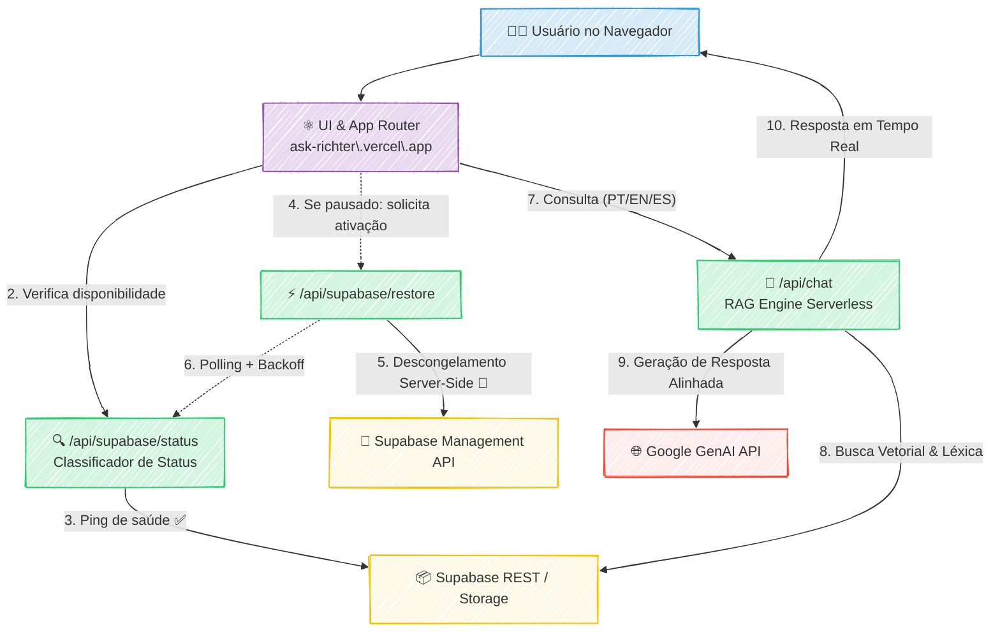

***

### 🚀 Project:  Admin Canaoaves

#### 🎯 Visão Geral E Arquitetura Da Solução

O **Admin Canaoaves** não é apenas um painel administrativo; é o "cérebro" operacional e estratégico por trás da plataforma pública de observação de aves. O objetivo central era criar um ambiente seguro e robusto que permitisse à equipe interna ultrapassar as barreiras de segurança (RLS - *Row Level Security*) impostas aos usuários comuns, garantindo controle total sobre dados, moderação e usuários.

A solução foi arquitetada como uma aplicação *server-side* moderna, utilizando a sinergia entre **Refine** e **Next.js**. A grande sacada arquitetural foi transformar o navegador em uma camada puramente de apresentação. Enquanto a aplicação pública restringe o acesso aos dados, este painel atua como um "bunker": todas as operações de leitura e escrita são interceptadas por **Server Actions**, que instanciam clientes Supabase privilegiados (`Service Role Key`) em um ambiente seguro, permitindo a gestão irrestrita da plataforma sem jamais expor credenciais críticas ao cliente.

#### 👨‍💻 Meu Papel No Projeto

Atuei como **Líder Técnico e Arquiteto Full Stack**, responsável por conduzir a evolução do produto da versão 1.0 para a 2.0. Minhas responsabilidades incluíram:

  * **Arquiteto de Soluções:** Desenhei o padrão de "RLS Bypass" via Server Actions e a estrutura de banco de dados para suportar a nova taxonomia e gamificação.
  * **Desenvolvedor Front-End:** Implementei a interface utilizando **Refine** e **shadcn/ui**, focando na criação de componentes reutilizáveis (`UserProfileCard`, `CategoryManager`) e na responsividade (Mobile/Dark Mode).
  * **Engenheiro de Back-End:** Otimizei a performance substituindo chamadas RPC lentas por queries diretas em Views do Postgres e criei a lógica de "Soft Deletes" e triggers de automação.
  * **Gerente de Produto (DX):** Refinei a experiência do desenvolvedor (DX) com tipagem forte (`database.types.ts`) e hooks customizados (`useServerTable`) para padronizar listagens e filtros.

#### ✨ Pontos Fortes E Desafios Superados

O projeto se destaca pela **segurança arquitetural** e pela **evolução da performance**.

  * **O Desafio do Acesso Seguro (RLS Bypass):** O maior desafio técnico foi permitir que administradores editassem dados de terceiros em um banco protegido por RLS, sem criar brechas de segurança.
      * *Superação:* Implementamos um padrão onde o *client-side* usa apenas a chave pública para autenticação. Todas as mutações de dados são roteadas para o servidor Next.js, onde uma instância isolada do Supabase (com a `SERVICE_ROLE_KEY`) executa a ação. Isso garantiu poder total aos admins mantendo a integridade do banco.
  * **O Gargalo de Performance na Moderação:** Na versão inicial, carregar listas de moderação envolvia múltiplas chamadas RPC (Remote Procedure Calls), tornando o painel lento.
      * *Superação:* Refatorei o backend para utilizar **Views SQL** otimizadas (`view_admin_*`) e consolidei a lógica de busca em uma única Server Action (`data.ts`). Criamos o hook `useServerTable` que gerencia paginação e filtros via URL, resultando em um carregamento instantâneo e uma UX muito mais fluida.
  * **De "Fila de Tarefas" para "Gestão Inteligente":** Transformamos a moderação simples em um sistema rico. Agora, em vez de apenas aprovar/rejeitar, o admin pode **editar conteúdo** (textos de cidades, fotos) antes da publicação e visualizar o contexto do usuário (Score de Gamificação, Nível de Reputação) para tomar decisões mais rápidas e justas.

#### 🌱 Pontos Para Evolução Futura

1.  **Dashboard Analítico Avançado:** Aproveitar os dados centralizados para criar gráficos de tendências de novos usuários e engajamento por região geográfica.
2.  **Moderação Assistida por IA:** Implementar uma camada de pré-análise em textos e imagens para sugerir automaticamente a aprovação ou rejeição de denúncias simples, acelerando o trabalho humano.

-----

#### 🛠️ Pilha De Tecnologias (Tech Stack)

| Componente | Tecnologia Utilizada | Papel na Arquitetura |
| :--- | :--- | :--- |
| **Framework Web** | **Next.js 15.3.1** | Estrutura principal da aplicação, responsável pelo roteamento, renderização híbrida e execução segura das Server Actions. |
| **Framework Admin** | **Refine 5.0.1** | Acelerador de desenvolvimento para aplicações internas, gerenciando estado de formulários, tabelas e provedores de dados. |
| **Backend & DB** | **Supabase (PostgreSQL)** | Banco de dados relacional, autenticação de usuários e triggers (Automação de perfis e roles). |
| **Interface (UI)** | **shadcn/ui + Tailwind CSS** | Biblioteca de componentes visuais modernos e sistema de estilização para criar o tema "Naturebirds" e responsividade. |
| **Linguagem** | **TypeScript** | Garante a tipagem estática e segurança do código, integrado aos tipos gerados automaticamente pelo banco de dados. |
| **Infra & DevOps** | **Vercel** | Hospedagem da aplicação com CI/CD contínuo integrado ao GitHub. |

-----

#### 🗺️ Diagrama Da Arquitetura

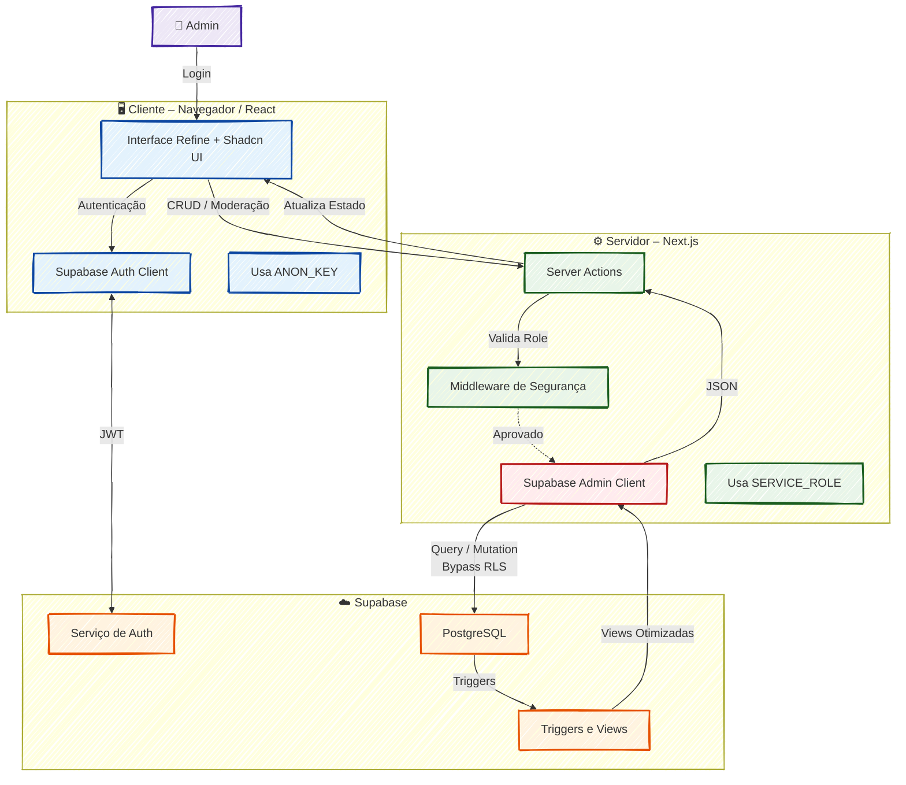

***

### 🚀 Project:  Canaoaves - Plataforma Colaborativa Para a Comunidade de Observadores de Aves

#### 🎯 Visão Geral e Arquitetura da Solução

O **Canaoaves** nasceu para solucionar um problema histórico na comunidade de observadores de aves no Brasil: a fragmentação de informações e a falta de centralização de serviços de apoio validados (como guias, hospedagens e locais de observação). A plataforma funciona como o Cadastro Nacional de Observadores de Aves, um ecossistema colaborativo onde os próprios membros constroem e validam a base de dados. O projeto está publicado e operacional em **[www.canaoaves.com.br](http://www.canaoaves.com.br)**.

A arquitetura do sistema evoluiu de um modelo SPA tradicional para um **Monolito Modular (Vertical Slice Architecture)** de alta coesão e baixo acoplamento. A aplicação frontend é construída em **React**, **Vite** e **TypeScript**, hospedada na infraestrutura global da **Vercel**. O backend é sustentado pelo **Supabase**, utilizando o **PostgreSQL** como motor central de persistência e executando lógicas complexas de negócio através de funções em PL/pgSQL (RPCs), gatilhos (triggers) e **Edge Functions (Deno)**.

A fundação do código frontend está estruturada sob o diretório `src/modules/`, organizada em 11 módulos funcionais independentes (`auth`, `statistics`, `events`, `library`, `alavai`, `search`, `location`, `services`, `profile`, `home`, `legal`). Cada módulo encapsula rigorosamente suas próprias telas (`pages/`), componentes de UI (`components/`), hooks de estado (`hooks/`), definições de tipos (`types/`) e uma camada isolada de acesso a dados (`services/*Service.ts`), seguindo o padrão em camadas **`Page ➔ Hook ➔ Service ➔ Supabase`**.

#### 👨‍💻 Meu Papel no Projeto

Como **Arquiteto de Soluções e Desenvolvedor Principal (Tech Lead)**, liderei a concepção técnica, a modelagem de dados e a reestruturação arquitetural completa da plataforma:

  - 🏛️ **Evolução Arquitetural para Monolito Modular:** Planejei e executei a transição de um frontend legado com chamadas diretas ao banco de dados espalhadas na UI para uma **Vertical Slice Architecture** estruturada por fatias de domínio (`src/modules/`). Essa refatoração reorganizou a base de código inteira em 11 módulos autônomos sem causar qualquer regressão ou interrupção de serviço (0% downtime / 0% regressão).
  - 🐘 **Modelagem e Engenharia de Banco de Dados (PostgreSQL):** Projetei o schema relacional no Supabase, implementando **estruturas polimórficas** para interações sociais (curtidas, comentários e fotos), categorias hierárquicas, procedimentos armazenados (PL/pgSQL) e regras rigorosas de segurança via **Row Level Security (RLS)**.
  - ⚙️ **Desenvolvimento Backend & Serverless:** Criei RPCs para cálculo de estatísticas e gamificação, além de desenvolver **Edge Functions em Deno** conectadas a **Database Webhooks** para tarefas assíncronas, como geocoding automático de cidades e disparo de notificações por e-mail via **Resend**.
  - 🧪 **Qualidade e Engenharia de Testes (E2E):** Implementei uma suíte automatizada de testes E2E com **Cypress**, incluindo travas de segurança de ambiente e rotinas automáticas de limpeza de dados (teardown), assegurando a resiliência dos fluxos críticos de cadastro, buscas e gerenciamento de perfis.

#### ✨ Pontos Fortes e Desafios Superados

  - 📦 **Refatoração para Monolito Modular por Fatias Verticais (Vertical Slice Architecture):**
      - **O Desafio:** A aplicação cresceu rapidamente com múltiplos recursos (Biblioteca, Agenda, Alertas de Raridades ALAVAI, Estatísticas, Perfis). Os componentes de interface realizavam consultas diretas ao cliente do Supabase, misturando regras de negócio, chamadas assíncronas e renderização visual, o que dificultava os testes e a manutenção.
      - **A Superação:** Migrei 100% da aplicação para um Monolito Modular sob `src/modules/`, encapsulando cada funcionalidade em seu próprio módulo de domínio. Criei a camada de serviço (`*Service.ts`) para cada módulo, isolando as queries do Supabase e chamadas de APIs externas. A migração foi executada de forma incremental, mantendo compatibilidade com shims e eliminando completamente a pasta antiga `src/pages/` após atingir 100% de sucesso nos checadores de tipos TypeScript e testes Cypress E2E.
  - 🔗 **Arquitetura Social Limpa com Associações Polimórficas:**
      - **O Desafio:** O sistema exigia recursos de interação social (curtidas, comentários, fotos) em diversas entidades diferentes (perfis de observadores, pousadas, guias, cidades, artigos da biblioteca). A abordagem tradicional de criar tabelas duplicadas (`service_likes`, `profile_likes`) inflaria o schema e duplicaria a lógica de backend.
      - **A Superação:** Implementei uma **estrutura polimórfica** no PostgreSQL utilizando tabelas genéricas `likes` e `comments` com chaves compostas `target_id` e `target_type`. Essa abstração permitiu estender recursos sociais a novas fatias do sistema com esforço zero de banco de dados.
  - 🎮 **Gamificação Centralizada e Dinâmica no Banco de Dados:**
      - **O Desafio:** As pontuações e regras de nivelamento da comunidade (Ovo, Pinguim, Ema, etc.) mudavam conforme o engajamento crescia. Manter esses valores codificados no frontend exigiria deploys frequentes para simples ajustes de parâmetros.
      - **A Superação:** Centralizei o motor de pontuação na tabela `gamification_rules` e criei triggers automáticos no PostgreSQL. A lógica atribui pontos por indicações prestadas e confirmações recebidas, permitindo que a equipe de produto ajuste regras em tempo real diretamente no banco.
  - ⚡ **Processamento Assíncrono com Edge Functions & Webhooks (Zero Latência na UI):**
      - **O Desafio:** Quando um usuário cadastrasse uma cidade inédita, o sistema precisava obter as coordenadas geográficas (Lat/Lng) via API externa para atualizar o Mapa da Comunidade. Fazer essa consulta síncrona no fluxo de cadastro travava a tela do usuário em caso de instabilidade na API externa.
      - **A Superação:** Projetei um fluxo assíncrono baseado em **Database Webhooks** (`AFTER INSERT` na tabela `cities`). O banco dispara um evento para uma **Edge Function (Deno)** que busca as coordenadas em background e atualiza o registro na base de dados, garantindo resposta instantânea na interface do usuário.
  - 🛡️ **Resiliência e Tolerância a Falhas em Tempo de Execução:**
      - **O Desafio:** Evitar falhas silenciosas na aplicação client-side que pudessem comprometer a experiência dos usuários em campo.
      - **A Superação:** Configurei um monitoramento global de exceções integrando `ErrorBoundary` com um listener assíncrono que captura erros não tratados e os persiste na tabela `client_errors` do Supabase com o contexto técnico completo (stack trace, user agent e rota).

#### 🌱 Pontos Para Evolução Futura

  - 🎛️ **Painel Administrativo Desacoplado:** Evoluir o gerenciamento de moderação de conteúdo (revisão de descrições colaborativas de cidades e denúncias) para um dashboard dedicado desacoplado com controle RBAC avançado.
  - 🤖 **Inteligência Artificial & Visão Computacional:** Integrar modelos de visão computacional para pré-identificação automática de espécies de aves nas fotos enviadas pelos observadores na Biblioteca e no feed ALAVAI.

---

#### 🛠️ Pilha de Tecnologias (Tech Stack)

| Componente | Tecnologia Utilizada | Papel na Arquitetura |
| :--- | :--- | :--- |
| **Arquitetura Frontend** | **Monolito Modular (Vertical Slice)** | Estrutura sob `src/modules/` em 11 domínios funcionais isolados com o padrão `Page ➔ Hook ➔ Service ➔ Supabase`. |
| **Framework & Build** | **React 18 + Vite + TypeScript** | Construção da Single Page Application (SPA) reativa, fortemente tipada e com compilação ultra-rápida. |
| **Estilização & UI** | **Tailwind CSS + shadcn/ui** | Design system modular, responsivo e mobile-first com componentes acessíveis. |
| **Gerenciamento de Estado** | **TanStack Query (React Query)** | Cache inteligente, revalidação e sincronização assíncrona dos dados do Supabase. |
| **Formulários & Validação** | **React Hook Form + Zod** | Gerenciamento de formulários com validação estrita de esquemas no client-side. |
| **Backend-as-a-Service** | **Supabase** | Backend unificado fornecendo banco PostgreSQL, autenticação, PostgREST API e armazenamento de arquivos (Storage). |
| **Banco de Dados** | **PostgreSQL** | Banco relacional executando regras de negócio em PL/pgSQL, tabelas polimórficas, triggers e Row Level Security (RLS). |
| **Serverless & Webhooks** | **Supabase Edge Functions (Deno)** | Execução de rotinas de backend com privilégios elevados, geocoding assíncrono e e-mails via API **Resend**. |
| **Hospedagem & CI/CD** | **Vercel** | Hospedagem de alta performance com entrega via CDN Global e integração contínua ligada ao repositório Git. |
| **Testes Automatizados** | **Cypress (E2E)** | Suíte de testes ponta a ponta que valida fluxos de autenticação, cadastros, buscas e resiliência de dados. |

---

#### 🗺️ Diagrama da Arquitetura

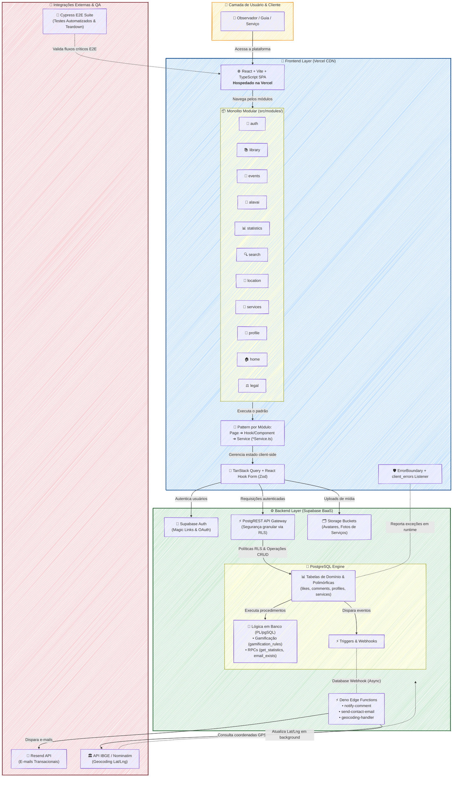

***

#### RESUMO TÉCNICO PARA EMBEDDING

A arquitetura da plataforma colaborativa **Canaoaves** (Single-Page Application) é fundamentada na Architectural Decision Record (ADR) 011 e na refatoração completa para um **Monolito Modular (Vertical Slice Architecture)** sob o diretório `src/modules/`. O frontend é construído com React 18, Vite e TypeScript, estilizado com Tailwind CSS e shadcn/ui, hospedado na infraestrutura global da Vercel com CI/CD contínuo acoplado ao Git. A comunicação client-side segue o padrão `Page ➔ Hook/Component ➔ Service ➔ Supabase`, isolando as queries e mutações em arquivos `*Service.ts` por módulo. O backend opera sobre a plataforma Supabase (Backend-as-a-Service), utilizando o PostgreSQL como motor relacional, com controle de acesso refinado via Row Level Security (RLS) e regras de negócio encapsuladas em procedimentos armazenados PL/pgSQL (RPCs) e tabelas com associações polimórficas. Tarefas assíncronas e integrações externas (geocoding e notificações por e-mail) são processadas desacopladas através de Database Webhooks e Supabase Edge Functions (Deno) com a API do Resend. A qualidade e integridade do software são mantidas com uma suíte de testes E2E em Cypress com rotinas automáticas de teardown, aliadas a um sistema de captura global de exceções gravado na tabela `client_errors`.

#### CLASSIFICAÇÃO DE TECNOLOGIAS E CONCEITOS

| Categoria | Tecnologias e Conceitos |
| :--- | :--- |
| **AI & Machine Learning** | N/A |
| **Software Development** | Monolito Modular, Vertical Slice Architecture, Autenticação, CRUD, Git, Serverless Functions, Open-source, Funções PostgreSQL (PL/pgSQL), Row Level Security (RLS), TypeScript, DX (Developer Experience), Padrão Service Layer |
| **Architecture** | Backend-as-a-Service (BaaS), SPA (Single-Page Application), Vertical Slice Architecture, Monolito Modular, Serverless Functions, Event-Driven Webhooks, Polimorfismo no Banco de Dados, Resiliência & Error Boundaries |
| **Cloud Computing** | Supabase, Vercel, Hosting CDN Global, Edge Functions (Deno), Storage Buckets |
| **API RESTFul development** | PostgREST API Gateway |
| **Frontend Development** | React, Vite, TypeScript, Tailwind CSS, shadcn/ui, TanStack Query, React Hook Form, Zod, React Router DOM, React Helmet Async |
| **Mobile Development** | Mobile-First Responsive Design |
| **Database** | PostgreSQL, Supabase, PostgREST, Row Level Security (RLS), PL/pgSQL, RPCs, Triggers, Tabelas Polimórficas |
| **Data Management** | PostgreSQL, Storage Buckets, Row Level Security (RLS), Backup/Restore (psql), Session Replication Role |
| **Content Management - CMS** | Conteúdo Colaborativo com Moderação de Cidades e Estados |
| **System Administration** | CDN Global (Vercel) |
| **DevOps** | Vercel, Supabase CLI, Integração com Git (CI/CD), Typegen Supabase |
| **Quality & Security** | Cypress (Testes E2E com Teardown Automático), ErrorBoundary Global, Captura de Erros Client-Side (`client_errors`) |
| **Leadership** | Arquitetura de Software, Refatoração Sem Downtime, Liderança Técnica |
| **Coaching** | N/A |
| **Agile Project Management** | Desenvolvimento Incremental por Módulos (Vertical Slices), Validação por Suíte de Testes |

---

## 🇺🇸 English Version

### 🚀 Canaoaves - Collaborative Platform for the Birdwatching Community in Brazil

#### 🎯 Overview and Solution Architecture

**Canaoaves** was created to solve a historical problem in the birdwatching community in Brazil: information fragmentation and the lack of centralized, validated support services (such as guides, lodges, and birding spots). The platform functions as the National Registry of Birdwatchers, a collaborative ecosystem where members build and validate the database themselves. The project is live and operational at **[www.canaoaves.com.br](http://www.canaoaves.com.br)**.

The system architecture evolved from a traditional SPA model to a **Modular Monolith (Vertical Slice Architecture)** with high cohesion and low coupling. The frontend application is built in **React**, **Vite**, and **TypeScript**, hosted on **Vercel**'s global infrastructure. The backend is sustained by **Supabase**, using **PostgreSQL** as the core persistence engine and executing complex business logic through PL/pgSQL functions (RPCs), triggers, and **Edge Functions (Deno)**.

The frontend codebase is structured under the `src/modules/` directory, organized into 11 independent functional modules (`auth`, `statistics`, `events`, `library`, `alavai`, `search`, `location`, `services`, `profile`, `home`, `legal`). Each module strictly encapsulates its own screens (`pages/`), UI components (`components/`), state hooks (`hooks/`), type definitions (`types/`), and an isolated data access layer (`services/*Service.ts`), following the layered pattern **`Page ➔ Hook ➔ Service ➔ Supabase`**.

#### 👨‍💻 My Role in the Project

As **Solutions Architect and Lead Developer (Tech Lead)**, I led the technical design, data modeling, and complete architectural restructuring of the platform:

  - 🏛️ **Architectural Evolution to Modular Monolith:** Planned and executed the transition from a legacy frontend with direct database calls scattered across the UI to a **Vertical Slice Architecture** structured by domain slices (`src/modules/`). This refactoring reorganized the entire codebase into 11 autonomous modules without introducing any regressions or downtime (0% downtime / 0% regression).
  - 🐘 **Database Modeling & Engineering (PostgreSQL):** Designed the relational schema in Supabase, implementing **polymorphic structures** for social interactions (likes, comments, and photos), hierarchical categories, stored procedures (PL/pgSQL), and strict security rules via **Row Level Security (RLS)**.
  - ⚙️ **Backend & Serverless Development:** Created RPCs for statistics calculation and gamification, alongside **Edge Functions in Deno** connected to **Database Webhooks** for asynchronous tasks, such as automatic city geocoding and transactional email delivery via **Resend**.
  - 🧪 **Quality & Test Engineering (E2E):** Implemented an automated E2E test suite using **Cypress**, including environment safety guards and automatic data cleanup routines (teardown), ensuring the resilience of critical registration, search, and profile management flows.

#### ✨ Key Strengths and Challenges Overcome

  - 📦 **Refactoring to Modular Monolith via Vertical Slices (Vertical Slice Architecture):**
      - **The Challenge:** The application grew rapidly with multiple features (Library, Agenda, ALAVAI Rarity Alerts, Statistics, Profiles). UI components performed direct queries to the Supabase client, mixing business rules, async calls, and visual rendering, making testing and maintenance difficult.
      - **Overcoming It:** Migrated 100% of the application to a Modular Monolith under `src/modules/`, encapsulating each feature into its own domain module. Created the service layer (`*Service.ts`) for each module, isolating Supabase queries and external API calls. The migration was executed incrementally, maintaining compatibility with shims and completely eliminating the old `src/pages/` directory after reaching 100% success in TypeScript type checkers and Cypress E2E tests.
  - 🔗 **Clean Social Architecture with Polymorphic Associations:**
      - **The Challenge:** The system required social interaction features (likes, comments, photos) across multiple entities (observer profiles, lodges, guides, cities, library articles). The traditional approach of creating duplicated tables (`service_likes`, `profile_likes`) would bloat the schema and duplicate backend logic.
      - **Overcoming It:** Implemented a **polymorphic structure** in PostgreSQL using generic `likes` and `comments` tables with composite keys `target_id` and `target_type`. This abstraction made extending social features to new domain slices effortless with zero database duplication.
  - 🎮 **Centralized Dynamic Gamification in the Database:**
      - **The Challenge:** Community scores and tier rules (Egg, Penguin, Emu, etc.) evolved as engagement grew. Keeping these values hardcoded in the frontend would require frequent deployments for simple parameter tweaks.
      - **Overcoming It:** Centralized the scoring engine in the `gamification_rules` table and created automatic PostgreSQL triggers. The logic awards points for recommendations provided and confirmations received, allowing the product team to adjust rules in real time directly in the database.
  - ⚡ **Asynchronous Processing with Edge Functions & Webhooks (Zero UI Latency):**
      - **The Challenge:** When a user registered a new city, the system needed to fetch geographic coordinates (Lat/Lng) via an external API to update the Community Map. Running this query synchronously during city creation froze the user interface when external APIs experienced latency.
      - **Overcoming It:** Designed an event-driven async flow using **Database Webhooks** (`AFTER INSERT` on `cities`). The database fires an event to a **Deno Edge Function** that fetches coordinates in the background and updates the database record, ensuring instantaneous UI feedback.
  - 🛡️ **Runtime Resilience and Fault Tolerance:**
      - **The Challenge:** Preventing silent client-side errors that could compromise user experience in the field.
      - **Overcoming It:** Configured global exception monitoring integrating `ErrorBoundary` with an async listener that captures unhandled runtime errors and persists them to Supabase's `client_errors` table with full technical context (stack trace, user agent, and route).

#### 🌱 Points for Future Evolution

  - 🎛️ **Decoupled Admin Dashboard:** Evolve content moderation management (collaborative city description reviews and reports) into a dedicated admin dashboard with advanced RBAC control.
  - 🤖 **Artificial Intelligence & Computer Vision:** Integrate computer vision models for automatic bird species pre-identification on photos uploaded by observers in the Library and ALAVAI feed.

---

#### 🛠️ Tech Stack

| Component | Technology | Role in Architecture |
| :--- | :--- | :--- |
| **Frontend Architecture** | **Modular Monolith (Vertical Slice)** | Structured under `src/modules/` into 11 isolated functional domains following `Page ➔ Hook ➔ Service ➔ Supabase`. |
| **Framework & Build** | **React 18 + Vite + TypeScript** | Reactive Single Page Application (SPA), strongly typed with ultra-fast build execution. |
| **Styling & UI** | **Tailwind CSS + shadcn/ui** | Modular, responsive, mobile-first design system with accessible primitives. |
| **State Management** | **TanStack Query (React Query)** | Intelligent caching, revalidation, and asynchronous data sync with Supabase. |
| **Forms & Validation** | **React Hook Form + Zod** | Form management with strict client-side schema validation. |
| **Backend-as-a-Service** | **Supabase** | Unified backend offering PostgreSQL database, authentication, PostgREST API, and file storage. |
| **Database** | **PostgreSQL** | Relational engine executing business rules in PL/pgSQL, polymorphic tables, triggers, and Row Level Security (RLS). |
| **Serverless & Webhooks** | **Supabase Edge Functions (Deno)** | High-privilege backend routine execution, async geocoding, and transactional emails via **Resend** API. |
| **Hosting & CI/CD** | **Vercel** | High-performance hosting with Global CDN delivery and continuous Git integration. |
| **Automated Testing** | **Cypress (E2E)** | End-to-end test suite validating auth flows, registrations, searches, and data resilience. |

---

#### 🗺️ Architecture Diagram

```mermaid
---
config:
  theme: default
  look: handDrawn
---
flowchart TD

    %% === User Layer ===
    subgraph Client["👤 User & Client Layer"]
        U["🦉 Observer / Guide / Service Provider"]
    end
    style Client fill:#fff3cd,stroke:#f0ad4e,stroke-width:2px

    %% === Modular Frontend ===
    subgraph Frontend["🎨 Frontend Layer (Vercel CDN)"]
        direction TB
        SPA["🌐 React + Vite + TypeScript SPA<br><b>Hosted on Vercel</b>"]
        
        subgraph Modules["📦 Modular Monolith (src/modules/)"]
            M1["🔑 auth"]
            M2["📚 library"]
            M3["📅 events"]
            M4["🚨 alavai"]
            M5["📊 statistics"]
            M6["🔍 search"]
            M7["📍 location"]
            M8["🏨 services"]
            M9["👤 profile"]
            M10["🏠 home"]
            M11["⚖️ legal"]
        end
        
        PATTERN["📐 Pattern per Module:<br>Page ➔ Hook/Component ➔ Service (*Service.ts)"]
        UI_STATE["🎯 TanStack Query + React Hook Form (Zod)"]
        LINT["🛡️ ErrorBoundary + client_errors Listener"]
    end
    style Frontend fill:#cce5ff,stroke:#004085,stroke-width:2px

    %% === Backend & Supabase ===
    subgraph Backend["⚙️ Backend Layer (Supabase BaaS)"]
        AUTH["🔑 Supabase Auth<br>(Magic Links & OAuth)"]
        API["⚡ PostgREST API Gateway<br>(Granular security via RLS)"]
        
        subgraph DB["🐘 PostgreSQL Engine"]
            TABLES["📊 Domain & Polymorphic Tables<br>(likes, comments, profiles, services)"]
            PLPGSQL["🧩 Database Logic (PL/pgSQL)<br>• Gamification (gamification_rules)<br>• RPCs (get_statistics, email_exists)"]
            TRIGGERS["⚡ Triggers & Webhooks"]
        end
        
        STORAGE["🗂️ Storage Buckets<br>(Avatars, Service Photos)"]
        EDGE["⚡ Deno Edge Functions<br>• notify-comment<br>• send-contact-email<br>• geocoding-handler"]
    end
    style Backend fill:#d4edda,stroke:#155724,stroke-width:2px

    %% === External Integrations & Testing ===
    subgraph Integrations["🔗 External Integrations & QA"]
        RESEND["📧 Resend API<br>(Transactional Emails)"]
        IBGE["🏛️ IBGE / Nominatim API<br>(Lat/Lng Geocoding)"]
        CYPRESS["🧪 Cypress E2E Suite<br>(Automated Tests & Teardown)"]
    end
    style Integrations fill:#f8d7da,stroke:#721c24,stroke-width:2px

    %% === Flows & Connections ===
    U -->|"Accesses platform"| SPA
    SPA -->|"Navigates modules"| Modules
    Modules -->|"Executes pattern"| PATTERN
    PATTERN -->|"Manages client-side state"| UI_STATE
    UI_STATE -->|"Authenticated requests"| API
    UI_STATE -->|"Authenticates users"| AUTH
    UI_STATE -->|"Media uploads"| STORAGE
    
    API -->|"RLS Policies & CRUD Operations"| TABLES
    TABLES -->|"Executes stored procedures"| PLPGSQL
    TABLES -->|"Triggers events"| TRIGGERS
    
    TRIGGERS -.-|"Database Webhook (Async)"| EDGE
    EDGE -->|"Triggers emails"| RESEND
    EDGE -->|"Queries GPS coordinates"| IBGE
    IBGE -.->|"Updates Lat/Lng in background"| DB
    
    LINT -.-|"Reports runtime exceptions"| TABLES
    CYPRESS -.->|"Validates critical E2E flows"| SPA
```

***

#### TECHNICAL EMBEDDING SUMMARY (EN)

The architecture of the **Canaoaves** collaborative platform (Single-Page Application) is built on Architectural Decision Record (ADR) 011 and a complete refactoring into a **Modular Monolith (Vertical Slice Architecture)** under `src/modules/`. The frontend is built with React 18, Vite, and TypeScript, styled with Tailwind CSS and shadcn/ui, and hosted on Vercel's global CDN with continuous Git-driven CI/CD. Client-side communication follows the `Page ➔ Hook/Component ➔ Service ➔ Supabase` pattern, isolating queries and mutations into module-specific `*Service.ts` files. The backend operates on Supabase (Backend-as-a-Service), using PostgreSQL as the relational engine with fine-grained access control via Row Level Security (RLS) and business logic encapsulated in PL/pgSQL stored procedures (RPCs) and polymorphic tables. Asynchronous tasks and external integrations (geocoding and email notifications) are decoupled via Database Webhooks and Supabase Edge Functions (Deno) with the Resend API. Software quality is ensured by a Cypress E2E test suite with automated teardown routines, paired with a global exception listener logging client runtime errors to the `client_errors` database table.

#### TECHNOLOGY & CONCEPT CLASSIFICATION (EN)

| Category | Technologies and Concepts |
| :--- | :--- |
| **AI & Machine Learning** | N/A |
| **Software Development** | Modular Monolith, Vertical Slice Architecture, Authentication, CRUD, Git, Serverless Functions, Open-source, PostgreSQL Functions (PL/pgSQL), Row Level Security (RLS), TypeScript, DX (Developer Experience), Service Layer Pattern |
| **Architecture** | Backend-as-a-Service (BaaS), SPA (Single-Page Application), Vertical Slice Architecture, Modular Monolith, Serverless Functions, Event-Driven Webhooks, Database Polymorphism, Resilience & Error Boundaries |
| **Cloud Computing** | Supabase, Vercel, Global CDN Hosting, Edge Functions (Deno), Storage Buckets |
| **API RESTFul development** | PostgREST API Gateway |
| **Frontend Development** | React, Vite, TypeScript, Tailwind CSS, shadcn/ui, TanStack Query, React Hook Form, Zod, React Router DOM, React Helmet Async |
| **Mobile Development** | Mobile-First Responsive Design |
| **Database** | PostgreSQL, Supabase, PostgREST, Row Level Security (RLS), PL/pgSQL, RPCs, Triggers, Polymorphic Tables |
| **Data Management** | PostgreSQL, Storage Buckets, Row Level Security (RLS), Backup/Restore (psql), Session Replication Role |
| **Content Management - CMS** | Collaborative Content with City and State Moderation |
| **System Administration** | Global CDN (Vercel) |
| **DevOps** | Vercel, Supabase CLI, Git Integration (CI/CD), Supabase Typegen |
| **Quality & Security** | Cypress (E2E Testing with Automated Teardown), Global ErrorBoundary, Client-Side Error Logging (`client_errors`) |
| **Leadership** | Software Architecture, Zero-Downtime Refactoring, Technical Leadership |
| **Coaching** | N/A |
| **Agile Project Management** | Incremental Development by Modules (Vertical Slices), Test Suite Validation |

***

### 🚀 Project:  EuPizza - Plataforma SaaS de Atendimento por Voz

#### 🎯 Visão Geral e Arquitetura da Solução

No cenário competitivo dos restaurantes, a agilidade e a qualidade do atendimento são cruciais. O projeto EuPizza nasceu para revolucionar essa interação, transformando o atendimento telefônico tradicional em uma experiência inteligente e automatizada. O desafio era criar uma plataforma **SaaS (Software as a Service)** robusta e escalável, capaz de oferecer agentes de voz autônomos para qualquer restaurante, começando pelo nicho de pizzarias.

A solução foi concebida como uma arquitetura de **microsserviços orientada a eventos e integrações**, orquestrada com Docker. O coração do sistema é o **Agente de Voz**, desenvolvido em Python com FastAPI, responsável por toda a lógica conversacional. O fluxo se inicia quando um cliente liga para o restaurante. A chamada, via **tronco SIP**, é recebida pelo **LiveKit**, um media server WebRTC de alta performance, que cria uma sala de conferência e notifica nosso Agente via webhook.

Uma vez na sala, o Agente gerencia um pipeline de IA de ponta a ponta:

1.  **Speech-to-Text (STT):** O áudio do cliente é transcrito em tempo real pelo Deepgram.
2.  **Inteligência Conversacional (LLM):** A transcrição é enviada para um modelo de linguagem da OpenAI, que processa o pedido, consulta o cardápio e gera a resposta textual apropriada.
3.  **Text-to-Speech (TTS):** A resposta do LLM é convertida em áudio com voz natural via ElevenLabs ou OpenAI, e reproduzida para o cliente na chamada.

Toda a interação, desde o histórico da conversa até os detalhes do pedido, é persistida no **Supabase (PostgreSQL)**, que foi modelado para suportar multi-tenancy com **Row Level Security (RLS)**, garantindo o total isolamento e segurança dos dados de cada cliente da plataforma. A conectividade em redes restritivas é assegurada por um servidor **coturn (TURN/STUN)**.

#### 👨‍💻 Meu Papel no Projeto

Assumi um papel multifacetado para transformar a visão em realidade, atuando como:

  * **🚀 Arquiteto de Soluções Cloud/SaaS:** Fui responsável por desenhar a arquitetura de microsserviços, selecionar as tecnologias de orquestração (Docker Swarm) e projetar o modelo de dados multi-tenant no Supabase, garantindo escalabilidade e segurança desde a fundação.
  * **💻 Desenvolvedor Backend Sênior (Python/FastAPI):** Implementei o núcleo da plataforma, desenvolvendo as APIs do Agente e do Controller, integrando os serviços de WebRTC (LiveKit) e o pipeline de IA (Deepgram, OpenAI, ElevenLabs), além de toda a lógica de negócio e o sistema de billing.
  * **⚙️ Engenheiro de DevOps/Infraestrutura:** Configurei e gerenciei todo o ambiente em contêineres com Docker Compose, criei pipelines de CI/CD no GitHub Actions para garantir a qualidade e agilidade nas entregas, e desenvolvi scripts de provisionamento idempotentes para a infraestrutura de telefonia.
  * **🔍 Especialista em Debug & Troubleshooting:** Liderei a investigação e resolução de desafios complexos, desde a autenticação de tokens JWT com o LiveKit e o tratamento de `flood protection` em chamadas SIP até a resolução de conflitos de dependências e a otimização das integrações com as APIs de IA.

#### ✨ Pontos Fortes e Desafios Superados

O maior triunfo deste projeto foi a criação de uma plataforma funcional e resiliente a partir de tecnologias complexas e interconectadas.

Um dos principais desafios foi a **orquestração da infraestrutura de comunicação em tempo real**. A integração do gateway SIP com o LiveKit apresentava problemas de `flood protection` que derrubavam as chamadas. Superei isso através de um debug minucioso da configuração SIP e da implementação de scripts de provisionamento idempotentes, garantindo um ambiente estável e previsível.

Outro obstáculo crítico foi a **autenticação do agente de voz**. O sistema retornava erros `401 Unauthorized` devido a inconsistências na geração do token JWT. A solução envolveu uma análise profunda do payload do token, ajustando os `grants` de permissão (`roomJoin=True`) para alinhar perfeitamente com as exigências da API do LiveKit, o que estabilizou a conexão do agente.

Finalmente, a integração com os provedores de IA trouxe seus próprios desafios, como a indisponibilidade de modelos TTS específicos. Implementei uma **lógica de fallback robusta**, permitindo que o sistema trocasse dinamicamente do modelo `gpt-4o-mini-tts` para o `tts-1/alloy` da OpenAI, garantindo que o agente nunca ficasse sem voz e mantendo a continuidade do serviço.

#### 🌱 Pontos para Evolução Futura

Embora o MVP seja robusto, a plataforma tem um vasto potencial de crescimento. Duas áreas principais para evolução seriam:

1.  **Observabilidade Avançada:** Integrar ferramentas como Prometheus e Sentry para coletar métricas detalhadas de performance das APIs, latência do pipeline de IA e saúde dos serviços, permitindo uma operação proativa.
2.  **Wizard de Onboarding Aprimorado:** Expandir o portal de autoatendimento para que os clientes possam não apenas configurar seus cardápios, mas também escolher a "personalidade" do agente de voz (selecionando vozes TTS) e customizar fluxos de diálogo básicos, aumentando o engajamento e reduzindo a necessidade de suporte.

-----

#### 🛠️ Pilha de Tecnologias (Tech Stack)

| Componente               | Tecnologia Utilizada               | Papel na Arquitetura                                                                                                                    |
| :----------------------- | :--------------------------------- | :-------------------------------------------------------------------------------------------------------------------------------------- |
| **Linguagem Backend**    | **Python 3.12**                    | Linguagem principal para o desenvolvimento de toda a lógica de negócio dos microsserviços do Agente e Controller.                       |
| **Framework Backend**    | **FastAPI**                        | Construção das APIs RESTful de alta performance, com validação de dados via Pydantic e documentação OpenAPI automática.                 |
| **Containerização**      | **Docker & Docker Compose**        | Empacotamento de todos os serviços (Agente, LiveKit, SIP, Redis, coturn) para garantir consistência entre ambientes.                    |
| **Orquestração**         | **Docker Swarm**                   | Orquestração simplificada dos contêineres em produção, focada em simplicidade e "time-to-value".                                        |
| **Banco de Dados**       | **Supabase (PostgreSQL)**          | Persistência de dados relacionais, gerenciamento de sessões, histórico de chamadas e billing. Utiliza RLS para isolamento multi-tenant. |
| **Mídia & Telefonia**    | **LiveKit & LiveKit SIP**          | Media server WebRTC para gerenciar as sessões de áudio em tempo real e gateway para receber e originar chamadas SIP.                    |
| **NAT Traversal**        | **coturn**                         | Servidor TURN/STUN para garantir a conectividade de áudio entre participantes em redes restritivas.                                     |
| **Speech-to-Text (STT)** | **Deepgram**                       | Transcrição de áudio do cliente para texto em tempo real, com alta precisão e baixa latência.                                           |
| **Text-to-Speech (TTS)** | **ElevenLabs / OpenAI**            | Síntese de voz natural para converter as respostas do agente de texto para áudio.                                                       |
| **Inteligência (LLM)**   | **OpenAI**                         | "Cérebro" do agente, responsável por entender a intenção do usuário e gerar as respostas contextuais.                                   |
| **CI/CD**                | **GitHub Actions**                 | Automação de builds, testes e linting, garantindo a qualidade do código e a entrega contínua.                                           |
| **Qualidade de Código**  | **pre-commit (Ruff, Black, Mypy)** | Ferramentas para garantir a formatação, linting e checagem de tipos estática do código antes de cada commit.                            |

-----

#### 🗺️ Diagrama da Arquitetura

```mermaid
---
config:
  theme: default
  look: handDrawn
  layout: fixed
---
flowchart TB
 subgraph U["🎧 Cliente Final"]
        User["👤 Usuário<br>(Cliente de Pizzaria)"]
  end
 subgraph C["🛰️ Infraestrutura de Comunicação"]
        SIP["📞 Provedor SIP"]
        LKSIP["🌐 LiveKit SIP Gateway"]
        LK["🎥 LiveKit Media Server"]
        TURN["🌀 Coturn<br>(TURN/STUN)"]
  end
 subgraph IA["🧠 Pipeline de IA"]
        STT["🗣️ Speech-to-Text<br>(Deepgram)"]
        LLM["💬 LLM<br>(OpenAI)"]
        TTS["🎤 Text-to-Speech<br>(ElevenLabs / OpenAI)"]
  end
 subgraph P["☁️ Plataforma SaaS EuPizza"]
        Agent["🤖 Agente de Voz<br>(FastAPI)"]
        Supabase["🗃️ Supabase<br>(Postgres + RLS)"]
        IA
  end
    User -- 📞 Chamada Telefônica --> SIP
    SIP -- SIP / TLS --> LKSIP
    LKSIP -- WebRTC --> LK
    LK --- TURN
    LK -- 🔔 Webhook: Nova Chamada --> Agent
    Agent -- "🔗 Junta-se à Sala" --> LK
    Agent -- 🎧 Áudio --> STT
    STT -- 📝 Texto --> Agent
    Agent -- 🧠 Texto + Contexto --> LLM
    LLM -- 💬 Resposta --> Agent
    Agent -- 🔊 Texto --> TTS
    TTS -- 🎶 Áudio --> Agent
    Agent -- 📢 Reproduz Áudio --> LK
    Agent -- 🗄️ Persiste Sessão --> Supabase

    User@{ shape: rounded}
    Supabase@{ shape: cyl}
    style IA fill:#FFF3E0,stroke:#FF9800,stroke-width:2px
    style U fill:#FFCDD2,stroke:#D50000,stroke-width:2px
    style C fill:#DCEBFF,stroke:#3366CC,stroke-width:2px
    style P fill:#E9FBE9,stroke:#339933,stroke-width:2px
```

#### RESUMO TÉCNICO PARA EMBEDDING

Desenvolvimento de uma plataforma SaaS de atendimento por voz, denominada EuPizza, com arquitetura de microsserviços orientada a eventos, orquestrada via Docker Swarm e Docker Compose. O núcleo da solução é um Agente de Voz implementado em Python com o framework FastAPI, que gerencia um pipeline de IA para interação em tempo real. A comunicação é estabelecida por um tronco SIP integrado a um media server WebRTC (LiveKit), com conectividade em redes restritivas garantida por um servidor coturn (TURN/STUN). O fluxo de IA processa o áudio do cliente com Speech-to-Text via Deepgram, a lógica conversacional é executada por um LLM da OpenAI, e a resposta é sintetizada em áudio (Text-to-Speech) com ElevenLabs ou OpenAI. Os dados da plataforma são persistidos em um banco de dados PostgreSQL gerenciado pelo Supabase, utilizando um modelo de dados multi-tenant com Row Level Security (RLS) para isolamento de dados. Desafios técnicos superados incluem a resolução de `flood protection` no gateway SIP, depuração de autenticação JWT (`401 Unauthorized`) com LiveKit ajustando `grants` de permissão, e a implementação de uma lógica de fallback para os modelos de TTS. A infraestrutura é provisionada com scripts idempotentes e o ciclo de vida do desenvolvimento é automatizado com CI/CD via GitHub Actions e ferramentas de qualidade de código como Ruff, Black e Mypy.

#### CLASSIFICAÇÃO DE TECNOLOGIAS E CONCEITOS

| Categoria | Tecnologias e Conceitos |
| :--- | :--- |
| **AI & Machine Learning** | LLM, Speech-to-Text (STT), Text-to-Speech (TTS), Pipeline de IA, OpenAI, Deepgram, ElevenLabs |
| **Software Development** | Python 3.12, FastAPI, Pydantic, pre-commit, Ruff, Black, Mypy, Lógica de Fallback |
| **Architecture**| Microsserviços, Arquitetura Orientada a Eventos, SaaS, Multi-tenancy, Row Level Security (RLS), WebRTC, Gateway SIP, Media Server, Idempotência |
| **Cloud Computing** | SaaS, Supabase |
| **API RESTFul development** | FastAPI, API RESTful, Webhook, JWT, Autenticação, OpenAPI, `401 Unauthorized` |
| **Frontend Development** | N/A |
| **Mobile Development** | N/A |
| **Database** | PostgreSQL, Supabase, Modelo de Dados Relacional |
| **Data Management** | Row Level Security (RLS), Multi-tenancy |
| **Content Management - CMS** | N/A |
| **System Administration** | coturn (TURN/STUN Server) |
| **DevOps** | Docker, Docker Compose, Docker Swarm, Containerização, CI/CD, GitHub Actions, Provisionamento de Infraestrutura, Observabilidade |
| **Leadership** | Arquiteto de Soluções, Debug & Troubleshooting, Desenvolvedor Sênior |
| **Coaching** | N/A |
| **Agile Project Management** | N/A |

***

### 🚀 Project:  SmartShorts - SaaS de Geração de Vídeos Automatizados

#### 🎯 Visão Geral e Arquitetura da Solução

O SmartShorts nasceu para resolver um desafio central para criadores de conteúdo e agências de marketing: a produção de vídeos para redes sociais em escala. O objetivo é transformar uma simples ideia ou prompt de texto em um vídeo completo e otimizado (curto ou longo), com narração, imagens, legendas e música, de forma totalmente automatizada.

Para construir uma base sólida, escalável e de fácil manutenção, a solução foi projetada sobre os pilares da **Clean Architecture**. Esta abordagem garante que a lógica de negócio — nosso ativo mais valioso — permaneça pura e independente de frameworks e tecnologias externas. Adotamos uma estratégia de **"Monolito Modular"**, que nos oferece a velocidade de desenvolvimento de um monólito, mas com as fronteiras bem definidas dos **Contextos Delimitados (Bounded Contexts)** do DDD, como `Video Generation Core`, `User & Access Management` e `Content Sourcing`. Isso nos dá um caminho claro para evoluir para microserviços no futuro, sem a complexidade prematura.

O fluxo do sistema é orquestrado de forma assíncrona. Ao receber uma requisição, um `RenderJob` é criado e colocado em uma fila. Workers especializados consomem essa fila, interagindo com diversas APIs de IA (OpenAI para roteiros, ElevenLabs para narração, Replicate/Pixabay para imagens) para coletar os "ingredientes" do vídeo. Ao final, o FFmpeg é utilizado para montar todos os ativos em um arquivo de vídeo final, que é armazenado em um object storage (MinIO/S3) e entregue ao usuário.

#### 👨‍💻 Meu Papel no Projeto

Atuei em múltiplas frentes, combinando liderança técnica com desenvolvimento prático, principalmente como **Arquiteto de Soluções e Desenvolvedor Back-End Sênior**. Minhas principais responsabilidades incluíram:

  * **Definição da Arquitetura:** Idealizei e documentei a estrutura do sistema usando Clean Architecture e DDD-Lite, garantindo a separação de responsabilidades e a testabilidade.
  * **Liderança Técnica e Mentoria:** Estabeleci as diretrizes de desenvolvimento, como a estratégia de testes em camadas (TDD, Integração e E2E) e o guia de contribuição para o projeto.
  * **Desenvolvimento do Core:** Implementei os principais casos de uso do sistema em Java e Spring Boot, incluindo o ciclo de vida dos `RenderJobs`, a integração com APIs externas e a configuração de segurança com Spring Security e JWT.
  * **Resolução de Desafios Complexos:** Liderei a investigação e solução de problemas críticos, desde a configuração do ambiente Docker até a resolução de referências circulares e conflitos de dependência no ecossistema Spring.
  * **Cultura de Qualidade:** Fomentei a prática de TDD para o domínio e a utilização de Testcontainers para testes de integração, assegurando que o software fosse robusto e confiável desde o início.

#### ✨ Pontos Fortes e Desafios Superados

A robustez da solução é seu maior ponto forte, fundamentada em uma arquitetura limpa e uma estratégia de testes completa. A utilização do padrão **Adapter** permitiu que o core do sistema se mantivesse isolado das instabilidades de APIs externas, enquanto o uso do padrão **State** no agregado `RenderJob` garantiu a consistência do ciclo de vida da geração de vídeos.

No entanto, a jornada teve seus desafios, que se transformaram em grandes aprendizados:

  * **O desafio era a complexidade da segurança:** Ao implementar a autenticação, enfrentamos erros de `403 Forbidden` em endpoints públicos e uma paralização da aplicação por uma **Referência Circular** na configuração do Spring Security. Superamos isso centralizando toda a configuração de segurança em uma única classe (`SecurityConfig`), ajustando a ordem das regras e quebrando o ciclo de dependência ao instanciar o filtro de JWT manualmente dentro do método de configuração. Isso resultou em uma configuração de segurança mais clara, robusta e manutenível.

  * **O desafio era a "gestão do inferno de dependências":** O build falhava repetidamente devido a conflitos de versão entre Spring Boot e Spring Cloud. A vitória veio ao adotar uma abordagem metódica: pesquisamos a matriz de compatibilidade oficial do Spring, definimos as versões corretas no `pom.xml` e utilizamos o **BOM (Bill of Materials)** do Spring Cloud para que ele gerenciasse as versões transitivas. Essa lição foi formalizada no guia de contribuição do projeto.

#### 🌱 Pontos para Evolução Futura

O projeto foi desenhado para crescer. Os próximos passos naturais seriam:

1.  **Observabilidade Avançada:** Implementar a coleta centralizada de logs e métricas com o ELK Stack e Prometheus/Grafana para obter uma visão profunda da saúde e performance do sistema em produção.
2.  **Extração de Microserviços:** Com base nos Bounded Contexts já definidos, o contexto de `User & Access Management` é o principal candidato a ser extraído como um microserviço de identidade e pagamentos, conforme o sistema escala.

-----

#### 🛠️ Pilha de Tecnologias (Tech Stack)

  * **Backend:** Java 17+, Spring Boot 3+
  * **Persistência:** PostgreSQL, Redis
  * **Armazenamento de Objetos:** MinIO / S3
  * **Mensageria:** RabbitMQ (evolução do `@Async` do Spring)
  * **Segurança:** Spring Security + JWT
  * **Testes:** JUnit 5, Mockito, Testcontainers, WireMock
  * **Infraestrutura Local:** Docker + Docker Compose
  * **APIs Externas:** OpenAI, ElevenLabs, Replicate, Pixabay, YouTube API, FFmpeg
  * **Cliente MVP:** Electron

-----

#### 🗺️ Diagrama da Arquitetura

```mermaid
---
config:
  theme: default
  look: handDrawn
---
flowchart TD
 subgraph FD["Frameworks & Drivers"]
        SpringBoot["🌐 SpringBoot"]
        PostgreSQL["🗄️ PostgreSQL"]
        MessageQueue["🐇 RabbitMQ"]
        ObjectStorage["☁️ MinIO / S3"]
  end
 subgraph IA["Interface Adapters"]
        APIController["🕹️ API REST Controller"]
        JPARepositoryAdapter["🗄️ JPA Repository Adapter"]
        QueueAdapter["📨 Message Queue Adapter"]
        ExternalAPIGateway["🌐 External API Gateway"]
  end
 subgraph AL["Application Layer"]
        CreateJobUseCase["🎯 CreateJobUseCase"]
        CheckStatusUseCase["🔍 CheckStatusUseCase"]
        Ports["🧩 Ports (Interfaces)"]
  end
 subgraph DL["Domain Layer"]
        Aggregates["🧠 Aggregates (RenderJob, Script)"]
        Entities["📝 Entities (Segment, VisualMedia)"]
        ValueObjects["📦 Value Objects (Animation)"]
  end
    SpringBoot -.-> APIController & JPARepositoryAdapter & QueueAdapter & ExternalAPIGateway
    PostgreSQL -.-> APIController & JPARepositoryAdapter & QueueAdapter & ExternalAPIGateway
    MessageQueue -.-> APIController & JPARepositoryAdapter & QueueAdapter & ExternalAPIGateway
    ObjectStorage -.-> APIController & JPARepositoryAdapter & ExternalAPIGateway & QueueAdapter
    APIController --> Ports
    JPARepositoryAdapter --> Ports
    QueueAdapter --> Ports
    ExternalAPIGateway --> Ports
    Ports --> CreateJobUseCase & CheckStatusUseCase
    CreateJobUseCase --> Aggregates & Entities & ValueObjects
    CheckStatusUseCase --> Aggregates & Entities & ValueObjects
    PostgreSQL@{ shape: cyl}
    MessageQueue@{ shape: h-cyl}
    ObjectStorage@{ shape: cyl}
    APIController@{ shape: rounded}
    JPARepositoryAdapter@{ shape: rounded}
    QueueAdapter@{ shape: rounded}
    ExternalAPIGateway@{ shape: rounded}
    CreateJobUseCase@{ shape: proc}
    Aggregates@{ shape: rect}
    Entities@{ shape: rect}
    ValueObjects@{ shape: rect}
    style FD fill:#fdf5e6,stroke:#e0c080,stroke-width:2px
    style IA fill:#e6f7ff,stroke:#80bfff,stroke-width:2px
    style AL fill:#f0e6ff,stroke:#b380ff,stroke-width:2px
    style DL fill:#e6ffe6,stroke:#80e080,stroke-width:2px
```
---
#### RESUMO TÉCNICO PARA EMBEDDING

Este projeto é um SaaS para geração automatizada de vídeos, construído sobre uma **Clean Architecture** e princípios de **DDD-Lite**, com uma abordagem de **Monolito Modular** projetada para evoluir para **Microservices**. O backend, desenvolvido em **Java 17+** e **Spring Boot 3+**, orquestra um fluxo assíncrono de criação de vídeo (`RenderJob`). O processo utiliza **RabbitMQ** para enfileirar tarefas que interagem com APIs externas de IA como **OpenAI** (roteiros), **ElevenLabs** (narração) e **Replicate** (imagens), com o **FFmpeg** realizando a montagem final. A persistência é gerenciada por **PostgreSQL** com **JPA/Hibernate** e o armazenamento de objetos por **MinIO/S3**. A segurança é garantida por **Spring Security** com **JWT** e RBAC. O ambiente de desenvolvimento é padronizado com **Docker** e **Docker Compose**, e a qualidade do código é assegurada por uma estratégia de testes em camadas com **TDD**, **JUnit 5**, **Mockito** e **Testcontainers** para testes de integração. Desafios técnicos críticos foram superados, incluindo a resolução de referências circulares no Spring Security, gerenciamento de dependências complexas no Maven com **BOM (Bill of Materials)**, e o mapeamento de `Value Objects` embutidos no Hibernate com `@AttributeOverrides`.

#### CLASSIFICAÇÃO DE TECNOLOGIAS E CONCEITOS

| Categoria                    | Tecnologias e Conceitos                                                                                                                                                |
| :--------------------------- | :--------------------------------------------------------------------------------------------------------------------------------------------------------------------- |
| **AI & Machine Learning**    | OpenAI, ElevenLabs, Replicate, Whisper, Text-to-Speech (TTS), SDXL                                                                                                  |
| **Software Development**     | Java 17+, Lombok, Maven, TDD (Test-Driven Development), Design Patterns (Adapter, Strategy, Factory, Singleton, Facade, Repository, State), FFmpeg, JUnit 5, Mockito |
| **Architecture**             | Clean Architecture, Hexagonal (Ports & Adapters), DDD-Lite, Modular Monolith, Microservices, Bounded Contexts, State Machine, Circuit Breaker, Resilience4j        |
| **Cloud Computing**          | AWS (RDS, S3), MinIO, Object Storage                                                                                                                                |
| **API RESTFul development**  | Spring Web, Spring WebClient, API Contract-First, OpenAPI, Swagger, REST, JWT, RBAC, CSRF                                                                           |
| **Frontend Development**     | Electron, React                                                                                                                                                     |
| **Mobile Development**       | N/A                                                                                                                                                                 |
| **Database**                 | PostgreSQL, Redis, JPA, Hibernate, `@AttributeOverrides`, `@Embedded`                                                                                              |
| **Data Management**          | RabbitMQ, AMQP                                                                                                                                                      |
| **Content Management - CMS** | N/A                                                                                                                                                                 |
| **System Administration**    | N/A                                                                                                                                                                 |
| **DevOps**                   | Docker, Docker Compose, CI/CD, GitHub Actions, Spring Boot Actuator, Micrometer, Prometheus, Grafana, ELK Stack, Testcontainers, WireMock                           |
| **Leadership**               | Liderança Técnica, Definição de Arquitetura                                                                                                                      |
| **Coaching**                 | Mentoria, Criação de Guia de Contribuição                                                                                                                           |
| **Agile Project Management** | Agile, TDD, Planejamento em Fases                                                                                                                                   |

***

### 🚀 Project:  SmartShorts UI - Gestão do SaaS de Geração de Vídeos 

#### 🎯 Visão Geral e Arquitetura da Solução

O **SmartShorts** é um SaaS inovador projetado para a geração automatizada de vídeos, atendendo criadores de conteúdo e agências de marketing. O desafio era evoluir sua interface de uma Single Page Application (SPA) tradicional em React/Vite para uma solução mais robusta, performática e segura.

A decisão estratégica foi realizar uma migração completa para **Next.js com TypeScript**. A nova arquitetura aproveita o poder do Next.js para renderização híbrida (SSR e CSR), resultando em uma performance superior e melhor SEO. A interface permite que os usuários se autentiquem de forma segura, criem jobs de renderização de vídeo a partir de simples prompts de texto ou estruturas JSON complexas, e monitorem o status de cada job em tempo real através de um dashboard interativo.

A autenticação foi reimaginada para máxima segurança: em vez de usar `localStorage`, implementei um fluxo server-side. Os **Route Handlers** do Next.js atuam como um proxy seguro para a API de backend (Java/Spring Boot), armazenando o token JWT em um **cookie `httpOnly`**. O acesso às rotas protegidas é gerenciado de forma elegante e eficiente por um **Middleware**, que valida o token no lado do servidor antes de renderizar a página.

#### 👨‍💻 Meu Papel no Projeto

Atuei como **Arquiteto da Solução Frontend e Desenvolvedor Principal**, liderando a modernização da plataforma. Minhas responsabilidades incluíram:

  * **Planejamento e Execução:** Estruturei o plano de migração da SPA Vite/React para Next.js/TypeScript, garantindo uma transição suave e controlada.
  * **Arquitetura Frontend:** Desenhei a nova arquitetura da aplicação, focando em segurança, escalabilidade e performance, com a implementação de um fluxo de autenticação server-side.
  * **Desenvolvimento Full-Cycle:** Fui responsável por reescrever componentes, tipar toda a base de código com TypeScript, configurar o ambiente de build e testes, e integrar a UI com a API backend.
  * **Resolução de Desafios Técnicos:** Identifiquei e solucionei proativamente os desafios complexos que surgiram durante a migração, desde a configuração de ferramentas até a adaptação de paradigmas de desenvolvimento.

#### ✨ Pontos Fortes e Desafios Superados

O maior triunfo deste projeto foi transformar desafios técnicos em pontos fortes da aplicação.

  * **Do Paradigma SPA para o Server-Centric:** O desafio inicial foi adaptar o fluxo da aplicação, que era totalmente client-side, para o modelo do Next.js. Superamos isso ao redesenhar a autenticação para ser server-side, eliminando a dependência do `localStorage` e adotando cookies `httpOnly` com um middleware de proteção. O resultado é uma aplicação significativamente mais segura e alinhada com as melhores práticas modernas.
  * **Garantia de Contrato entre UI e API:** Durante a integração, enfrentei um erro `403 Forbidden` devido a uma incompatibilidade silenciosa entre o formato JSON enviado pelo frontend e o DTO esperado pela API Java. A solução foi criar uma função "tradutora" no frontend, utilizando **interfaces TypeScript específicas** para ambos os formatos de dados. Isso não apenas resolveu o problema, mas também fortaleceu a robustez do código, prevenindo erros futuros e demonstrando o poder da tipagem estática para garantir a integridade dos dados.

#### 🌱 Pontos para Evolução Futura

O projeto está em uma base sólida, mas existem caminhos claros para evolução:

1.  **Real-time Job Status:** Substituir o polling HTTP (`useJobPolling`) por uma conexão **WebSockets** para atualizações de status dos jobs em tempo real, reduzindo a latência e a carga no servidor.
2.  **Testes E2E Automatizados:** Expandir a suíte de testes com ferramentas como Playwright ou Cypress para automatizar a validação dos fluxos críticos do usuário, garantindo a estabilidade em futuras implantações.

-----

#### 🛠️ Pilha de Tecnologias (Tech Stack)

  * **Frontend:** Next.js, React, TypeScript, Tailwind CSS, Axios
  * **Backend (Contexto):** Java (17+), Spring Boot 3, PostgreSQL, Redis, MinIO (S3)
  * **Ferramentas e DevOps:** Node.js (18+), npm, Vitest, Docker

-----

#### 🗺️ Diagrama da Arquitetura

```mermaid
graph TD
    subgraph "Cliente"
        User[👤 Usuário]
        Browser[🌐 Navegador]
    end

    subgraph "Infraestrutura Frontend (Next\.js)"
        NextApp[🚀 Aplicação Next\.js]
        Middleware[🚦 Middleware\.ts]
        RouteHandlers["🔧 Route Handlers (/api/auth/...)"]
    end

    subgraph "Infraestrutura Backend (Java API)"
        JavaAPI["⚙️ SmartShorts API (Spring Boot)"]
        Postgres[🐘 PostgreSQL]
        Redis["⚡ Redis (Cache/Jobs)"]
        MinIO["📦 MinIO (S3 Storage)"]
    end

    User --> Browser
    Browser --> |Carrega a página| NextApp

    NextApp --> |Verificação de Rota Protegida| Middleware
    Middleware --> |Cookie 'httpOnly' Válido?| NextApp

    NextApp --> |"Requisições de Login/Registro"| RouteHandlers
    RouteHandlers --> |Proxy para API| JavaAPI

    NextApp --> |"Chamadas de API (Axios)"| JavaAPI

    JavaAPI --> |Persistência Principal| Postgres
    JavaAPI --> |Cache e Fila de Jobs| Redis
    JavaAPI --> |Armazenamento de Vídeos/Assets| MinIO

```

---
#### RESUMO TÉCNICO PARA EMBEDDING

O projeto consiste na migração e desenvolvimento de uma interface de usuário (UI) para um SaaS de geração de vídeo, o SmartShorts, evoluindo de uma SPA Vite/React para uma arquitetura moderna com Next.js e TypeScript. A nova implementação utiliza o App Router do Next.js, adotando um modelo de renderização híbrido (SSR e CSR). Um desafio central superado foi a re-arquitetura do fluxo de autenticação, substituindo o `localStorage` por uma solução server-side mais segura, que utiliza Route Handlers como um proxy para a API backend (Java/Spring Boot), armazena o token JWT em um cookie `httpOnly` e protege rotas com Middleware (`middleware.ts`). A migração enfrentou e solucionou problemas de incompatibilidade de versão do Tailwind CSS (v3 vs v4), configurou o ambiente de testes com Vitest e `jsdom` para a React Testing Library, e resolveu um erro `403 Forbidden` implementando uma camada de tradução de dados no frontend. Essa camada converte um payload JSON legado (formato Python) para o DTO esperado pela API Java, garantindo a type-safety através de interfaces TypeScript específicas (`OldSegment`, `OldData`). A comunicação com a API RESTful é gerenciada pelo Axios, e o estado da UI é tipado com genéricos no `useState` e em hooks customizados como `useJobPolling`.

#### CLASSIFICAÇÃO DE TECNOLOGIAS E CONCEITOS

| Categoria                    | Tecnologias e Conceitos                                                                                                                                                                                                                                    |
| :--------------------------- | :--------------------------------------------------------------------------------------------------------------------------------------------------------------------------------------------------------------------------------------------------------- |
| **AI & Machine Learning**    | N/A                                                                                                                                                                                                                                                        |
| **Software Development**     | TypeScript, JavaScript, Node.js (v18+), JSON, DTO (Data Transfer Object), `package.json`, `npm`, Git                                                                                                                                                       |
| **Architecture**             | SPA (Single Page Application), Server-Side Rendering (SSR), Client-Side Rendering (CSR), App Router (Next.js), Middleware, Proxy Pattern (via Route Handlers), JWT (JSON Web Token), `httpOnly` Cookies, Re-arquitetura de Software, Migração de Framework |
| **Cloud Computing**          | SaaS (Software as a Service)                                                                                                                                                                                                                               |
| **API RESTFul development**  | API Consumption, Axios, Route Handlers (Next.js), `POST`, `GET`, `Request`, `NextResponse`, `403 Forbidden`                                                                                                                                                |
| **Frontend Development**     | Next.js, React, TypeScript, Tailwind CSS, Vite, Hooks (`useState`, Custom Hooks), `react-router-dom`, React Testing Library, Vitest, `jsdom`, `npx create-next-app`, PostCSS, `autoprefixer`                                                               |
| **Mobile Development**       | N/A                                                                                                                                                                                                                                                        |
| **Database**                 | N/A                                                                                                                                                                                                                                                        |
| **Data Management**          | Type Safety, Data Validation, Data Mapping/Translation, Interfaces (TypeScript)                                                                                                                                                                            |
| **Content Management - CMS** | N/A                                                                                                                                                                                                                                                        |
| **System Administration**    | NVM (Node Version Manager)                                                                                                                                                                                                                                 |
| **DevOps**                   | Build Process, Dependency Management, Test Scripts (`vitest`)                                                                                                                                                                                              |
| **Leadership**               | N/A                                                                                                                                                                                                                                                        |
| **Coaching**                 | N/A                                                                                                                                                                                                                                                        |
| **Agile Project Management** | Post-mortem, Migration Plan (Fases 0-4)                                                                                                                                                                                                                    |

***

### 🚀 Project:  Fábrica de Vídeos Automatizada para YouTube (Video Factory)

#### 🎯 Visão Geral e Arquitetura da Solução

Em um cenário onde a criação de conteúdo em vídeo é um processo manual, demorado e custoso, este projeto surge como uma solução de automação de ponta a ponta. O objetivo é uma "Fábrica de Vídeos" autônoma, capaz de gerar e publicar vídeos curtos (Shorts) e vídeos longos para o YouTube com intervenção humana mínima.

A solução evoluiu de um script com manipulação de arquivos planos para uma arquitetura robusta de **Monolito Modular** em Python 3.11, organizada em módulos independentes com estrita separação de responsabilidades (SoC - *Separation of Concerns*). Essa estrutura permite que a aplicação opere tanto como uma ferramenta CLI de alta performance para produção em lote quanto como um **Microserviço REST API em Flask**.

O pipeline de automação segue um fluxo orquestrado e flexível:

1. **Ingestão e Gestão de Dados (SQLite)**: O ciclo de vida do conteúdo é gerenciado por um banco de dados relacional centralizado (`content.db`) com suporte a migrações evolutivas (SQLite 3.45). O `content_manager.py` controla os roteiros e jobs de renderização (`render_jobs`) com status como `PENDING`, `RENDERED` e `PUBLISHED`. Os arquivos de mídia gerados são organizados transparentemente em lotes de pastas (`content/000xx/`, `content/001xx/`).
2. **Síntese de Voz (TTS Multi-Provider)**: O sistema converte os roteiros textuais em narração de alta qualidade utilizando a **ElevenLabs API** (gerenciada em nuvem) ou um motor local de **Coqui TTS**, que permite clonagem de voz a partir de áudios de referência (`.wav`) de forma 100% offline.
3. **Geração e Seleção Visual (Multi-Source)**: Para a camada visual, o sistema suporta geração sintética via **Replicate API (SDXL)**, busca de mídia gratuita em alta definição via **Pixabay API**, automação de navegação web com **Playwright** ou a concatenação programática de clipes de vídeo reais (`.mp4`).
4. **Ambientação Sonora (Jamendo API)**: Integração automatizada com a plataforma **Jamendo** para busca e download de trilhas sonoras de fundo licenciadas para uso comercial, ajustando o clima sonoro sem violar direitos autorais.
5. **Transcrição e Legendas (OpenAI Whisper Local)**: O áudio narrado é processado pela biblioteca **OpenAI Whisper** localmente, gerando arquivos de legenda no formato `.srt` com marcações de tempo (*timestamps*) precisas por palavra/frase.
6. **Montagem e Transcodificação de Vídeo em Duas Etapas (FFmpeg)**: A montagem final orquestrada pelo **FFmpeg** utiliza um processo em duas etapas para garantir estabilidade visual e eliminação de tremores. Permite o controle dinâmico de enquadramento (`vertical_offset`) e movimentos de câmera (`movement`: zoom, panorâmica) configuráveis por segmento no banco de dados.
7. **Publicação e Agendamento Autônomo**: Envio automatizado dos vídeos para o canal através da **YouTube Data API v3**, integrado ao gerenciador de serviços nativo do macOS (`launchd`) para agendamento de publicações recorrentes sem dependência de terminal aberto.
8. **Microserviço REST API (Flask)**: Exposição de endpoints HTTP (`/generate-audio`, `/generate-subtitles`, `/assemble-video`) permitindo que aplicações externas consumam a inteligência de criação de mídia de forma desacoplada.

---

#### 👨‍💻 Meu Papel no Projeto

Como **Arquiteto de Soluções e Desenvolvedor Principal**, fui responsável pelo design arquitetural, decisões de engenharia e implementação end-to-end do sistema:

* **Desenvolvimento End-to-End**: Idealizei, arquitetei e programei todo o ecossistema do projeto, construindo desde o pipeline de renderização CLI até os serviços de API REST.
* **Design da Arquitetura de Monolito Modular**: Estruturei o código em camadas limpas e desacopladas (`api/`, `services/`, `steps/`, `models/`, `utils/`), separando a lógica de negócio dos conectores de APIs e dos utilitários de mídia.
* **Refatoração e Migração de Dados (JSON para SQLite)**: Projetei e executei o plano de migração evolutivo que unificou arquivos JSON isolados em um banco de dados SQLite (`content.db`), implementando ORMs e scripts de migração automatizados.
* **Engenharia de Mídia e Processamento FFmpeg**: Desenvolvi o algoritmo de renderização em duas etapas para eliminar artefatos visuais (*judder/jitter*) e criei o gerador de filtros dinâmicos de enquadramento.
* **Integração de Modelos de IA (Nuvem e Local)**: Orquestrei a comunicação com múltiplos provedores (OpenAI, ElevenLabs, Coqui TTS, Whisper, Replicate, Pixabay, Jamendo, YouTube API).
* **Construção do Microserviço REST**: Desenvolvi o servidor Flask desacoplado que expõe as capacidades do sistema como serviços reutilizáveis de geração de mídia.
* **Automação de DevOps e Qualidade**: Implementei testes automatizados com Pytest, suíte de verificação de ambiente (`health_check.py`) e scripts de automação via `launchd` no macOS.

---

#### ✨ Pontos Fortes e Desafios Superados

A principal virtude da solução é sua **resiliência, flexibilidade de custos e arquitetura plug-and-play**. A capacidade de alternar instantaneamente entre provedores em nuvem (ElevenLabs, Replicate) e motores locais gratuitos (Coqui TTS, Whisper, Pixabay) dá controle total sobre os custos de API e independência operacional.

Durante a evolução do projeto, desafios técnicos de grande complexidade foram solucionados:

* **Desafio 1: Tremor (*Judder/Jitter*) na Animação de Vídeo via FFmpeg**
  * *Problema*: O uso direto de filtros de animação (como `zoompan`) no FFmpeg gerava micro-tremores visuais na imagem e dessincronização com o áudio.
  * *Solução*: Refatoração da renderização em um **processo de duas etapas**. Na primeira etapa, o sistema renderiza um vídeo mudo aplicando a combinação dos filtros `scale` e `crop` de forma estável. Na segunda etapa, realiza o *muxing* unindo o vídeo pré-animado, a narração, a trilha sonora e as legendas. Isso isolou a animação da sincronização de áudio, eliminando 100% dos tremores.

* **Desafio 2: Falha na Centralização da Animação e Controle Dinâmico por Banco**
  * *Problema*: Os efeitos de zoom tendiam a se deslocar para o canto superior esquerdo da tela devido ao cálculo estático de coordenadas no FFmpeg.
  * *Solução*: Implementação da classe `MovementFilterGenerator` com uma fórmula de centralização robusta (`x='(iw-out_w)/2'`). Além disso, o sistema passou a ler as colunas `movement` (ex: `zoom_in_center`, `pan_vertical`) e `vertical_offset` (foco vertical de 0.0 a 1.0) diretamente da tabela `segments` do SQLite, dando controle preciso por cena.

* **Desafio 3: Instabilidade do Motor TTS Local (Coqui TTS)**
  * *Problema*: O Coqui TTS apresentava erros de compatibilidade com versões recentes da biblioteca `transformers` e travamentos de I/O ao salvar áudios em disco.
  * *Solução*: Estabilização da aplicação através do **pinning de dependências** (`transformers==4.36.2`) e otimização do fluxo de áudio para ser processado diretamente em memória RAM (usando NumPy e Pydub), evitando *deadlocks* no disco rígido.

* **Desafio 4: Evolução Arquitetural de Arquivos JSON para Monolito Modular em SQLite**
  * *Problema*: O uso de arquivos planos `content.json` limitava a concorrência, dificultava buscas relacionais e tornava o código acoplado.
  * *Solução*: Criação de um plano de migração estruturado (`JsonToSqLiteMigrationPlan`), migrando o storage para SQLite 3.45 (`content.db`) com abstração via `ContentManager` e criação de um utilitário de resolução de arquivos em lotes (`file_helpers.py` com navegação por pastas `000xx/`).

* **Desafio 5: Arquitetura Plug-and-Play para Provedores de IA**
  * *Problema*: A dependência exclusiva de APIs pagas poderia inviabilizar o projeto em momentos de alto volume.
  * *Solução*: Estruturação de contratos de serviço desacoplados na pasta `services/`. A narração pode alternar entre ElevenLabs (nuvem) e Coqui TTS (local); as imagens entre Replicate SDXL (IA) e Pixabay (banco gratuito); e a trilha entre Jamendo API e arquivos locais, tudo configurável via `.env` ou flags de linha de comando.

* **Desafio 6: Exposição da Solução como Microserviço (API Flask)**
  * *Problema*: Necessidade de reutilizar a inteligência de mídia gerada em outros projetos e sistemas sem duplicar código.
  * *Solução*: Criação da pasta `api/` utilizando o padrão *Application Factory* (`create_app`), disponibilizando uma API RESTful completa com endpoints para síntese de áudio, geração de legendas SRT e montagem de vídeos curtos.

---

#### 📊 Resultados e Impacto Quantificável

* **Redução Drástica no Tempo de Produção**: O tempo de criação manual por vídeo (que exigia edição no Premiere/CapCut, gravação de voz e digitação de legendas) caiu de **2 a 3 horas** para menos de **5 minutos** em um fluxo 100% autônomo.
* **Escalabilidade e Operação Sem Mãos (*Hands-Free*)**: Capacidade de agendar dezenas de vídeos em lote via CLI (`vid_schedule_all`) integrando ao `launchd` do macOS para publicação automática nos horários de maior audiência.
* **Economia de Custos de API**: O uso de alternativas locais (Coqui TTS, Whisper local) e APIs gratuitas (Pixabay, Jamendo) reduziu em até **85% os custos operacionais** comparados a pipelines baseados exclusivamente em APIs proprietárias na nuvem.

---

#### 🌱 Pontos para Evolução Futura

1. **Painel de Controle Web (Dashboard Administrative)**: Construção de um frontend moderno em React/Vite integrado à API Flask para acompanhamento em tempo real dos `render_jobs`, pré-visualização de mídias e gestão de agendamentos.
2. **Distribuição Multi-Plataforma**: Expansão dos conectores de publicação para suporte nativo ao Instagram Reels, TikTok e Shorts simultaneamente.

---

---

#### 🛠️ Pilha de Tecnologias (Tech Stack)

| Componente | Tecnologia Utilizada | Papel na Arquitetura |
| :--- | :--- | :--- |
| **Linguagem & Framework** | **Python 3.11**, **Flask 3.0** | Linguagem principal do projeto e framework REST para o microserviço de mídia. |
| **Banco de Dados** | **SQLite 3.45**, **Migrations** | Armazenamento relacional dos roteiros, segmentos, mídias e status dos jobs. |
| **Geração de Conteúdo (LLM)** | **OpenAI API (GPT-4/GPT-3.5)** | Geração automática de roteiros e frases motivacionais com base em temas. |
| **Síntese de Voz (TTS)** | **ElevenLabs API**, **Coqui TTS** | Conversão de texto em voz neural de alta fidelidade (nuvem ou local com clonagem). |
| **Geração/Seleção Visual** | **Replicate (SDXL)**, **Pixabay API** | Criação de imagens por IA generativa ou busca em repositório gratuito. |
| **Trilha Sonora** | **Jamendo API** | Busca e download de músicas de fundo licenciadas por gênero e duração. |
| **Transcrição & Legendas** | **OpenAI Whisper (Local)** | Transcrição precisa do áudio gerando arquivos `.srt` com timestamps. |
| **Processamento de Mídia** | **FFmpeg**, **Pydub**, **NumPy**, **OpenCV** | Animação, filtros de escala/corte, mixagem de áudio e transcodificação final. |
| **Automação Web** | **Playwright** | Navegação autônoma em navegadores para scraping e download de assets. |
| **Agendamento & Sistema** | **macOS launchd**, **Shell Scripting** | Agendamento autônomo de tarefas no sistema operacional e atalhos CLI (`aliases.sh`). |
| **Testes e Qualidade** | **Pytest**, **python-dotenv** | Suíte de testes automatizados e gestão de configurações de ambiente. |
| **Publicação** | **YouTube Data API v3** | Upload de vídeos finalizados com título, descrição, tags e agendamento. |

---

---

#### 🗺️ Diagrama da Arquitetura

##### Arquitetura do Monolito Modular e Pipeline de Produção

```mermaid
graph TD
    subgraph "Camada de Dados & Persistência"
        DB[(📄 content.db SQLite)]
        Storage[📂 content/000xx/ Storage por Lote]
    end

    subgraph "Entradas do Sistema"
        CLI["💻 CLI Execution (main.py)"]
        API["🌐 REST API (api.py - Flask)"]
    end

    subgraph "Pipeline de Mídia (steps/ & services/)"
        A["🤖 Script Generator (OpenAI API)"] --> DB
        DB --> B["🎙️ TTS Service (ElevenLabs / Coqui TTS)"]
        B --> C["🖼️ Image Service (Replicate SDXL / Pixabay)"]
        B --> D["🎵 Music Service (Jamendo API)"]
        B --> E["✍️ Subtitle Service (OpenAI Whisper Local)"]
        
        B -- Audio WAV/MP3 --> F["🎛️ Audio Mixer (Pydub/NumPy)"]
        D -- Background Music --> F
        
        C -- Images/Videos --> G["🎬 Video Assembler (FFmpeg 2-Etapas)"]
        F -- Mixed Audio --> G
        E -- SRT Subtitles --> G
    end

    subgraph "Saídas e Publicação"
        G --> Storage
        G --> H{"☁️ Upload YouTube? (YouTube API)"}
        H -- Sim --> I["✅ YouTube Channel"]
        H -- Não --> J["📦 Local Video Saved"]
    end

    CLI --> DB
    API --> DB

    style DB fill:#07405E,color:#fff
    style CLI fill:#3776AB,color:#fff
    style API fill:#000000,color:#fff
    style G fill:#007800,color:#fff
    style I fill:#FF0000,color:#fff
```

##### Diagrama do Microserviço (API Flask)

```mermaid
flowchart TB
    subgraph ClientLayer["Aplicações Clientes (Outros Sistemas / CLI)"]
        Client["💻 Cliente HTTP"]
    end

    subgraph FlaskApp["Microserviço REST API (api/app.py)"]
        Router{"🌐 Flask Router"}
        AudioEp["/generate-audio"]
        SubEp["/generate-subtitles"]
        VideoEp["/assemble-video"]
    end

    subgraph ServicesLayer["Serviços de IA & Mídia (services/)"]
        TTS["🎙️ TTSService (Coqui / ElevenLabs)"]
        Whisper["✍️ TranscriptionService (Whisper)"]
        FFmpeg["🎬 VideoService (FFmpeg)"]
    end

    Client --> Router
    Router --> AudioEp --> TTS --> Client
    Router --> SubEp --> Whisper --> Client
    Router --> VideoEp --> FFmpeg --> Client

    style Router fill:#FFD600,color:#000
    style TTS fill:#000000,color:#fff
    style Whisper fill:#412991,color:#fff
    style FFmpeg fill:#007800,color:#fff
```

##### Diagrama de Sequência da Renderização em Duas Etapas (FFmpeg)

```mermaid
sequenceDiagram
    autonumber
    participant Step as ⚙️ Step Video Creation
    participant FFmpeg1 as 🎬 FFmpeg (Etapa 1: Animação)
    participant FFmpeg2 as 🎬 FFmpeg (Etapa 2: Muxing)
    participant Out as 📹 Vídeo MP4 Final

    Step->>FFmpeg1: Executa scale + crop (MovementFilterGenerator) na Imagem
    FFmpeg1-->>Step: Retorna vídeo mudo animado (video_no_audio.mp4) sem tremores
    Step->>FFmpeg2: Combina video_no_audio.mp4 + audio_mix.wav + legendas.srt
    FFmpeg2-->>Out: Gera vídeo final estabilizado e sincronizado (final.mp4)
```

---

#### RESUMO TÉCNICO PARA EMBEDDING

Este projeto é uma fábrica autônoma de automação de vídeos para YouTube (Shorts e vídeos longos) desenvolvida em Python 3.11, baseada em uma arquitetura de Monolito Modular e exposta também como um Microserviço RESTful com Flask 3.0. A persistência e o gerenciamento de estados dos render jobs são realizados em um banco de dados SQLite 3.45 (content.db) com migrações evolutivas e armazenamento transparente de arquivos em lotes de diretórios (content/000xx/). O pipeline utiliza síntese de voz (TTS) via ElevenLabs API ou Coqui TTS local com clonagem de voz, geração e seleção visual via Replicate API (SDXL), Pixabay API, automação Playwright ou composição de vídeos MP4. A ambientação sonora é realizada por busca automatizada de trilhas na Jamendo API, e as legendas SRT com timestamps precisos são transcritas localmente pelo OpenAI Whisper. A montagem de vídeo no FFmpeg adota um processo estabilizado em duas etapas (Etapa 1: renderização de vídeo mudo animado via scale/crop sem tremores; Etapa 2: muxing final com áudio e legendas), controlado por parâmetros de enquadramento (vertical_offset) e movimentos de câmera (movement) armazenados na tabela segments do banco de dados. O projeto inclui publicação automatizada via YouTube Data API v3, agendamento no macOS via launchd, testes automatizados com Pytest e endpoints HTTP desacoplados para geração de áudio, legendas e vídeo.

#### CLASSIFICAÇÃO DE TECNOLOGIAS E CONCEITOS

| Categoria | Tecnologias e Conceitos |
| :--- | :--- |
| **AI & Machine Learning** | OpenAI API (GPT-4/3.5), Replicate API (SDXL), Coqui TTS (Voice Cloning), OpenAI Whisper, `transformers`, NumPy |
| **Software Development** | Python 3.11, `subprocess`, Pydub, Pillow, OpenCV, `python-dotenv`, Pytest, SOLID, Clean Code |
| **Architecture** | Monolito Modular, Microserviços REST, Provider Pattern (Plug-and-Play), Renderização FFmpeg em Duas Etapas, `MovementFilterGenerator` (Factory) |
| **Cloud Computing & APIs** | ElevenLabs API, Replicate API, Pixabay API, Jamendo API, YouTube Data API v3, OpenAI API |
| **API RESTful Development** | Flask 3.0, Application Factory Pattern, JSON/Multipart APIs |
| **Database & Storage** | SQLite 3.45, Migrações de Banco de Dados, Relational Data Modeling, Batch File Storage Strategy |
| **System Administration & DevOps** | macOS `launchd` Scheduling, Shell Scripting (`aliases.sh`), Environment Isolation (`pyenv`/`venv`), Automated Testing (Pytest) |
| **Leadership & Engineering** | Arquiteto de Soluções, Desenvolvedor Principal, Refatoração Estratégica de Débito Técnico, Documentação Técnica |