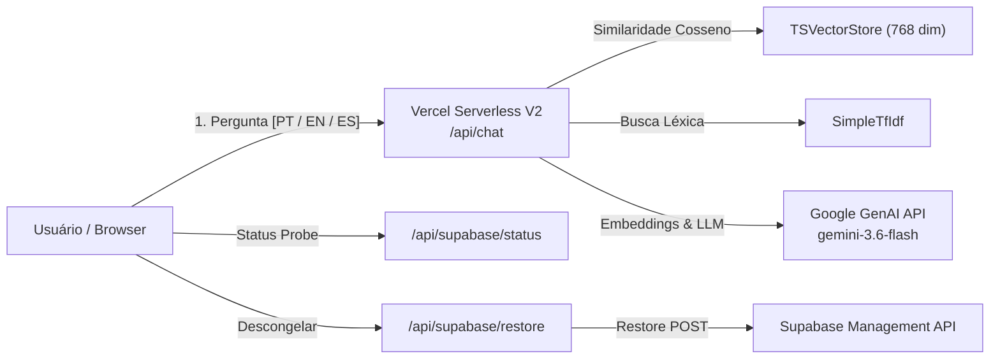

# Index de Arquitetura & Mapa Mental — AskRichter

> **Documento de Referência:** Mapa Mental e Índice da Arquitetura do Projeto AskRichter  
> **Constituição Canônica:** [`META_SPEC.md`](../META_SPEC.md) (versão em português: [`docs/pt-br/META_SPEC.md`](pt-br/META_SPEC.md))  
> **Código de Conduta dos Agentes:** [`AGENTS.md`](../AGENTS.md) (versão em português: [`docs/pt-br/AGENTS.md`](pt-br/AGENTS.md))  
> **Framework:** AI Engineering Framework v2.1  

---

## 1. Visão Geral da Arquitetura (Serverless V2)

O **AskRichter** é construído como um monorepo modular orquestrado via **Turborepo** e **npm workspaces**.
A aplicação opera no modelo **Serverless V2 Nativo na Vercel** (ADR-0007 / ADR-0008 / ADR-0009):
- **Engine RAG Serverless (`apps/frontend`):** Rota `/api/chat` executando busca híbrida em TypeScript puro com similaridade de cosseno (`TSVectorStore`) e TF-IDF (`SimpleTfIdf`), consumindo vetores estáticos em memória (< 80MB) e gerando respostas via Google GenAI (`gemini-3.6-flash`).
- **Resiliência e Descongelamento Supabase (`apps/frontend`):** Máquina de estados de 7 estados e rota segura `/api/supabase/restore` que aciona a Supabase Management API v1.
- **Toolkit Offline & Base de Conhecimento (`apps/backend`):** Markdown consolidado da carreira (`apps/backend/src/knowledge-base/`), scripts CLI de chunking/embedding (`generate-index.ts`, `export-vectors.ts`) e suite de provedores de IA (`ProviderFactory`).



---

## 2. Taxonomia de Componentes

### 2.1 Workspaces de Aplicação (`/apps`)
- **[`frontend`](../apps/frontend/package.json):** Next.js 15 (App Router, React 19), Serverless RAG Engine V2, `RetrievalOrchestrator` (Sanity GROQ + TSVectorStore Fallback), Status Classifier do Supabase, `SupabaseUnfreezeModal`, internacionalização e componentes Tailwind CSS/Framer Motion.
- **[`studio`](../apps/studio/package.json):** Sanity Studio v3 (React 19, TypeScript, ESLint 9), modelagem ontológica de conteúdo (6 schemas tipados), Content Lake (`production`), scripts de migração determinística e manifesto auditável.
- **[`backend`](../apps/backend/package.json):** Repositório da Base de Conhecimento (`src/knowledge-base/`), scripts de reindexação e exportação de vetores (`src/scripts/`), suite agnóstica de provedores (`ProviderFactory`) com fallback resiliente.

### 2.2 Infraestrutura & Configurações Globais
- **[`vercel.json`](../vercel.json):** Deploy primário de produção do frontend e APIs serverless na Vercel.
- **[`turbo.json`](../turbo.json):** Pipeline de tarefas do Turborepo (`build`, `dev`, `lint`, `check-types`, `jidoka`).
- **[`package.json`](../package.json):** Definição de npm workspaces e dependências raiz.
- **[`render.yaml`](../render.yaml):** [Legado] Configuração de deploy no Render (mantida para fallback e histórico).

---

## 3. Índice de ADRs (Architecture Decision Records)

Todas as decisões arquiteturais e mudanças estruturais no projeto são registradas de forma imutável e numerada no diretório [`docs/adr/`](adr/).

| Registro | Título | Data | Status |
| :--- | :--- | :--- | :---: |
| [ADR-0001](adr/0001-meta-spec-e-governanca-de-arquitetura.md) | Definição da Meta Spec, Isolamento WSCI e Protocolo Jidoka | 2026-08-05 | Aprovado |
| [ADR-0002](adr/0002-recuperacao-deterministica-de-chunks-sinteticos.md) | Recuperação Determinística de Chunks Sintéticos via Docstore | 2026-08-05 | Aprovado |
| [ADR-0003](adr/0003-roteamento-de-intencoes-e-extracao-multi-tecnologia.md) | Roteamento de Intenções por Tecnologia e Extração Multi-Tecnologia | 2026-08-05 | Aprovado |
| [ADR-0004](adr/0004-isolamento-de-escopo-de-metadados-em-ingestao.md) | Isolamento de Escopo de Metadados de Tecnologia na Ingestão | 2026-08-05 | Aprovado |
| [ADR-0005](adr/0005-provider-agnostic-ai-architecture.md) | Arquitetura de IA Provider-Agnostic e Migração de Embeddings para Gemini | 2026-08-18 | Aprovado |
| [ADR-0006](adr/0006-llm-provider-resilience-and-fallback.md) | Resiliência de LLM com Retentativa Bounded e Cadeia de Fallback Abstrata | 2026-08-18 | Aprovado |
| [ADR-0007](adr/0007-faiss-elimination-and-ts-vector-search.md) | Eliminação do FAISS/Render & Migração para Serverless RAG em TypeScript (Vercel) | 2026-08-26 | Aprovado |
| [ADR-0008](adr/0008-lexical-retriever-modernization.md) | Modernização da Busca Léxica (SimpleTfIdf em TS Puro) | 2026-08-26 | Aprovado |
| [ADR-0009](adr/0009-supabase-resilience-and-state-machine.md) | Máquina de Estados e Resiliência Operacional do Supabase (Fase 2) | 2026-08-26 | Aprovado |
| [ADR-0010](adr/0010-tri-retrieval-engine-and-sanity-content-lake.md) | Tri-Retrieval Engine & Sanity Content Lake | 2026-09-29 | Aprovado |

---

## 4. Engenharia de Contexto WSCI (Isolamento de Escopo & Worktrees)

Ao atuar em qualquer tarefa, siga a divisão estrita de escopo:
1. **Scope `Frontend`**: [`apps/frontend/`](../apps/frontend/) (Comando isolado: `npm run dev --workspace=frontend`).
2. **Scope `Backend`**: [`apps/backend/`](../apps/backend/) (Comando isolado: `npm run dev --workspace=backend`).
3. **Scope `Infra`**: Configurações na raiz do repositório ([`vercel.json`](../vercel.json), [`turbo.json`](../turbo.json), [`package.json`](../package.json)).
4. **Refatorações Estruturais:** Criar Git Worktree física antes de iniciar: `git worktree add ../askrichter-<feature>-refactor -b <feature>-refactor`.

---

## 5. Protocolo Jidoka (Andon Cord Checkpoint Unificado)

Antes de considerar qualquer tarefa finalizada ou consolidar alterações, execute o comando único da corda do Andon:

```bash
npm run jidoka
```

Este comando executa a pipeline unificada no Turborepo (`check-types`, `lint` e `build` em paralelo com grafo de dependências). Qualquer erro (exit code != 0) dispara o gatilho automático do **Andon Cord: Halt & Reset Limpo**.
