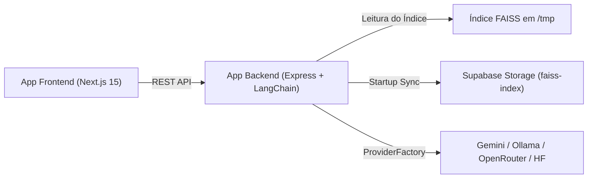

# Index de Arquitetura & Mapa Mental — AskRichter

> **Documento de Referência:** Mapa Mental e Índice da Arquitetura do Projeto AskRichter  
> **Constituição:** [`.askrichter-spec.md`](../.askrichter-spec.md)

---

## 1. Visão Geral da Arquitetura

O **AskRichter** é construído como um monorepo modular utilizando **Turborepo**. A aplicação combina um **Frontend em Next.js 15** hospedado na Vercel com um **Backend em Node.js / Express** hospedado no Render.com. O motor de busca contextual baseia-se na técnica de **Retrieval-Augmented Generation (RAG)** com vetorização FAISS persistida no **Supabase Storage**.



---

## 2. Taxonomia de Componentes

### 2.1 Apps (`/apps`)
- **[`backend`](../apps/backend/package.json):** API REST em Express, RAG Pipeline com FAISS e LangChain, roteamento Provider-Agnostic via `ProviderFactory`.
- **[`frontend`](../apps/frontend/package.json):** Interface de usuário reativa em Next.js 15, i18n, componentes Tailwind CSS/Framer Motion.

### 2.2 Infraestrutura & Configurações Globais
- **[`render.yaml`](../render.yaml):** Definição de build e runtime do serviço backend no Render.com.
- **[`vercel.json`](../vercel.json):** Configurações de deploy do frontend na Vercel.
- **[`turbo.json`](../turbo.json):** Pipeline de tarefas Turborepo (build, dev, lint, check-types).

---

## 3. Índice de ADRs (Architecture Decision Records)

Todas as decisões arquiteturais e mudanças estruturais no projeto são registradas de forma imutável e numerada no diretório [`docs/adr/`](adr/).

| Registro | Título | Data | Status |
| :--- | :--- | :--- | :--- |
| [ADR-0001](adr/0001-meta-spec-e-governanca-de-arquitetura.md) | Definição da Meta Spec, Isolamento WSCI e Protocolo Jidoka | 2026-08-05 | Aprovado |
| [ADR-0002](adr/0002-recuperacao-deterministica-de-chunks-sinteticos.md) | Recuperação Determinística de Chunks Sintéticos via Docstore | 2026-08-05 | Aprovado |
| [ADR-0003](adr/0003-roteamento-de-intencoes-e-extracao-multi-tecnologia.md) | Roteamento de Intenções por Tecnologia e Extração Multi-Tecnologia | 2026-08-05 | Aprovado |
| [ADR-0004](adr/0004-isolamento-de-escopo-de-metadados-em-ingestao.md) | Isolamento de Escopo de Metadados de Tecnologia na Ingestão | 2026-08-05 | Aprovado |
| [ADR-0005](adr/0005-provider-agnostic-ai-architecture.md) | Arquitetura de IA Provider-Agnostic e Migração de Embeddings para Gemini | 2026-08-18 | Aprovado |
| [ADR-0006](adr/0006-llm-provider-resilience-and-fallback.md) | Resiliência de LLM com Retentativa Bounded e Cadeia de Fallback Abstrata | 2026-08-18 | Aprovado |

---

## 4. Engenharia de Contexto WSCI (Isolamento de Escopo & Worktrees)

Ao atuar em qualquer tarefa, siga a divisão estrita de escopo:
1. **Scope `Frontend`**: [`apps/frontend/`](../apps/frontend/) (Comando isolado: `npm run dev --workspace=frontend`).
2. **Scope `Backend`**: [`apps/backend/`](../apps/backend/) (Comando isolado: `npx turbo run dev --filter=backend`).
3. **Scope `Infra`**: Configurações na raiz do repositório ([`render.yaml`](../render.yaml), [`vercel.json`](../vercel.json), [`package.json`](../package.json)).
4. **Refatorações Estruturais:** Criar Git Worktree física antes de iniciar: `git worktree add ../askrichter-<feature>-refactor -b <feature>-refactor`.

---

## 5. Protocolo Jidoka (Andon Cord Checkpoint Unificado)

Antes de considerar qualquer tarefa finalizada ou consolidar alterações, execute o comando único da corda do Andon:

```bash
npm run jidoka
```

Este comando executa a pipeline unificada no Turborepo (`check-types`, `lint` e `build` em paralelo com grafo de dependências). Qualquer erro (exit code != 0) dispara o gatilho automático do **Andon Cord: Halt & Reset Limpo**.
