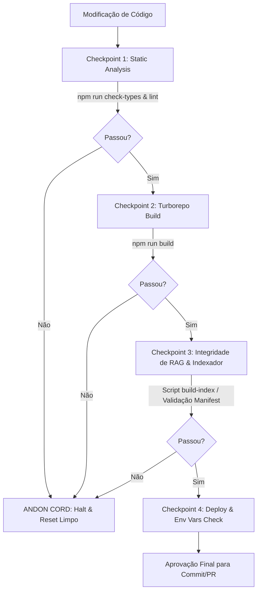

# Snapshot de Governança, Arquitetura e RAG — Ask Richter (2026-08-26)

> **Finalidade:** Consolidação de todas as especificações técnicas, regras de governança, decisões arquiteturais (ADRs), regras de indexação, estratégias de RAG e histórico de correções que **não estão presentes no `README.md` principal**.

---

## 1. Governança Avançada & Meta Spec (`.askrichter-spec.md`)

Embora o `README.md` mencione os pilares gerais de governança, a Meta Spec ([`.askrichter-spec.md`](../../.askrichter-spec.md)) estabelece especificações formais de execução:

### 1.1 Metodologia SDLC SPARC+DD
- O projeto opera sob a metodologia **SPARC+DD** (*Specification, Pseudocode, Architecture, Refinement, Completion + Design-Driven*).
- Nenhuma alteração estrutural pode ser realizada sem antes passar pela fase de especificação e refinamento pseudocodificado.

### 1.2 Mecanismo Fail-Fast de Compatibilidade do FAISS
- Durante o startup do backend (`index.ts` / `download-index.ts`), o servidor lê o arquivo [`manifest.json`](../../apps/backend/faiss_index/manifest.json) presente no diretório do índice FAISS.
- É realizada a validação estrita dos campos `provider`, `model` e `dimension` contra a instância do `EmbeddingProvider` ativo nas variáveis de ambiente.
- Se houver qualquer divergência (ex: índice gerado com dimensão 1536 da OpenAI e backend iniciado com dimensão 768 do Gemini), o servidor **aborta o startup imediatamente (`Fail-Fast`)**, evitando a execução com alucinações silenciosas ou erros C++ no `faiss-node`.

### 1.3 Esteira Jidoka — Detalhamento dos 4 Checkpoints
O protocolo Jidoka (Andon Cord) executa sequencialmente 4 checkpoints de validação Zero-Trust:



### 1.4 Regras de Operação WSCI e Git Worktrees
- **Filtros por Workspace:** Operações no dia a dia devem utilizar comandos escopados (ex: `npm run dev --workspace=frontend` ou `npx turbo run dev --filter=backend`).
- **Worktrees para Refatoração:** Refatorações estruturais de arquitetura ou RAG exigem a criação de uma Git Worktree física isolada:
  ```bash
  git worktree add ../askrichter-backend-refactor -b backend-refactor
  ```

---

## 2. Decisões Arquiteturais Detalhadas (`docs/adr/`)

Resumo aprofundado das 6 Architectural Decision Records (ADRs) do projeto:

### 📄 ADR-0001: Meta Spec, WSCI e Protocolo Jidoka
- **Decisão:** Instituição da Meta Spec como constituição imutável, divisão de contexto WSCI e comando unificado `npm run jidoka`.

### 📄 ADR-0002: Recuperação Determinística de Chunks Sintéticos via Docstore
- **Problema:** A consulta vetorial por `LIST_PROJECTS` falhava porque o FAISS executava a busca por distância antes da filtragem por metadados. Com `Top-K=1`, recuperava um vetor próximo aleatório e o descartava ao aplicar o filtro, gerando falhas silenciosas.
- **Solução:** Substituição da busca vetorial probabilística pela função `findSyntheticProjectListDoc`, que inspeciona deterministicamente o `docstore.json` em memória (`metadata.source === 'synthetic_project_list'`), retornando o índice oficial com score 1.0.
- **Sincronia:** O script `generate-index.ts` passou a gravar o `docstore.json` nos diretórios de fallback local (`apps/backend/faiss_index` e `apps/backend/src/faiss_index`).

### 📄 ADR-0003: Roteamento de Intenções por Tecnologia e Extração Multi-Tecnologia
- **Problema:** Perguntas como "mostre todos os projetos php e laravel" ativavam o roteador genérico `LIST_PROJECTS` (com `Top-K=1`) por conterem a expressão "todos os projetos", ignorando as tecnologias e interrompendo a busca na primeira correspondência.
- **Solução:** Reestruturação da função `decomposeQuery`:
  1. A extração de tecnologias tem precedência sobre palavras-chave genéricas de listagem.
  2. Acúmulo de array de tecnologias conhecidas (`technologies: string[]`, ex: `['PHP', 'Laravel']`).
  3. Ativação do plano `PROJECT_TECHNOLOGY_SEARCH` com orçamento expandido de `Top-K=6` chunks.

### 📄 ADR-0004: Isolamento de Escopo de Metadados em Ingestão (Scope Bleed Fix)
- **Problema:** Chunks de Cursos e Certificações recebiam o array `metadata.technologies` acumulado de projetos, fazendo com que buscas por tecnologia retornassem cursos no lugar de projetos de software reais.
- **Solução:** Aplicação da trava booleana `isSoftwareProject = Boolean(projectData.projectName)` no `generate-index.ts`.
- **Sanitização de Conteúdo:**
  - Proj. Reais: prefixo `[Contexto - Projeto: ...]` e `[Tecnologias do Projeto: ...]`.
  - Cursos/Certificações: prefixo `[Contexto - Histórico/Formação/Certificações]`, omitindo metadados de software.

### 📄 ADR-0005: Arquitetura de IA Provider-Agnostic e Migração de Embeddings
- **Decisão:** Refatoração da camada de IA via Design Pattern Factory (`ProviderFactory`) com interfaces explícitas `LLMProvider` e `EmbeddingProvider`.
- **Mudança de Provedor:** Desativação do runtime OpenAI. Migração do padrão de produção para Google Gemini (`gemini-3.6-flash` para LLM e `gemini-embedding-2` de 768 dimensões para Embeddings).
- **Validação de Schema:** `manifest.json` com `schemaVersion: 1`.

### 📄 ADR-0006: Resiliência de LLM com Retentativa Bounded e Fallback Abstrato
- **Retentativa Bounded no Gemini (`GeminiLLMProvider`):** Backoff exponencial para erros transitórios (`429`, `502`, `503`, `504`) em até 3 tentativas (delays de 2s, 4s, 8s). Erros de autenticação/bad request (`400`, `401`, `403`) falham imediatamente.
- **Cadeia de Fallback Abstrata (`ResilientLLMProvider`):** Orquestração em cadeia configurável via `AI_FALLBACK_PROVIDERS="openrouter,huggingface,ollama"`.
- **Instanciação Preguiçosa (Lazy Evaluation):** Validação de chaves secundárias apenas quando o provedor de fallback é acionado, prevenindo falhas de startup em dev/prod.
- **Semântica HTTP 503:** Resposta HTTP 503 com payload `{ "error": "AI service temporarily unavailable. Please try again.", "code": "SERVICE_UNAVAILABLE" }` em caso de indisponibilidade total dos provedores upstream.

---

## 3. Governança da Pipeline de Indexação (`.agents/rules/indexing-rules.md`)

A regra contida em `.agents/rules/indexing-rules.md` estabelece os requisitos inegociáveis para a geração do banco vetorial:

1. **Geração Obrigatória de `manifest.json`:**
   O manifesto deve conter obrigatoriamente:
   - `timestamp` (ISO string)
   - `embeddingModel` (ex: `gemini-embedding-2`)
   - `sourceDocumentsCount`
   - `totalChunks`
   - `uploadedToSupabase` (boolean)
   - `bucketName`
2. **Audit Log em [`docs/INDEXING_LOG.md`](../INDEXING_LOG.md):**
   Toda execução do `generate-index.ts` (local ou nuvem) deve acrescentar um bloco de histórico no log auditável.
3. **Upload Tríplice no Supabase Storage:**
   Ao utilizar `--upload`, os três arquivos (`docstore.json`, `faiss.index`, `manifest.json`) devem ser sincronizados em lote no bucket `faiss-index`.

---

## 4. Histórico de Alinhamento de Versões (`docs/version_changes.md`)

Documentação da resolução do conflito de dependências ocorrido em Agosto/2026:

- **Problema:** O `apps/frontend` declarava Next.js 14 e React 18, enquanto a raiz do monorepo definia overrides para React 19. Isso causou a coexistência de duas instâncias do React em memória, disparando erros de hidratação e SSR (`TypeError: Cannot read properties of null (reading 'useContext')`) durante os builds da Vercel.
- **Solução:** Alinhamento do `apps/frontend` para Next.js 15 (`^15.4.2`) e React 19 (`^19.1.0`), garantindo paridade com os workspaces `apps/web` e `apps/docs`.

---

## 5. Histórico de Engenharia de RAG e Bugfixes (`docs/Fixes/` & `docs/Plans/`)

Resumo das otimizações e correções aplicadas no pipeline de busca e indexação:

### 5.1 Engenharia de Chunking e Prompting Sintético
- **Cabeçalho Sintético Estruturado (`enhancedContent`):** O documento sintético de listagem de projetos foi enriquecido com a estrutura:
  ```typescript
  Título: Lista Completa de Todos os 23 Projetos.
  Resumo: Este documento é o índice sintético oficial que lista o nome de todos os 23 projetos documentados na base de conhecimento.
  Palavras-chave: todos os projetos, lista completa, índice de projetos, quantos projetos, listagem total.
  Projetos: ${projectListString}
  ```
- **Densidade Semântica de Títulos (`Projects-Consolidated.md`):** Alteração de todos os cabeçalhos de projetos na base Markdown de `### 🚀 [Nome]` para `### 🚀 Projeto: [Nome]`, aumentando a afinidade vetorial com consultas em linguagem natural.

### 5.2 Correção de Contaminação de Contexto no Re-ranker
- Identificado e corrigido o bug em `assembleStructuredContext` e `smartSearch` onde a ordenação por `project_name` misturava o `pageContent` (resumo) de um projeto com o nome de outro durante a aglutinação dos chunks no prompt final.

### 5.3 Normalização de Tecnologias e Sanitização Unicode
- Adição de aliases para termos comuns (ex: `'vue'` normalizado para `'vue.js'`).
- Sanitização de emojis e caracteres especiais na ingestão de marcas de tecnologia utilizando a expressão regular Unicode `/[^\p{L}\p{N}\s.\-+#/]/gu`.

---

## 🚀 Extras (Informações Relevantes Adicionais sobre o Projeto)

### 📌 Base de Conhecimento Estruturada (`apps/backend/src/knowledge-base/`)
A base RAG do assistente é alimentada por 4 documentos consolidados que cobrem toda a carreira de Luis F. Richter:
1. `CV-Consolidated.md`: Visão executiva, resumo profissional, contatos e competências primárias.
2. `Experience-Consolidated.md`: Histórico detalhado de atuações profissionais, cargos, responsabilidades e conquistas.
3. `Education-Certifications-Consolidated.md`: Formação acadêmica, cursos de especialização e certificações técnicas.
4. `PoC-Challenges-SideProjects-Consolidated.md`: Mapeamento detalhado de 29+ projetos de software, PoCs e side projects (arquitetura, tecnologias utilizadas, desafios superados e resultados).

### 📌 Sistema Centralizado de Log de Erros (`client_errors`)
- O projeto conta com o utilitário `logClientError` (`apps/backend/src/utils/log-error.ts`).
- Erros críticos ocorridos no frontend ou backend são capturados em blocos `try/catch` e persistidos na tabela `client_errors` do Supabase PostgreSQL, registrando timestamp, mensagem de erro, stack trace, rota e e-mail do usuário logado (quando disponível).

### 📌 Diretrizes para Migrações do Supabase (Forward-Only)
- As migrações de banco de dados do Supabase devem ser escritas no padrão **Forward-Only**.
- **Proibido:** Incluir blocos de rollback (`-- drop below --`) no mesmo arquivo de migração. O Supabase CLI executa todo o arquivo sequencialmente; incluir o script de drop no final faz com que a alteração seja imediatamente revertida, anulando a migração.

### 📌 Workaround de Instâncias Pausadas no Supabase Storage
- Projetos no plano gratuito do Supabase entram automaticamente em estado *paused* (congelado) após período de inatividade.
- **Procedimento:** Antes de executar scripts de reindexação com upload (`npm run build-index -- --yes --upload`), é mandatório acessar o dashboard do Supabase e clicar em **Restore Project**. Caso contrário, o upload falhará com erro de resolução de DNS/conexão (`fetch failed` / `NXDOMAIN`).
