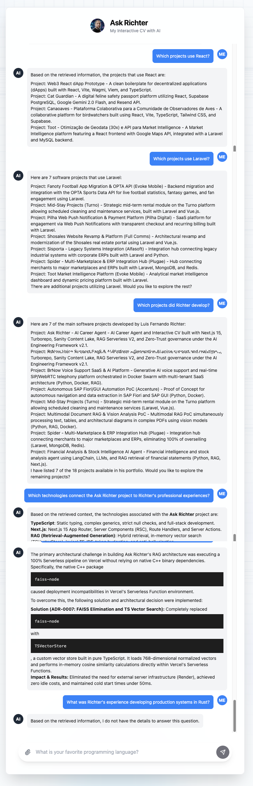

# Sanity AI Agent Challenge — Submission Overview

**Project Name:** Ask Richter — AI Career Agent & Structured Knowledge Platform

**Author:** Luis F. Richter

**Live URL:** [https://ask-richter-frontend.vercel.app/](https://ask-richter-frontend.vercel.app/)

**Repository:** [https://github.com/lfrichter/ask-richter](https://github.com/lfrichter/ask-richter)

**Sanity Project ID:** `q19ey6yx` (`production` dataset)

---

## ⚡ Executive Summary for Reviewers

| Question | Answer |
| :--- | :--- |
| **What is Ask Richter?** | An interactive **AI Career Agent** that transforms professional trajectory, projects, and architecture decisions into a multi-strategy conversational agent. |
| **What problem does it solve?** | Eliminates the hallucinations and loss of relational context common in traditional flat-text RAG by structuring career entities into a graph. |
| **Why Sanity?** | Sanity Content Lake serves as the **canonical, relational knowledge layer** allowing declarative GROQ queries, native dataset embeddings, and agentic graph traversal. |
| **What does Sanity power?** | 101 canonical typed documents across 6 schemas (`skill`, `experience`, `project`, `education`, `achievement`, `architectureDecision`). |
| **How does M2 / M3 / M4 work?** | **M2 (Structured):** GROQ queries for exact lists/technologies. **M4 (Agentic):** Multi-hop knowledge graph traversal. **M3 (Semantic):** Native Sanity dataset embeddings for free-form architectural search. |
| **How is hallucination prevented?** | Zero-Trust grounding: The LLM is constrained strictly to retrieved graph nodes and chunks. Missing data triggers explicit safe abstention. |
| **How was it tested?** | 170 automated unit/integration tests (100% pass) and 17 end-to-end HTTP regression scenarios. |
| **How to run locally?** | `npm install` ➔ configure `.env.local` ➔ `npm run dev` (Web app at `:3000`, Studio at `:3333`). |

---

## 📂 Submission Documentation Package

This directory contains comprehensive evidence and artifacts prepared for the Sanity Challenge review:

1. 🎬 **[Demo Script (`demo-script.md`)](demo-script.md)**: The validated 6-question demonstration script showing M2, M3, M4, cardinality, and zero-trust safety.
2. 🏛️ **[Deep Architecture (`architecture.md`)](architecture.md)**: Detailed breakdown of the Content Lake ontologies, Tri-Retrieval Engine, and fallback mechanisms.
3. 🧪 **[Test & Verification Evidence (`test-evidence.md`)](test-evidence.md)**: Complete test execution logs, Jidoka gate results, and regression reports.
